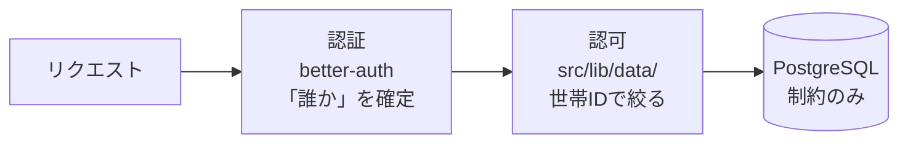
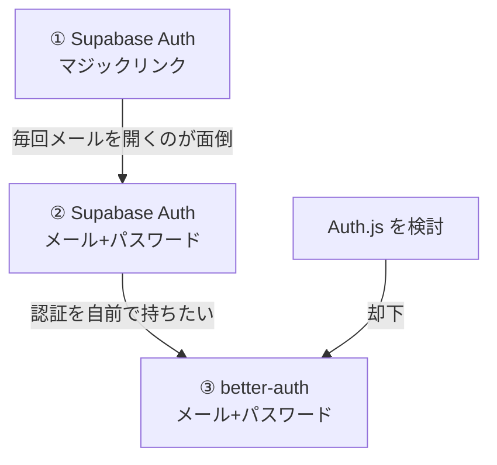
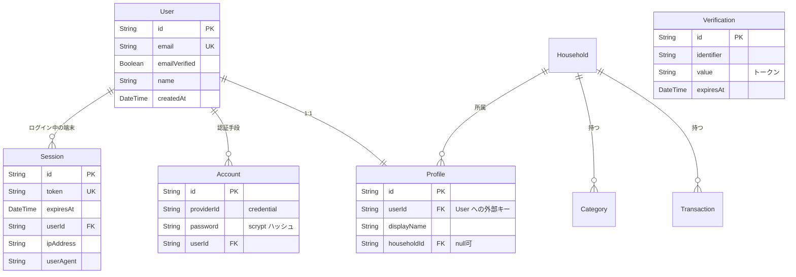
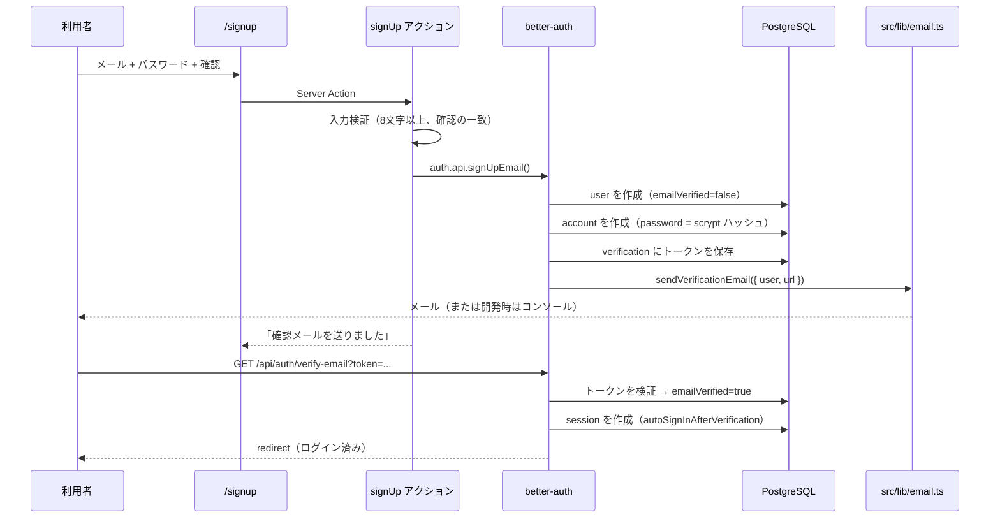
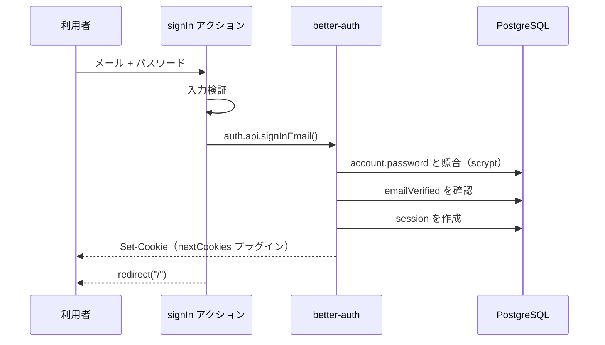
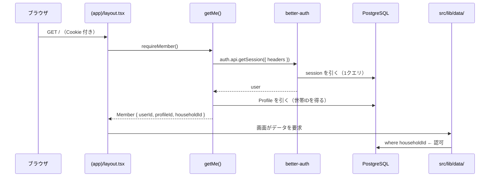
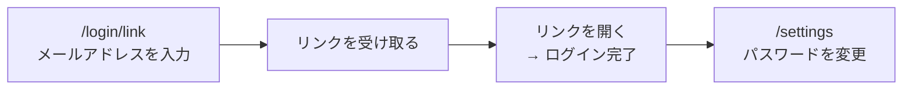
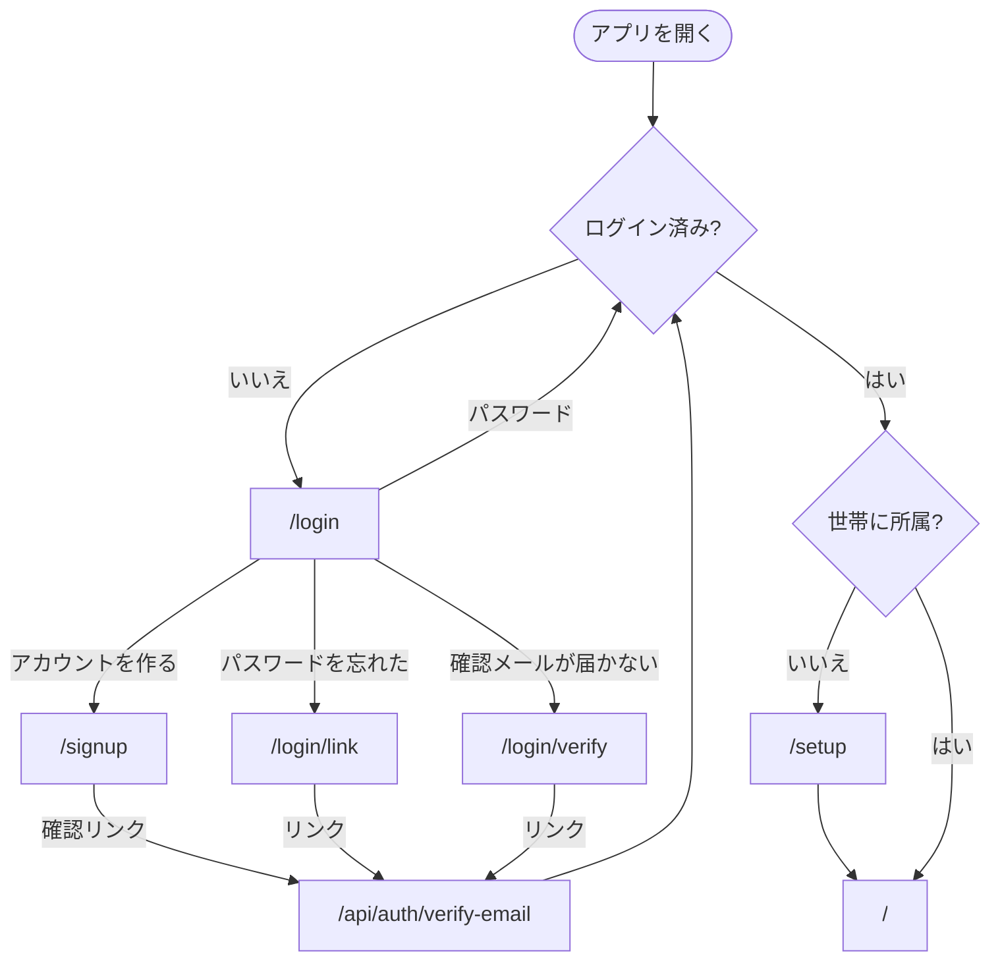

# Monely 認証の実装まとめ

> 家計管理アプリ Monely の認証をどう作ったかの記録。使ったライブラリ、データの持ち方、処理の流れ、判断の理由、ハマった点をまとめている。
>
> 作成日: 2026-11-08 / 対象: Next.js 16.4.5 + Prisma 7 + better-auth 1.7.18

---

## 1. まず押さえる: 認証と認可は別物

この2つを混同すると設計を読み違える。Monely では**担当が完全に分かれている**。

| | 認証 (Authentication) | 認可 (Authorization) |
| --- | --- | --- |
| 問い | **あなたは誰か** | **あなたは何を見てよいか** |
| 担当 | **better-auth**（ライブラリ） | **アプリのコード**（`src/lib/data/`） |
| 具体的に | パスワードの保存と照合、セッションの発行と検証、メール確認 | 「この人の世帯のデータだけ返す」 |
| 実装 | `src/lib/auth/server.ts` | `where: { householdId: me.householdId }` |



DB 側には認可の仕組み（RLS = 行レベルセキュリティ）を**置いていない**。そのため **`where` を書き忘れた瞬間に他世帯のデータが漏れる**。これは意識的な選択で、代わりに次の3つを約束している。

| | 約束 | 検出方法 |
| --- | --- | --- |
| A | `prisma` を `src/lib/data/` の外から import しない | `grep -rn "data/db" src \| grep -v "^src/lib/data/"` が 0 件 |
| B | DAL の関数は世帯 ID を引数で受け取らない（関数の中で取る） | コードレビュー |
| C | DAL の認可を自動テストで守る | `pnpm test` |

---

## 2. ライブラリ構成

| 役割 | 採用 | バージョン | 備考 |
| --- | --- | --- | --- |
| 認証 | **better-auth** | 1.7.18 | メール+パスワード、メール確認、マジックリンク |
| フレームワーク | Next.js（App Router） | 16.4.5 | Server Actions で認証を呼ぶ |
| ORM / DB アクセス | Prisma | 7.10.1 | **認証テーブルも Prisma が管理** |
| Prisma のドライバ | `@prisma/adapter-pg` + `pg` | 7.10.1 / 8.23.1 | Prisma 7 は driver adapter 必須 |
| DB | PostgreSQL（Supabase ホスト） | — | **Supabase は DB のみ。認証には使わない** |
| メール送信 | 自前（`fetch` で Resend の REST API） | — | **パッケージを追加していない** |
| 環境変数の読み込み | dotenv | 18.0.9 | Prisma 7 は `.env` を自動で読まない |

### 追加していないもの

| | 理由 |
| --- | --- |
| `@supabase/supabase-js` / `@supabase/ssr` | 認証を better-auth に移したので不要になり**削除した** |
| `next-auth` (Auth.js) | §3 参照 |
| `resend` パッケージ | REST API を `fetch` で叩けば足りる |
| 検証ライブラリ（zod 等） | 項目が少なく手書きで足りる |

---

## 3. なぜ better-auth なのか（判断の履歴）

認証基盤は **2回変えている**。その履歴自体が判断材料になる。



### 2026-11-08 時点の npm 実データ

| ライブラリ | 週間DL | 最新版 | 最終更新 |
| --- | --- | --- | --- |
| **better-auth** | 18,714,403 | 1.7.18（安定） | 2026-11-05 |
| next-auth / Auth.js | 9,403,576 | 4.24.15（安定） / **v5 は beta のみ** | 2026-07-20 |
| @clerk/nextjs | 3,749,727 | 7.9.25 | 2026-11-07 |
| lucia | 694,830 | **非推奨（deprecated）** | 2025-06 |

### Auth.js を却下した理由

```
5.0.0-beta.0   2023-10-24
5.0.0-beta.32  2026-07-20   ← 3年以上 beta、33リリース、安定版なし
```

1. **v5 に安定版がない。** 3年以上 beta のままで、本体の更新も約4か月停滞している
2. **メール+パスワード（Credentials provider）を公式に非推奨**としている。今回の用途と真逆
3. v4 は Pages Router 時代の API で App Router と素直に組み合わせられない

**セルフホスト型（自分の DB にユーザーを持つ）では better-auth が現在の主流。** DL 数で next-auth の約2倍あり、`prisma ^5 || ^6 || ^7` を peer deps で名指しサポートしている。

### better-auth に移して得たもの

| 得たもの | 内容 |
| --- | --- |
| スキーマが1箇所に集まった | `auth.users`（Supabase 所有、Prisma 管理外）が消え、全部 `prisma/schema.prisma` に |
| **本物の外部キーが張れた** | `Profile.userId → User.id`。以前は別スキーマなので張れなかった |
| HTTP 往復が消えた | ページ表示ごとの Supabase への問い合わせが、同じ DB への1クエリに |
| メール送信を自分で選べる | Supabase の組み込み SMTP の送信制限（1時間2通）から解放 |
| Supabase から抜けやすくなった | Supabase が「ただの Postgres」になった |

### 失ったもの（意識して受け入れた）

| 失ったもの | 対処 |
| --- | --- |
| Supabase のマネージドな保護（レート制限など） | better-auth の既定のレート制限に依る。公開するなら必ず見直す |
| メールが「勝手に送られる」利便性 | 自分で送信手段を用意する（§7） |

---

## 4. データモデル

### 4.1 テーブル構成



| テーブル | 所有 | 役割 |
| --- | --- | --- |
| `user` | **better-auth** | メールアドレス、確認状態 |
| `session` | **better-auth** | ログイン中のセッション（DB セッション方式） |
| `account` | **better-auth** | 認証手段。メール+パスワードは `providerId = "credential"`、`password` にハッシュ |
| `verification` | **better-auth** | メール確認・パスワード再設定・マジックリンクのトークン |
| `profiles` | **アプリ** | 表示名、所属世帯（**ドメインモデル**） |

### 4.2 なぜ `User` と `Profile` を分けたのか

`User` は better-auth の持ち物で、スキーマの形はライブラリが決める。一方「表示名」「所属世帯」はこのアプリ固有のドメイン知識。

**分けておくと、認証ライブラリを入れ替えても `Transaction.paidById` などの参照が壊れない。** 実際に Supabase Auth → better-auth の移行をやったとき、`Profile` を軸にしていたおかげで影響を局所化できた。

```prisma
model Profile {
  id          String  @id @default(uuid(7)) @db.Uuid
  userId      String  @unique @map("user_id")
  user        User    @relation(fields: [userId], references: [id], onDelete: Cascade)
  displayName String  @map("display_name") @db.VarChar(20)
  householdId String? @map("household_id") @db.Uuid   // null = まだ世帯に未所属
}
```

> **注意**: `User.id` は better-auth が生成する**ランダム文字列**（UUID ではない）。例: `wmwItq3fBKKisYOX2sUTMNK7Xbsy9Kal`。そのため `Profile.userId` の型は `uuid` ではなく `text`。

### 4.3 スキーマの定義をどう知るか

better-auth が要求するテーブルの形は、**インストール済みのバージョンから直接取り出せる**。

```bash
node -e 'import("better-auth/db").then(async m => {
  const { magicLink } = await import("better-auth/plugins/magic-link");
  console.log(m.getAuthTables({
    emailAndPassword: { enabled: true },
    plugins: [magicLink({ sendMagicLink: async () => {} })],
  }));
})'
```

**`@better-auth/cli` は使わなかった。** CLI の最新が 1.4.21 で本体（1.7.18）より古く、生成されるスキーマがずれる恐れがあったため。`getAuthTables()` なら実際に動いているバージョンの定義が得られる。

---

## 5. ファイル構成

```
src/
├── lib/
│   ├── auth/
│   │   └── server.ts          ★ better-auth の設定（121行）認証の中心
│   ├── auth.ts                ★ ガード（49行）getMe / requireUser / requireMember
│   ├── email.ts               メール送信（100行）Resend / 開発時はコンソール
│   ├── validation.ts          入力検証（パスワード・メール・全角数字の正規化）
│   ├── types.ts               Me / Member / ActionResult
│   └── data/
│       ├── db.ts              Prisma Client の生成口（ここ以外から import 禁止）
│       └── profile.ts         初回ログイン時に Profile を作る
├── actions/
│   └── auth.ts                ★ Server Actions（281行）signIn / signUp / …
└── app/
    ├── api/auth/[...all]/
    │   └── route.ts           better-auth のエンドポイント（11行）
    ├── login/                 ログイン
    │   ├── link/              パスワードを忘れたとき（マジックリンク）
    │   └── verify/            確認メールの再送
    ├── signup/                新規登録
    └── (app)/
        ├── layout.tsx         ★ 振り分け（未ログイン→/login、世帯なし→/setup）
        └── settings/          パスワードの変更
```

### 5.1 設定の中身（抜粋）

```ts
// src/lib/auth/server.ts
export const auth = betterAuth({
  appName: "Monely",
  baseURL,
  secret: requiredEnv("BETTER_AUTH_SECRET"),
  trustedOrigins: [baseURL],                        // callbackURL の検証

  database: prismaAdapter(prisma, { provider: "postgresql" }),

  emailAndPassword: {
    enabled: true,
    requireEmailVerification: true,                 // 確認が済むまでログインさせない
    minPasswordLength: 8,
    maxPasswordLength: 128,
    sendResetPassword: async ({ user, url }) => { /* メール送信 */ },
  },

  emailVerification: {
    sendOnSignUp: true,
    sendOnSignIn: true,                             // 未確認でログインを試したら再送
    autoSignInAfterVerification: true,              // 確認したらそのままログイン
    sendVerificationEmail: async ({ user, url }) => { /* メール送信 */ },
  },

  plugins: [
    magicLink({
      disableSignUp: true,                          // リンク経由の新規登録を禁じる
      sendMagicLink: async ({ email, url }) => { /* メール送信 */ },
    }),
    nextCookies(),                                  // ★ 必ず最後に置く
  ],
});
```

**`nextCookies()` はプラグインの最後**に置く必要がある（better-auth の作法）。これが Server Action から Cookie を書けるようにしている。

### 5.2 ガードの実装

```ts
// src/lib/auth.ts
export async function getMe(): Promise<Me | null> {
  const session = await auth.api.getSession({ headers: await headers() });
  if (!session?.user) return null;

  // 初回ログイン時に Profile を作る
  const profile = await findOrCreateProfile(session.user.id, session.user.email);

  return {
    userId: session.user.id,      // better-auth の User.id
    profileId: profile.id,        // アプリ側の Profile.id（別物）
    email: session.user.email,
    displayName: profile.displayName,
    householdId: profile.householdId,
  };
}

export async function requireUser(): Promise<Me> {
  const me = await getMe();
  if (!me) redirect("/login");
  return me;
}

export async function requireMember(): Promise<Member> {
  const me = await requireUser();
  if (!me.householdId) redirect("/setup");
  return { ...me, householdId: me.householdId };
}
```

**`requireMember()` が世帯 ID の唯一の供給源。** DAL のすべての関数がこれを呼ぶ（約束B）。

> `userId`（better-auth）と `profileId`（アプリ）は**別の値**。混同しやすいので型で区別している。

---

## 6. 処理の流れ

### 6.1 新規登録 → メール確認



### 6.2 ログイン（パスワード）



**失敗時はメールアドレスとパスワードのどちらが違うかを示さない。** 常に「メールアドレスまたはパスワードが正しくありません」。

### 6.3 リクエストごとのセッション検証



**Supabase Auth のときは、ここで毎回 Supabase へ HTTP 往復していた。** いまは同じ DB への1クエリ。

### 6.4 パスワードを忘れたとき

専用の「パスワード再設定画面」を**作っていない**。マジックリンクを残して兼用している。



**これで画面1つ分の実装が減った。** 再設定専用画面を作ると「メール → 専用画面 → 新パスワード入力」という別フローが必要になる。

---

## 7. メール送信の仕組み

**better-auth はメールを送らない。** 送信関数を渡す設計なので、自分で用意する。

```ts
// src/lib/email.ts
export async function sendMail(mail: Mail): Promise<void> {
  const apiKey = process.env.RESEND_API_KEY;
  const from = process.env.MAIL_FROM;

  if (!apiKey || !from) {
    logToConsole(mail);   // 開発モード
    return;
  }

  await fetch("https://api.resend.com/emails", {
    method: "POST",
    headers: { Authorization: `Bearer ${apiKey}`, "Content-Type": "application/json" },
    body: JSON.stringify({ from, to: [mail.to], subject: mail.subject, text: mail.text }),
  });
}
```

| 条件 | 動作 |
| --- | --- |
| `RESEND_API_KEY` がある | Resend の REST API に送信 |
| **鍵が無い（開発時）** | **コンソールと `.dev-mail.log` にリンクを出力**（メールは送らない） |

### 開発時にコンソールへ出す理由

Supabase の組み込み SMTP は無料プランで **1時間2通**。開発中に何度も詰まった。コンソール出力なら**メールの往復も送信制限もなく、即座にテストできる**。

> リンクは**出力の最後の1行**に単独で置いている。最初は本文の途中に置いていたため、ターミナルからコピーすると後続の文字まで入り、better-auth が `Invalid callbackURL` で弾いた（§10 ④）。

---

## 8. 画面と導線

| ルート | 役割 | 認証 | ビルド結果 |
| --- | --- | --- | --- |
| `/login` | メール + パスワードでログイン | 不要 | Partial Prerender |
| `/signup` | 新規登録（確認メール1通） | 不要 | Static |
| `/login/link` | パスワードを忘れたとき（マジックリンク） | 不要 | Static |
| `/login/verify` | 確認メールの再送 | 不要 | Static |
| `/api/auth/[...all]` | better-auth のエンドポイント | — | Dynamic |
| `/setup` | 世帯を作る / 招待コードで参加 | 必要・世帯なし | Dynamic |
| `/settings` | パスワードの変更、招待コード、ログアウト | 必要・世帯あり | Dynamic |



**振り分けは `(app)/layout.tsx` の1箇所に集めている。** これは UX のためであって、データの守りではない（データの守りは DAL）。

---

## 9. セキュリティ上の判断

### 9.1 アカウントの存在を漏らさない

| 画面 | 守ること |
| --- | --- |
| `/login` | 失敗時に**メールアドレスとパスワードのどちらが違うかを示さない** |
| `/signup` | 登録済みのアドレスでも同じ「確認メールを送りました」を出す |
| `/login/link` | 未登録のアドレスでも同じ表示にする |
| `/login/verify` | 同上 |

### 9.2 ただし「黙って失敗」と区別できなくなる罠

存在を隠すためにエラーを握りつぶすと、**利用者からは「黙って失敗」と区別できない**。実際にこれで詰まった（§10 ③）。

**握りつぶす対象は「登録済み／未登録の区別がつく情報」だけに限る。** 次のものは表示する。

| エラー | 表示する理由 |
| --- | --- |
| メールの送信制限（`over_email_send_rate_limit`） | アドレスに依らない情報。黙ると永遠に待たせる |
| 試行回数の制限（`TOO_MANY_REQUESTS`） | 同上 |
| パスワードの形式エラー | その場で直せる |

### 9.3 パスワードの要件

| 項目 | 値 | 理由 |
| --- | --- | --- |
| 最小長 | 8文字 | better-auth の既定と一致 |
| 最大長 | 128文字 | ライブラリの上限 |
| 文字種の制約 | **設けない** | 複雑さの要求は覚えにくいだけのパスワードを生みやすい。長さを優先 |
| 新規登録時の確認入力 | **あり** | 打ち間違いで入れなくなるのを防ぐ |
| ハッシュ | scrypt（better-auth の既定） | `account.password` に保存 |

### 9.4 マジックリンクで新規登録させない

```ts
magicLink({ disableSignUp: true, ... })
```

これが無いと、**リンク経由でパスワードなしのアカウントが作られてしまう**。アカウントの作成は `/signup` のパスワード経由に限る。

### 9.5 秘密情報

| 変数 | 扱い |
| --- | --- |
| `BETTER_AUTH_SECRET` | **セッションの署名鍵。漏れるとセッションを偽造できる** |
| `DATABASE_URL` / `DIRECT_URL` | **DB の全権**（RLS を使わないため） |
| `RESEND_API_KEY` | メール送信 |

**`NEXT_PUBLIC_` 付きの環境変数が1つもない。** `NEXT_PUBLIC_` を付けるとブラウザのバンドルに埋め込まれるため、上のどれにも付けてはいけない。

### 9.6 レート制限

better-auth の既定に依っている。**Supabase Auth のマネージドな保護は失った。** 利用者が家族数人なので v1 では許容し、外部に公開するなら見直す。

---

## 10. ハマった点と学び

### ① Supabase の既定権限で、全テーブルが公開されていた

RLS（DB 側の認可）をやめた結果、**ブラウザに埋め込まれる公開キーだけで全テーブルの読み書きができる状態**になっていた。

```
GET    /rest/v1/transactions         → 200（全世帯の記録が読める）
POST   /rest/v1/households           → CHECK 制約まで到達（権限はある）
DELETE /rest/v1/transactions?id=eq.. → 204（削除できる）
```

原因は Supabase の既定設定。`public` の新規テーブルに `anon` へ `ALL` を付与する。

```sql
alter default privileges in schema public grant all on tables to anon, authenticated, service_role;
```

**学び**: マネージドなサービスは「親切な既定」を持っている。その既定が自分の設計と衝突することがある。**実際に外から叩いて確かめないと分からない。**

対処: `anon` / `authenticated` から `public` の権限を剥奪し、既定権限も打ち消した。

### ② `TRUNCATE` は RLS の対象外

RLS を使っていた時期に見つけた穴。`revoke` せずに `grant` を足すだけでは、`ALL` に含まれる `TRUNCATE` が残る。

| 別世帯のアカウントが実行 | 結果 |
| --- | --- |
| `DELETE FROM transactions` | RLS が止めた |
| `TRUNCATE transactions` | **通った。全件消えた** |

**学び**: 権限は「足す」ではなく「**剥がしてから足す**」。

### ③ 存在を隠した結果、黙って失敗していた

「アカウントを作る」を押しても確認メールが来ない。原因は**既に同じメールアドレスのアカウントがあった**こと。Supabase/better-auth は既存の確認済みアドレスに何も送らず成功を返す（存在を漏らさないため）。こちらも表示を変えないので、永遠に待つことになる。

**学び**: 存在を隠す設計には副作用がある。**「誰にでも同じ文が出る案内」を置けば、存在を漏らさずに迷いを減らせる。**

対処: `/signup` に「すでに登録済みの場合は確認メールは届きません」を常時表示。

### ④ メール本文の体裁でコピーが壊れた

開発モードでリンクをコンソールに出していたが、**リンクの後ろに文章が続いていた**ため、ターミナルからコピーすると後続の文字まで入り、better-auth が弾いた。

```
[Better Auth]: Invalid callbackURL: /\n\nこのリンクは
```

**学び**: 人がコピーする前提の出力は、**コピー対象を最後の1行に単独で置く**。

### ⑤ バックグラウンドプロセスが開発者の出力を奪う

確認リンクをコンソールに出す設計にしたのに、開発者のターミナルには何も出なかった。AI 側がバックグラウンドで起動した dev サーバーが出力を握っていたため。

**学び**: 開発者が見る出力を、別のプロセスに握らせてはいけない。長時間動かすものは**開発者自身が起動する**。

### ⑥ Prisma 7 / better-auth のバージョン固有の罠

| 事項 | 内容 |
| --- | --- |
| npm の `latest` が RC を指す | Prisma の `latest` が `8.0.0-rc.33` だった。安定版は 7.10.1。**固定した** |
| `@better-auth/cli` が本体より古い | CLI 1.4.21 / 本体 1.7.18。CLI を使わず `getAuthTables()` で定義を取得した |
| Prisma 7 は `.env` を自動で読まない | `prisma.config.ts` で `dotenv` を使って明示的に読む |
| `migrate diff` に `--from-url` が無い | `--from-config-datasource` を使う |
| pnpm がビルドスクリプトをブロック | `allowBuilds` に `@prisma/engines` と `prisma` を追加（無いとエンジンが落ちてこない） |

**学び**: `latest` タグは安定版を指すとは限らない。**ライブラリの実際のバージョンから型と定義を読む**のが確実。

### ⑦ `Date.now()` のプリレンダリング警告

Next.js 16 の `cacheComponents` が有効だと、`Date.now()` を読む処理が「プリレンダリング中の不安定な値」として警告される。認証ライブラリはトークンの期限判定で `Date.now()` を使う。

対処: `getMe()` の先頭に `await connection()` を置いてリクエスト時評価を明示した。

---

## 11. 残っている課題

| # | 内容 | いつ |
| --- | --- | --- |
| 1 | **DAL の認可テスト**（約束C）。これが無いと「`where` の書き忘れ」を検出する工程がゼロ | 次のマイルストーン |
| 2 | 他世帯のデータが見えないことの確認（取引データが存在してから） | 同上 |
| 3 | メール送信の本番設定（Resend の鍵） | 家族を招待する前 |
| 4 | 家族が招待コードで参加できることの確認 | 同上 |
| 5 | レート制限の見直し | 外部に公開する場合 |
| 6 | 多要素認証 | 外部に公開する場合 |

---

## 12. まとめ: 設計判断の一覧

| 判断 | 選んだもの | 主な理由 |
| --- | --- | --- |
| 認証ライブラリ | **better-auth** | 安定版がある。Prisma 7 を名指しサポート。DL 数で主流 |
| 認証方式 | メール + パスワード | 毎回メールを開く摩擦をなくす |
| パスワード再設定 | **マジックリンクで兼用** | 専用画面を作らずに済む |
| メール確認 | **必須** | 所有していないアドレスで登録させない |
| 認可の置き場所 | **アプリ層（DAL）** | ORM を素直に使える。ただし最終防衛線が無くなる |
| 認可の担保 | 約束A/B/C（import 制限・引数を取らない・自動テスト） | 構造で守れない分を規約とテストで埋める |
| メール送信 | 自前（`fetch` + Resend） | パッケージを増やさない。開発時はコンソール |
| セッション | **DB セッション** | 検証が同じ DB の1クエリで済む |
| `User` と `Profile` | **分ける** | 認証ライブラリを入れ替えても参照が壊れない |

---

## 付録: 用語

| 用語 | 意味 |
| --- | --- |
| **認証**（Authentication） | 「あなたは誰か」を確かめること |
| **認可**（Authorization） | 「あなたは何を見てよいか」を決めること |
| **DAL**（Data Access Layer） | DB に触る唯一の層。ここに認可を閉じ込める |
| **RLS**（Row Level Security） | PostgreSQL の行レベルアクセス制御。**このアプリでは使っていない** |
| **PostgREST** | Supabase が DB の上に自動で立てる REST API |
| **PKCE** | 認可コードを安全に交換する手順。メールのリンクで使われる |
| **scrypt** | パスワードのハッシュ関数。better-auth の既定 |
| **DB セッション** | セッションを DB の行として持つ方式（JWT 方式の対） |
| **driver adapter** | Prisma 7 が必須とする DB ドライバの接続層 |
