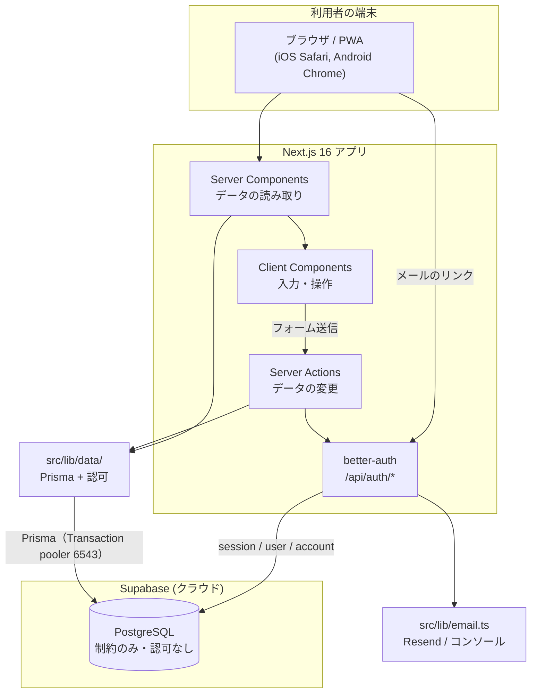
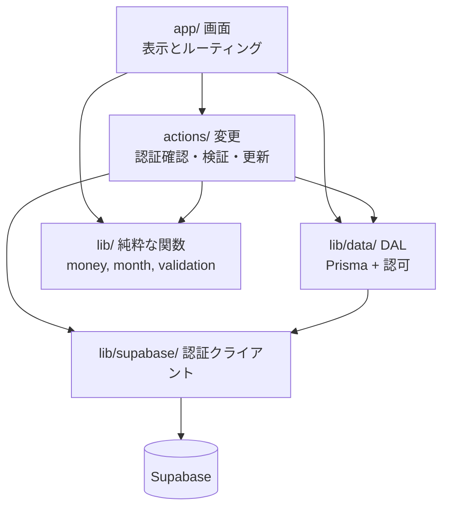
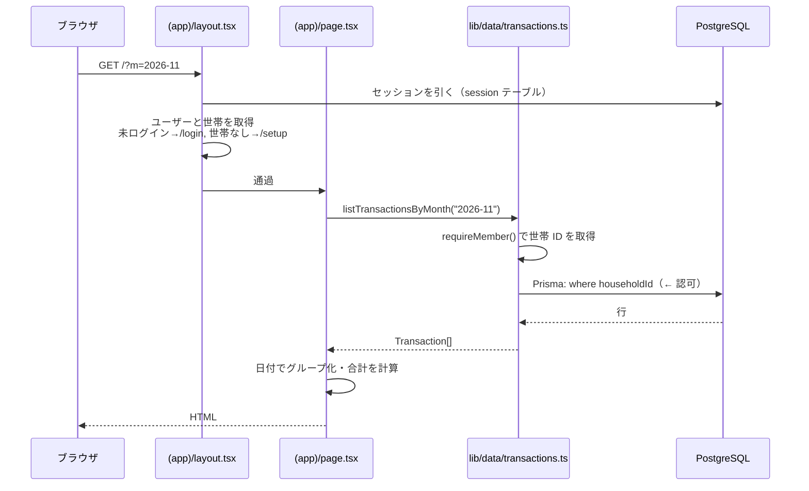
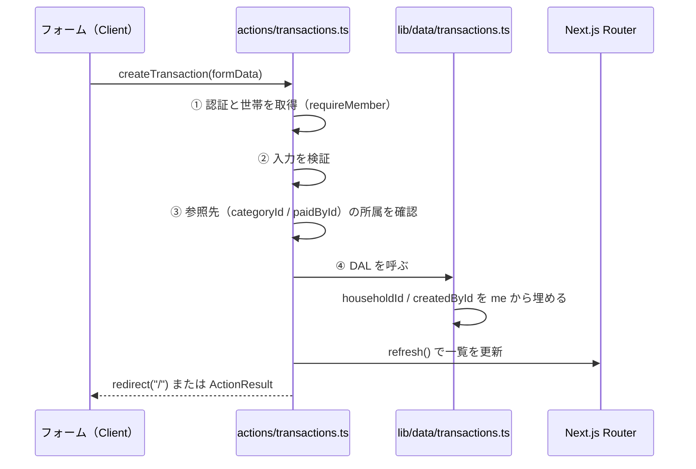
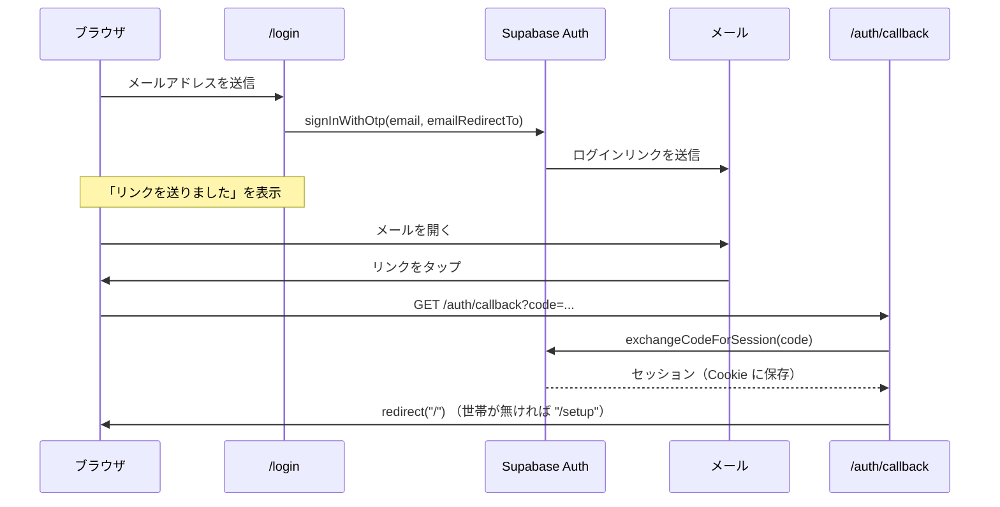
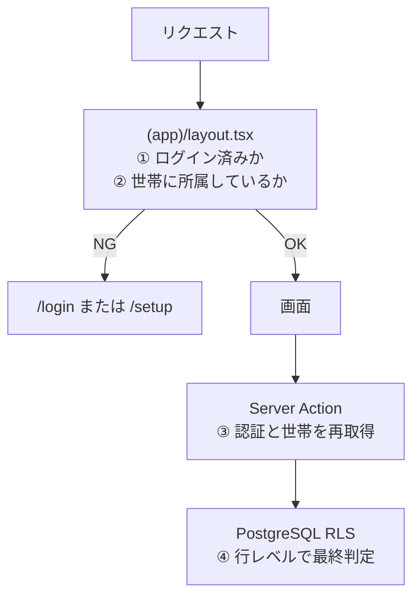

# アーキテクチャ

最終更新: 2026-11-07

**目的: アーキテクチャの一貫性を維持する。** どこに何を置くか、どの方向に依存してよいかを決める。迷ったらこの文書に戻る。

---

## 1. 全体構成



### 1.1 構成の要点

- **バックエンドを別に作らない。** DB へのアクセスは Next.js のサーバー側から Prisma 経由で行う。REST API 層は作らない（→ [ADR-0001](../05-decisions/ADR-0001-tech-stack.md)）。
- **認可はアプリ層（`src/lib/data/`）に置く。** DB は制約でデータの正しさを守るが、誰が見られるかは守らない（→ [ADR-0005](../05-decisions/ADR-0005-authorization-in-app-layer.md)）。**最終防衛線が無いので、DAL が唯一の砦。**
- **Supabase は DB のホストだけ。** 認証は better-auth が同じ Postgres の `user` / `session` / `account` / `verification` テーブルで行う（→ [ADR-0007](../05-decisions/ADR-0007-better-auth.md)）。ブラウザから DB を直接叩かない。
- **メール送信は自前**（`src/lib/email.ts`）。better-auth はメールを送らないため。開発時は**コンソールにリンクを出す**。

---

## 2. ディレクトリ構成

```
monely/
├── docs/                       設計ドキュメント（この文書群）
├── prisma/
│   ├── schema.prisma           スキーマの正
│   └── migrations/             Prisma Migrate が生成
│       └── 0001_init/migration.sql
├── prisma.config.ts            Prisma CLI の設定（.env.local を読む）
├── public/                     静的ファイル（PWA アイコンなど）
└── src/
    ├── app/
    │   ├── layout.tsx          ルートレイアウト（html/body, メタデータ）
    │   ├── globals.css         Tailwind の読み込みと色トークン
    │   ├── manifest.ts         PWA マニフェスト（M5）
    │   ├── login/              /login
    │   ├── setup/              /setup
    │   ├── api/auth/[...all]/
    │   │   └── route.ts        better-auth のエンドポイント（唯一の API 経路）
    │   └── (app)/              ← 認証 + 世帯所属が必要な画面
    │       ├── layout.tsx      振り分けと下部タブ
    │       ├── page.tsx        / 月次一覧
    │       ├── new/            /new
    │       ├── transactions/
    │       │   └── [id]/       /transactions/[id]
    │       └── settings/       /settings
    ├── actions/                Server Actions（"use server"）
    │   ├── transactions.ts
    │   ├── household.ts
    │   └── auth.ts
    ├── components/             再利用する UI
    │   ├── ui/                 汎用（Button, Field, Sheet …）
    │   └── …                   ドメイン固有（TransactionRow, AmountInput …）
    ├── generated/prisma/       Prisma Client（生成物。gitignore 済み）
    └── lib/
        ├── auth/
        │   └── server.ts       ★ better-auth の設定（認証の中心）
        ├── email.ts            メール送信（Resend / 開発時はコンソール）
        ├── data/               ★ DB に触る唯一の場所。認可もここ
        │   ├── db.ts           Prisma Client の生成口（外から import 禁止）
        │   ├── transactions.ts
        │   ├── transactions.test.ts   認可テスト（必須）
        │   └── household.ts
        ├── auth.ts             現在のユーザーと世帯の取得・ガード
        ├── money.ts            金額の整形・パース
        ├── month.ts            月の計算（開始日・前月・翌月・表示名）
        ├── validation.ts       入力検証
        └── types.ts            ドメインの型
```

### 2.1 配置のルール

| 置くもの | 置き場所 | 理由 |
| --- | --- | --- |
| 画面 | `src/app/**/page.tsx` | ルーティングと一致させる |
| DB へのアクセス（読み書き両方） | `src/lib/data/*.ts` | **認可をここに閉じ込める。** `prisma` を外から import しない（[ADR-0005](../05-decisions/ADR-0005-authorization-in-app-layer.md) 約束 A） |
| データの変更 | `src/actions/*.ts` | 変更の入口を一箇所にまとめ、認証確認の抜けを見つけやすくする |
| 画面をまたいで使う UI | `src/components/` | |
| その画面専用の UI | その画面のディレクトリ内（`_components/`） | 使われない場所に置かない |
| 純粋な計算（金額・日付） | `src/lib/*.ts` | テストしやすく、どこからでも呼べる |

---

## 3. 層と責務



| 層 | 責務 | してはいけないこと |
| --- | --- | --- |
| `app/`（画面） | 表示、ルーティング、フォームの組み立て | DB への直接アクセス、業務ルールの実装 |
| `actions/`（変更） | **認証と世帯の確認**、入力検証、DAL の呼び出し、キャッシュの更新、リダイレクト | `prisma` を直接触ること、表示の組み立て |
| `lib/data/`（DAL） | **世帯 ID による絞り込み（認可）**、クエリ、結果の型付け | 世帯 ID を引数で受け取ること、表示の組み立て |
| `lib/`（純粋関数） | 金額・日付の計算と整形、検証 | 外部への問い合わせ、`cookies()` の参照 |
| `lib/supabase/` | クライアントの生成と Cookie の受け渡し | 業務ロジック |

### 3.1 依存の方向

**上から下への一方向のみ。** `lib/` が `app/` を参照してはならない。`lib/data/` が `actions/` を参照してはならない。

循環を避けるため、共有する型は `src/lib/types.ts` に置く。

### 3.2 Server / Client の境界

- **既定は Server Component。** `"use client"` は必要な場所にだけ書く。
- Client Component が必要になるのは「入力」「開閉」「タブ切り替え」など**操作の状態を持つ**場合のみ。
- Client Component は `lib/data/` を呼ばない。データはサーバーから props で渡す。
- **`src/lib/data/db.ts` を `src/lib/data/` の外から import しない**（[ADR-0005](../05-decisions/ADR-0005-authorization-in-app-layer.md) 約束 A）。
- Client Component から変更を行う場合は、`src/actions/` の Server Action を import して `<form action={...}>` または `startTransition` で呼ぶ。

---

## 4. データの流れ

### 4.1 読み取り（月次一覧の表示）



**ポイント**: `where` の `householdId` が**認可そのもの**。これを書き忘れると他世帯のデータが出る。DAL の外には出さない。

### 4.2 変更（記録の登録）



**①〜④ を省略してはいけない。** Server Action は UI を経由せず直接 POST できる。**RLS が無いので、ここと DAL が唯一の防衛線。**

### 4.3 認証（マジックリンク）



**サインアップとログインは同じ入口。** 初回ログイン時に**アプリ側で** `Profile` を作成する（`auth.users` へのトリガーは使わない。`auth` スキーマは Prisma の管理外 → [DB設計 §1.7](./database-design.md#17-auth-スキーマは-prisma-の管理外)）。

---

## 5. 認証と認可の構造



| 段 | 何をするか | 信頼度 |
| --- | --- | --- |
| ① `(app)/layout.tsx` | 画面の振り分け（UX のため） | 中（迂回されうる） |
| ② Server Action | 認証と世帯の再確認、入力検証 | 高 |


**①だけで守った気にならない。** 画面を隠すことはデータを守ることではない。詳細 → [セキュリティガイドライン](../03-guidelines/security-guidelines.md)

---

## 6. Next.js 16.4.5 固有の制約

このリポジトリの Next.js は 16.4.5 で、一般的な記事やモデルの学習データと差がある。**同梱ドキュメント `node_modules/next/dist/docs/` が一次情報**（`AGENTS.md` にも明記されている）。

### 6.1 Middleware は `proxy.ts` に改名された（このプロジェクトでは未使用）

> Starting with Next.js 16, Middleware is now called Proxy.

Supabase Auth のときはトークン更新のために `src/proxy.ts` を置いていたが、**better-auth に移行して不要になった**（セッションは DB にあり、リクエストごとの更新処理が要らない）。そのため現在このプロジェクトに `proxy.ts` は無い。

将来必要になった場合は `src/proxy.ts`（`src/app` と同階層、プロジェクトに 1 つだけ、`proxy` という名前付き export または default export）。**matcher を書かないと静的ファイルにも走る。**

### 6.2 `cacheComponents: true` が有効

`next.config.ts` で有効化済み。従来の App Router と挙動が違う。

- `cookies()` を読むコンポーネントは `<Suspense>` の内側に置くか、そのセグメントで `export const instant = false` を宣言する必要がある。
- **方針: `src/app/(app)/layout.tsx` に `export const instant = false` を置く。** Monely はログイン後の全画面が個人データで、静的に先出しできる部分がほぼない。これで instant navigation の検証と静的シェルの検証が外れ、サーバーでブロックして描画する素直な構成になる。
- `instant = false` はドキュメントで示された正式な逃げ道であり、警告の抑制ハックではない。
- 判断の経緯、宣言する範囲、見直す条件 → [ADR-0004 認証後のセグメントを `instant = false` にする](../05-decisions/ADR-0004-instant-false-for-authed-segments.md)
- 素の `use cache` の中では `cookies()` / `headers()` を読めない（例外になる）。読む必要があれば `use cache: private`。
- **キャッシュキーとタグは平文で保存される。** メールアドレスなどを入れない（NFR-S4）。

速度の最適化（`use cache` によるプリフェッチ）は v1 では追わない。先に正しく動かす。

### 6.3 その他

| 事項 | 内容 |
| --- | --- |
| 更新後の反映 | `refresh()`（`next/cache`）。タグ付きデータは `updateTag()` / `revalidatePath()` |
| レイアウトの型 | `LayoutProps<"/">` のようなグローバル型が使える（スキャフォールドが既にこの形） |
| PWA マニフェスト | `src/app/manifest.ts` に `MetadataRoute.Manifest` を返す default export |
| Turbopack + Tailwind v4 | `next.config.ts` の `turbopack.rules` で CSS を処理している。設定を壊さない |
| React Compiler | `reactCompiler: true`。`useMemo` / `useCallback` を手で書く前に、本当に必要か確認する |

---

## 7. 認証の実装（better-auth）

| 事項 | 内容 |
| --- | --- |
| 設定 | `src/lib/auth/server.ts`。`betterAuth({ ... })` を 1 つ export する |
| DB | `prismaAdapter(prisma, { provider: "postgresql" })`。`src/lib/data/db.ts` の Prisma Client を共有する |
| エンドポイント | `src/app/api/auth/[...all]/route.ts`（`toNextJsHandler`）。メール確認・再設定・マジックリンクのリンクはここに来る |
| Server Action から | `auth.api.signInEmail({ body, headers })` のように呼ぶ。Cookie は `nextCookies()` プラグインが書く |
| セッションの取得 | `auth.api.getSession({ headers })`。`src/lib/auth.ts` の `getMe()` が包む |
| メール送信 | `src/lib/email.ts`。better-auth はメールを送らないので自分で渡す |

### 7.1 `nextCookies()` はプラグインの最後に置く

better-auth の作法。Server Action から呼んだときに Cookie を書けるようにするプラグインで、**並び順が意味を持つ**。

### 7.2 スキーマは `getAuthTables()` と突き合わせる

`prisma/schema.prisma` の `User` / `Session` / `Account` / `Verification` は better-auth が要求する形に手で合わせている。**better-auth を上げるときは必ず確認する。**

```bash
node -e 'import("better-auth/db").then(m => console.log(m.getAuthTables(options)))'
```

### 7.3 Supabase Auth は使わない

`@supabase/supabase-js` と `@supabase/ssr` は削除した。Supabase は Postgres のホストとしてのみ使う。`auth` スキーマ（Supabase が所有）は参照しない。

## 8. 環境と設定

| 変数 | 用途 | 公開 |
| --- | --- | --- |
| `DATABASE_URL` | アプリのクエリ（Transaction pooler, 6543） | **非公開。DB の全権を持つ** |
| `DIRECT_URL` | マイグレーション（Session pooler, 5432） | **非公開。DB の全権を持つ** |
| `BETTER_AUTH_SECRET` | セッションの署名鍵 | **非公開。漏れるとセッションを偽造できる** |
| `BETTER_AUTH_URL` | アプリの URL（リンクの組み立てに使う） | 公開してよい |
| `RESEND_API_KEY` | メール送信。**未設定なら開発モード（コンソール出力）** | 非公開 |
| `MAIL_FROM` | 送信元アドレス | 公開してよい |

**ブラウザに出る変数は現在 1 つも無い**（`NEXT_PUBLIC_` 付きの変数が存在しない）。

- **`.env.local` 1 つに統一する。** Next.js が読み、Prisma CLI も `prisma.config.ts` 経由で同じファイルを読む（Prisma 7 は `.env` を自動で読まない）。
- `.env.local.example` を雛形として置く（`.gitignore` の `.env*` に一致するため `!.env.local.example` の除外行が必要）。
- **`DATABASE_URL` / `DIRECT_URL` / `BETTER_AUTH_SECRET` に `NEXT_PUBLIC_` を付けない。** 付けるとブラウザのバンドルに埋め込まれる。
- 環境は「ローカル」と「本番」のみ。Supabase のプロジェクトは 1 つを共用する（NFR-O3）。

### 8.1 接続方式

アプリは Transaction pooler（6543）、マイグレーションは Session pooler（5432）。**マイグレーションを 6543 に向けるとハングする。** 理由と実測 → [DB設計 §7](./database-design.md#7-接続)

---

## 9. 意図的に採用しなかった構成

| 選ばなかったもの | 理由 |
| --- | --- |
| REST / GraphQL の API 層 | 利用者が Next.js アプリだけ。層を増やすと型とエラー処理の重複が生まれる → [ADR-0001](../05-decisions/ADR-0001-tech-stack.md) |
| Supabase Auth | better-auth に移行（[ADR-0007](../05-decisions/ADR-0007-better-auth.md)）。`@supabase/*` は依存から削除した |
| Auth.js | v5 が 3 年以上 beta。メール + パスワードを公式に非推奨 → [ADR-0007](../05-decisions/ADR-0007-better-auth.md) |
| RLS（DB 側の認可） | [ADR-0005](../05-decisions/ADR-0005-authorization-in-app-layer.md) で廃止。Prisma は所有者ロールで接続するためポリシーが効かない |
| 状態管理ライブラリ | サーバーから渡す props と `useState` で足りる |
| クライアントからの Supabase 直接アクセス | 認可の判断箇所を増やしたくない |
| 中間テーブルによる複数世帯対応 | v1 では不要 → [ADR-0003](../05-decisions/ADR-0003-one-household-per-user.md) |
