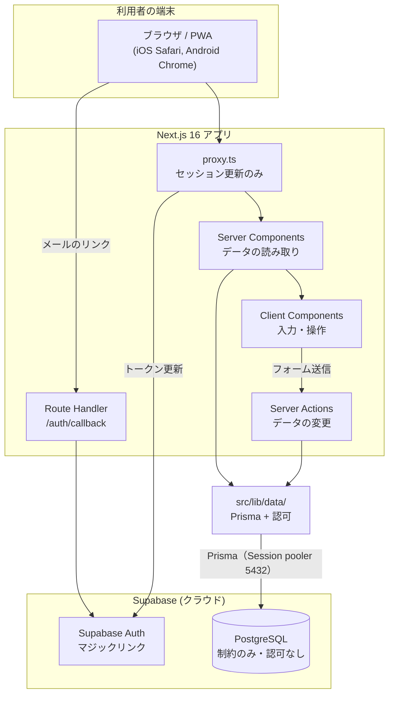
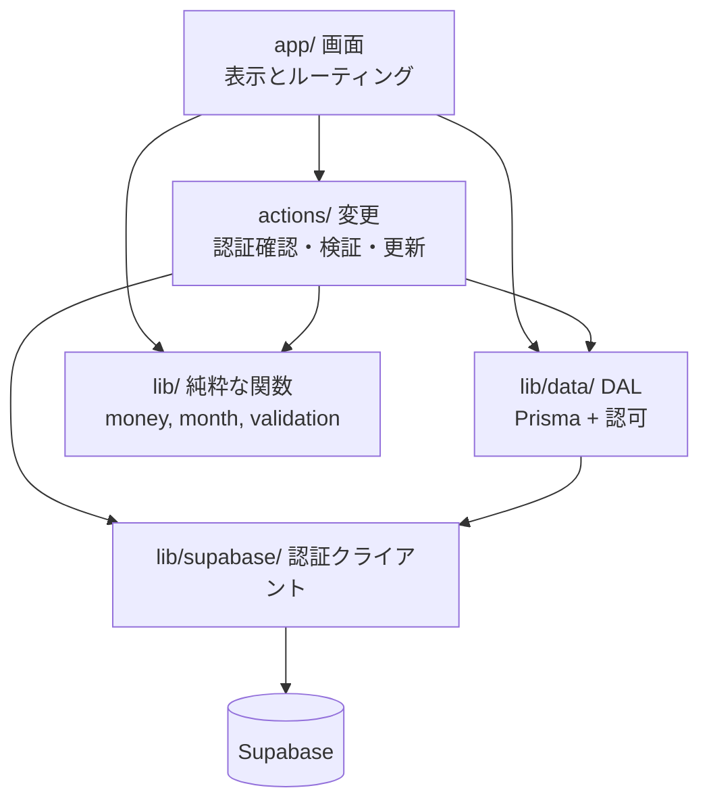
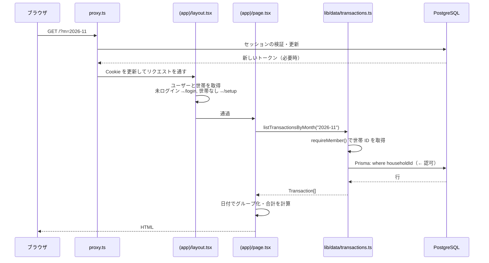
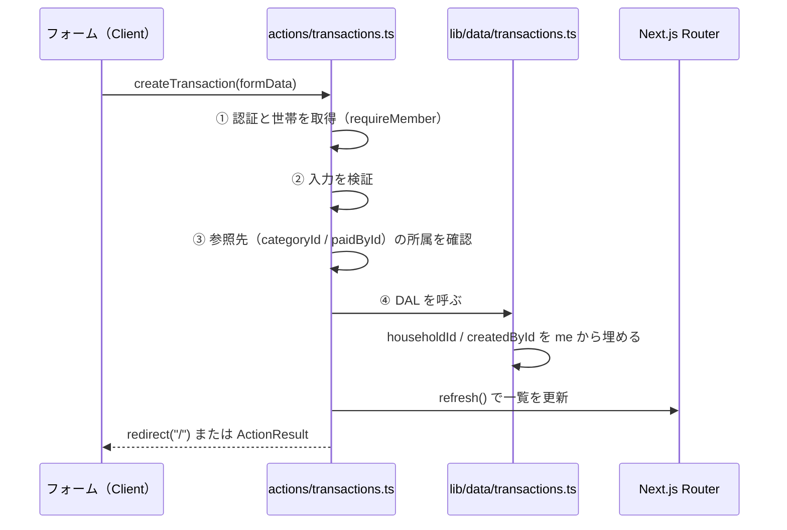
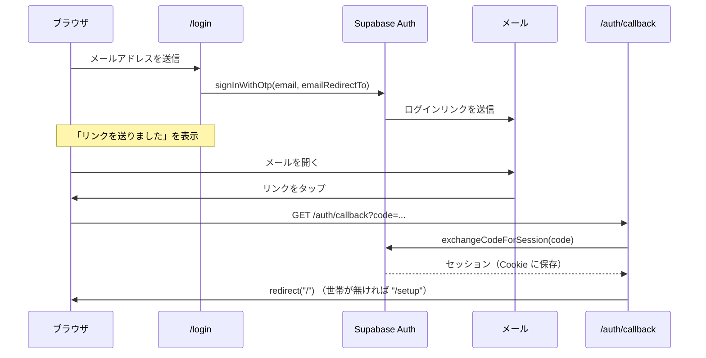
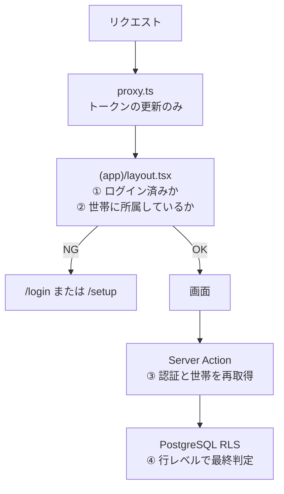

# アーキテクチャ

最終更新: 2026-11-07

**目的: アーキテクチャの一貫性を維持する。** どこに何を置くか、どの方向に依存してよいかを決める。迷ったらこの文書に戻る。

---

## 1. 全体構成



### 1.1 構成の要点

- **バックエンドを別に作らない。** DB へのアクセスは Next.js のサーバー側から Prisma 経由で行う。REST API 層は作らない（→ [ADR-0001](../05-decisions/ADR-0001-tech-stack.md)）。
- **認可はアプリ層（`src/lib/data/`）に置く。** DB は制約でデータの正しさを守るが、誰が見られるかは守らない（→ [ADR-0005](../05-decisions/ADR-0005-authorization-in-app-layer.md)）。**最終防衛線が無いので、DAL が唯一の砦。**
- **Supabase は DB と認証のホスト。** データアクセスに supabase-js は使わない（認証のみ）。ブラウザから DB を直接叩かない。

---

## 2. ディレクトリ構成

```
monely/
├── docs/                       設計ドキュメント（この文書群）
├── prisma/
│   ├── schema.prisma           スキーマの正
│   └── migrations/             Prisma Migrate が生成
│       └── 0001_init/migration.sql
├── prisma.config.ts            Prisma CLI の設定（.env.local を読む）
├── public/                     静的ファイル（PWA アイコンなど）
└── src/
    ├── proxy.ts                Next.js 16 の Proxy（旧 Middleware）
    ├── app/
    │   ├── layout.tsx          ルートレイアウト（html/body, メタデータ）
    │   ├── globals.css         Tailwind の読み込みと色トークン
    │   ├── manifest.ts         PWA マニフェスト（M5）
    │   ├── login/              /login
    │   ├── setup/              /setup
    │   ├── auth/
    │   │   └── callback/
    │   │       └── route.ts    認証コールバック
    │   └── (app)/              ← 認証 + 世帯所属が必要な画面
    │       ├── layout.tsx      振り分けと下部タブ
    │       ├── page.tsx        / 月次一覧
    │       ├── new/            /new
    │       ├── transactions/
    │       │   └── [id]/       /transactions/[id]
    │       └── settings/       /settings
    ├── actions/                Server Actions（"use server"）
    │   ├── transactions.ts
    │   ├── household.ts
    │   └── auth.ts
    ├── components/             再利用する UI
    │   ├── ui/                 汎用（Button, Field, Sheet …）
    │   └── …                   ドメイン固有（TransactionRow, AmountInput …）
    ├── generated/prisma/       Prisma Client（生成物。gitignore 済み）
    └── lib/
        ├── supabase/           ★ 認証のみ。データアクセスには使わない
        │   ├── client.ts       ブラウザ用クライアント
        │   └── server.ts       サーバー用クライアント
        ├── data/               ★ DB に触る唯一の場所。認可もここ
        │   ├── db.ts           Prisma Client の生成口（外から import 禁止）
        │   ├── transactions.ts
        │   ├── transactions.test.ts   認可テスト（必須）
        │   └── household.ts
        ├── auth.ts             現在のユーザーと世帯の取得・ガード
        ├── money.ts            金額の整形・パース
        ├── month.ts            月の計算（開始日・前月・翌月・表示名）
        ├── validation.ts       入力検証
        └── types.ts            ドメインの型
```

### 2.1 配置のルール

| 置くもの | 置き場所 | 理由 |
| --- | --- | --- |
| 画面 | `src/app/**/page.tsx` | ルーティングと一致させる |
| DB へのアクセス（読み書き両方） | `src/lib/data/*.ts` | **認可をここに閉じ込める。** `prisma` を外から import しない（[ADR-0005](../05-decisions/ADR-0005-authorization-in-app-layer.md) 約束 A） |
| データの変更 | `src/actions/*.ts` | 変更の入口を一箇所にまとめ、認証確認の抜けを見つけやすくする |
| 画面をまたいで使う UI | `src/components/` | |
| その画面専用の UI | その画面のディレクトリ内（`_components/`） | 使われない場所に置かない |
| 純粋な計算（金額・日付） | `src/lib/*.ts` | テストしやすく、どこからでも呼べる |

---

## 3. 層と責務



| 層 | 責務 | してはいけないこと |
| --- | --- | --- |
| `app/`（画面） | 表示、ルーティング、フォームの組み立て | DB への直接アクセス、業務ルールの実装 |
| `actions/`（変更） | **認証と世帯の確認**、入力検証、DAL の呼び出し、キャッシュの更新、リダイレクト | `prisma` を直接触ること、表示の組み立て |
| `lib/data/`（DAL） | **世帯 ID による絞り込み（認可）**、クエリ、結果の型付け | 世帯 ID を引数で受け取ること、表示の組み立て |
| `lib/`（純粋関数） | 金額・日付の計算と整形、検証 | 外部への問い合わせ、`cookies()` の参照 |
| `lib/supabase/` | クライアントの生成と Cookie の受け渡し | 業務ロジック |

### 3.1 依存の方向

**上から下への一方向のみ。** `lib/` が `app/` を参照してはならない。`lib/data/` が `actions/` を参照してはならない。

循環を避けるため、共有する型は `src/lib/types.ts` に置く。

### 3.2 Server / Client の境界

- **既定は Server Component。** `"use client"` は必要な場所にだけ書く。
- Client Component が必要になるのは「入力」「開閉」「タブ切り替え」など**操作の状態を持つ**場合のみ。
- Client Component は `lib/data/` を呼ばない。データはサーバーから props で渡す。
- **`src/lib/data/db.ts` を `src/lib/data/` の外から import しない**（[ADR-0005](../05-decisions/ADR-0005-authorization-in-app-layer.md) 約束 A）。
- Client Component から変更を行う場合は、`src/actions/` の Server Action を import して `<form action={...}>` または `startTransition` で呼ぶ。

---

## 4. データの流れ

### 4.1 読み取り（月次一覧の表示）



**ポイント**: `where` の `householdId` が**認可そのもの**。これを書き忘れると他世帯のデータが出る。DAL の外には出さない。

### 4.2 変更（記録の登録）



**①〜④ を省略してはいけない。** Server Action は UI を経由せず直接 POST できる。**RLS が無いので、ここと DAL が唯一の防衛線。**

### 4.3 認証（マジックリンク）



**サインアップとログインは同じ入口。** 初回ログイン時に**アプリ側で** `Profile` を作成する（`auth.users` へのトリガーは使わない。`auth` スキーマは Prisma の管理外 → [DB設計 §1.7](./database-design.md#17-auth-スキーマは-prisma-の管理外)）。

---

## 5. 認証と認可の構造



| 段 | 何をするか | 信頼度 |
| --- | --- | --- |
| ① `proxy.ts` | トークンの更新。**認可の判断はしない** | 低（ここに頼らない） |
| ② `(app)/layout.tsx` | 画面の振り分け（UX のため） | 中（迂回されうる） |
| ③ Server Action / Route Handler | 認証と世帯の再確認、入力検証 | 高 |
| ④ RLS | 行レベルの可否 | **最終防衛線** |

**②だけで守った気にならない。** 画面を隠すことはデータを守ることではない。詳細 → [セキュリティガイドライン](../03-guidelines/security-guidelines.md)

---

## 6. Next.js 16.4.5 固有の制約

このリポジトリの Next.js は 16.4.5 で、一般的な記事やモデルの学習データと差がある。**同梱ドキュメント `node_modules/next/dist/docs/` が一次情報**（`AGENTS.md` にも明記されている）。

### 6.1 Middleware は `proxy.ts` に改名された

> Starting with Next.js 16, Middleware is now called Proxy.

- 置き場所は `src/proxy.ts`（`src/app` と同階層）。プロジェクトに 1 つだけ。
- `proxy` という名前付き export、または default export。
- **ここで重いデータ取得や認可判断をしない**（ドキュメントが明記）。Supabase のトークン更新だけに留める。

### 6.2 `cacheComponents: true` が有効

`next.config.ts` で有効化済み。従来の App Router と挙動が違う。

- `cookies()` を読むコンポーネントは `<Suspense>` の内側に置くか、そのセグメントで `export const instant = false` を宣言する必要がある。
- **方針: `src/app/(app)/layout.tsx` に `export const instant = false` を置く。** Monely はログイン後の全画面が個人データで、静的に先出しできる部分がほぼない。これで instant navigation の検証と静的シェルの検証が外れ、サーバーでブロックして描画する素直な構成になる。
- `instant = false` はドキュメントで示された正式な逃げ道であり、警告の抑制ハックではない。
- 判断の経緯、宣言する範囲、見直す条件 → [ADR-0004 認証後のセグメントを `instant = false` にする](../05-decisions/ADR-0004-instant-false-for-authed-segments.md)
- 素の `use cache` の中では `cookies()` / `headers()` を読めない（例外になる）。読む必要があれば `use cache: private`。
- **キャッシュキーとタグは平文で保存される。** メールアドレスなどを入れない（NFR-S4）。

速度の最適化（`use cache` によるプリフェッチ）は v1 では追わない。先に正しく動かす。

### 6.3 その他

| 事項 | 内容 |
| --- | --- |
| 更新後の反映 | `refresh()`（`next/cache`）。タグ付きデータは `updateTag()` / `revalidatePath()` |
| レイアウトの型 | `LayoutProps<"/">` のようなグローバル型が使える（スキャフォールドが既にこの形） |
| PWA マニフェスト | `src/app/manifest.ts` に `MetadataRoute.Manifest` を返す default export |
| Turbopack + Tailwind v4 | `next.config.ts` の `turbopack.rules` で CSS を処理している。設定を壊さない |
| React Compiler | `reactCompiler: true`。`useMemo` / `useCallback` を手で書く前に、本当に必要か確認する |

---

## 7. Supabase クライアントの使い分け（**認証のみ**）

> データアクセスには使わない。DB は Prisma 経由（`src/lib/data/`）。ここで作るクライアントは `auth.*` のためだけに使う。

| 用途 | 生成関数 | 場所 | 注意 |
| --- | --- | --- | --- |
| Server Component / Server Action / Route Handler | `createServerClient` | `src/lib/supabase/server.ts` | **リクエストごとに新しく作る。** モジュールスコープで使い回さない |
| ブラウザ（Client Component） | `createBrowserClient` | `src/lib/supabase/client.ts` | v1 ではほぼ使わない |
| セッション更新 | `createServerClient` | `src/proxy.ts` 内で直接生成 | レスポンスに Cookie とヘッダを書き戻す |

### 7.1 Cookie メソッドは `getAll` / `setAll` を両方実装する

`get` / `set` / `remove` は非推奨。両方実装しないと「ランダムにログアウトされる」「JSON パースエラー」といった追いにくい不具合が出る、とライブラリ自身が警告している。

### 7.2 `setAll` の第 2 引数（`@supabase/ssr@0.12.7` 固有）

```ts
setAll(cookiesToSet, headers) {
  for (const { name, value, options } of cookiesToSet) {
    response.cookies.set(name, value, options);
  }
  // ← 忘れない
  for (const [key, value] of Object.entries(headers)) {
    response.headers.set(key, value);
  }
}
```

第 2 引数には `Cache-Control: private, no-cache, no-store, ...` などが入ってくる。**設定を忘れると、認証 Cookie を含むレスポンスが CDN やプロキシにキャッシュされ、他人のセッションが配信されうる**（NFR-S5）。

Server Component のレンダリング中に `setAll` が呼ばれると書き込みに失敗することがある。`try` / `catch` で握りつぶしてよい — セッションの更新は `proxy.ts` が担保する。

---

## 8. 環境と設定

| 変数 | 用途 | 公開 |
| --- | --- | --- |
| `DATABASE_URL` | アプリのクエリ（Transaction pooler, 6543） | **非公開。DB の全権を持つ** |
| `DIRECT_URL` | マイグレーション（Session pooler, 5432） | **非公開。DB の全権を持つ** |
| `NEXT_PUBLIC_SUPABASE_URL` | Supabase Auth 用 | ブラウザに出る |
| `NEXT_PUBLIC_SUPABASE_PUBLISHABLE_KEY` | Supabase Auth 用（Publishable key、旧 anon キー） | ブラウザに出る |

- **`.env.local` 1 つに統一する。** Next.js が読み、Prisma CLI も `prisma.config.ts` 経由で同じファイルを読む（Prisma 7 は `.env` を自動で読まない）。
- `.env.local.example` を雛形として置く（`.gitignore` の `.env*` に一致するため `!.env.local.example` の除外行が必要）。
- **`DATABASE_URL` / `DIRECT_URL` に `NEXT_PUBLIC_` を付けない。** 付けるとブラウザのバンドルに埋め込まれ、DB の全権が公開される。
- Supabase の Secret key（旧 `service_role`）は使わない（NFR-S3）。
- 環境は「ローカル」と「本番」のみ。Supabase のプロジェクトは 1 つを共用する（NFR-O3）。

### 8.1 接続方式

アプリは Transaction pooler（6543）、マイグレーションは Session pooler（5432）。**マイグレーションを 6543 に向けるとハングする。** 理由と実測 → [DB設計 §7](./database-design.md#7-接続)

---

## 9. 意図的に採用しなかった構成

| 選ばなかったもの | 理由 |
| --- | --- |
| REST / GraphQL の API 層 | 利用者が Next.js アプリだけ。層を増やすと型とエラー処理の重複が生まれる → [ADR-0001](../05-decisions/ADR-0001-tech-stack.md) |
| supabase-js でのデータアクセス | Prisma の型安全なクエリを使う（[ADR-0005](../05-decisions/ADR-0005-authorization-in-app-layer.md)）。supabase-js は認証のみ |
| RLS（DB 側の認可） | [ADR-0005](../05-decisions/ADR-0005-authorization-in-app-layer.md) で廃止。Prisma は所有者ロールで接続するためポリシーが効かない |
| 状態管理ライブラリ | サーバーから渡す props と `useState` で足りる |
| クライアントからの Supabase 直接アクセス | 認可の判断箇所を増やしたくない |
| 中間テーブルによる複数世帯対応 | v1 では不要 → [ADR-0003](../05-decisions/ADR-0003-one-household-per-user.md) |
