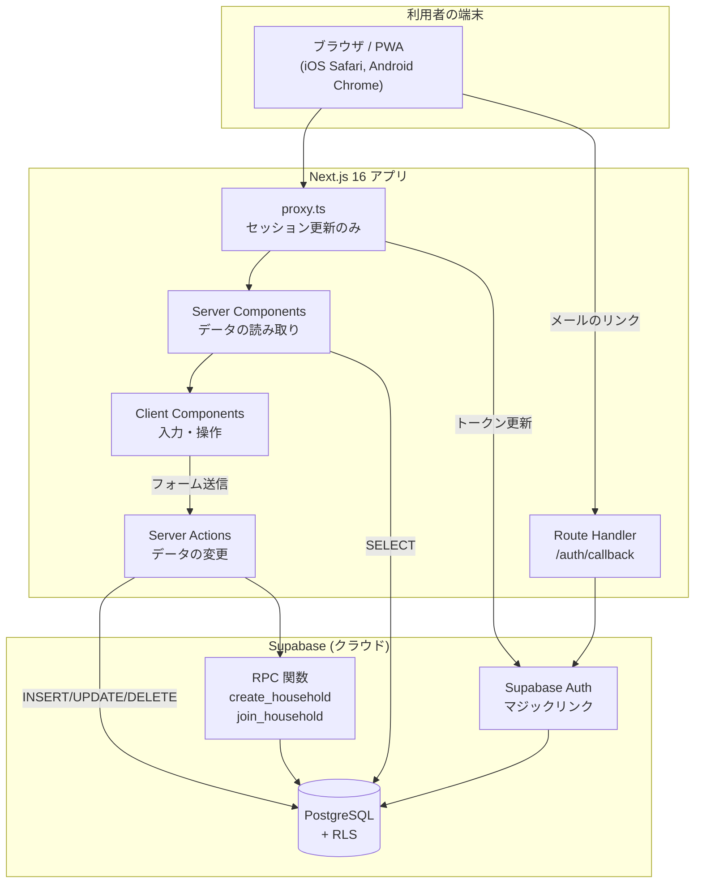
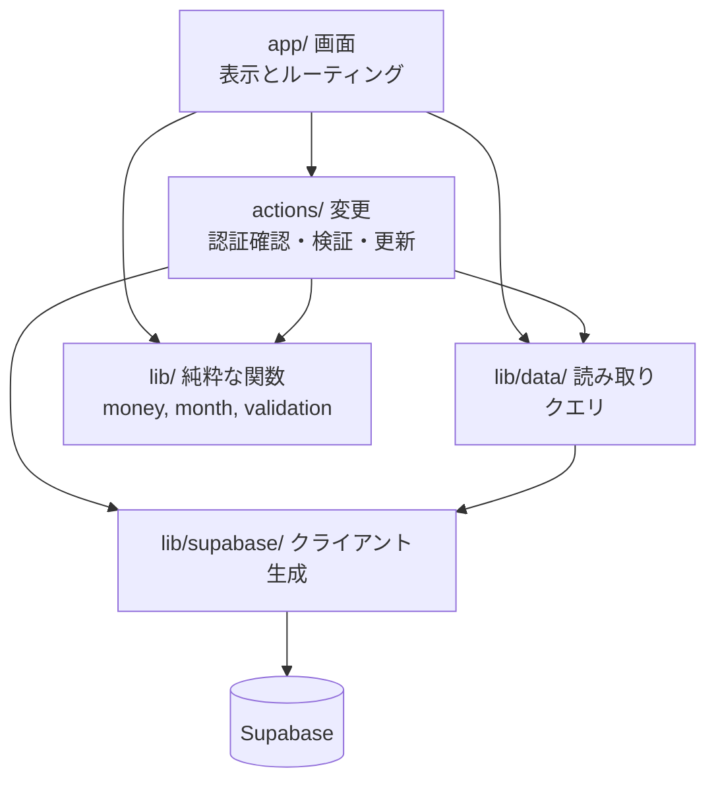
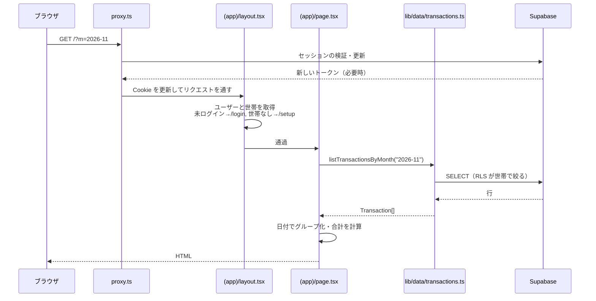
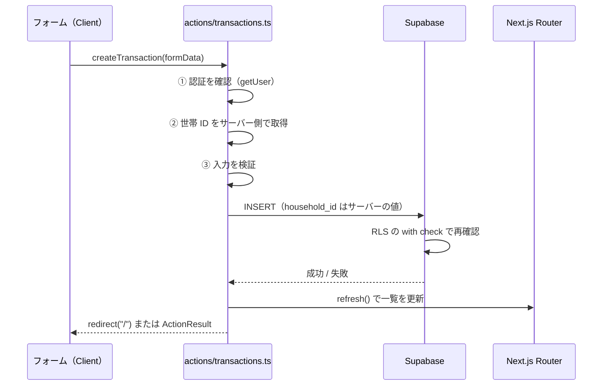
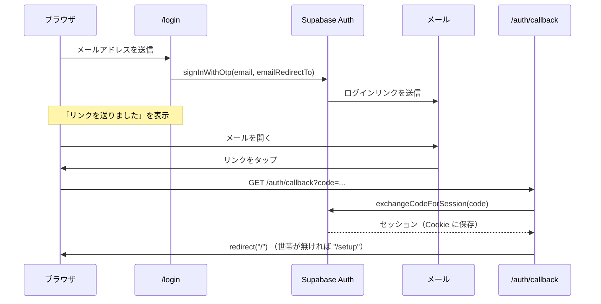
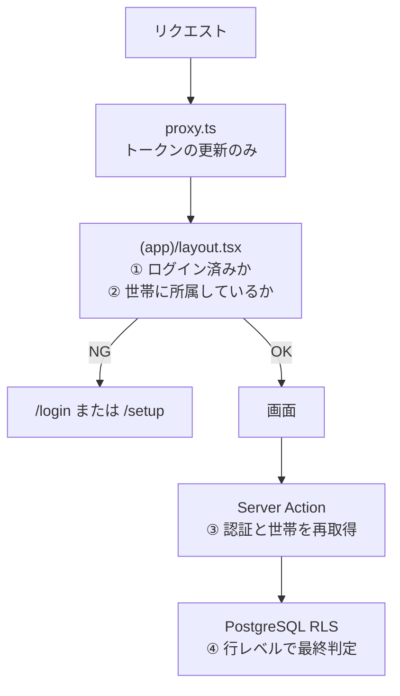

# アーキテクチャ

最終更新: 2026-11-07

**目的: アーキテクチャの一貫性を維持する。** どこに何を置くか、どの方向に依存してよいかを決める。迷ったらこの文書に戻る。

---

## 1. 全体構成



### 1.1 構成の要点

- **バックエンドを別に作らない。** DB へのアクセスは Next.js のサーバー側（Server Component / Server Action）から Supabase クライアント経由で直接行う。REST API 層は作らない（→ [ADR-0001](../05-decisions/ADR-0001-tech-stack.md)）。
- **権限は DB に置く。** 認可の本体は PostgreSQL の RLS。アプリ側の検証はその手前の二重化であって、代替ではない（→ [ADR-0002](../05-decisions/ADR-0002-authorization-via-rls.md)）。
- **ブラウザから Supabase を直接叩かない。** 読み取りも変更もサーバー側に通す。ブラウザ用クライアントは認証の都合で用意するが、データ操作には使わない。

---

## 2. ディレクトリ構成

```
monely/
├── docs/                       設計ドキュメント（この文書群）
├── supabase/
│   └── migrations/             DB のマイグレーション SQL（連番）
│       └── 0001_init.sql
├── public/                     静的ファイル（PWA アイコンなど）
└── src/
    ├── proxy.ts                Next.js 16 の Proxy（旧 Middleware）
    ├── app/
    │   ├── layout.tsx          ルートレイアウト（html/body, メタデータ）
    │   ├── globals.css         Tailwind の読み込みと色トークン
    │   ├── manifest.ts         PWA マニフェスト（M5）
    │   ├── login/              /login
    │   ├── setup/              /setup
    │   ├── auth/
    │   │   └── callback/
    │   │       └── route.ts    認証コールバック
    │   └── (app)/              ← 認証 + 世帯所属が必要な画面
    │       ├── layout.tsx      振り分けと下部タブ
    │       ├── page.tsx        / 月次一覧
    │       ├── new/            /new
    │       ├── transactions/
    │       │   └── [id]/       /transactions/[id]
    │       └── settings/       /settings
    ├── actions/                Server Actions（"use server"）
    │   ├── transactions.ts
    │   ├── household.ts
    │   └── auth.ts
    ├── components/             再利用する UI
    │   ├── ui/                 汎用（Button, Field, Sheet …）
    │   └── …                   ドメイン固有（TransactionRow, AmountInput …）
    └── lib/
        ├── supabase/
        │   ├── client.ts       ブラウザ用クライアント
        │   └── server.ts       サーバー用クライアント
        ├── data/               読み取りクエリ（Server Component から呼ぶ）
        │   ├── transactions.ts
        │   └── household.ts
        ├── auth.ts             現在のユーザーと世帯の取得・ガード
        ├── money.ts            金額の整形・パース
        ├── month.ts            月の計算（開始日・前月・翌月・表示名）
        ├── validation.ts       入力検証
        └── types.ts            ドメインの型
```

### 2.1 配置のルール

| 置くもの | 置き場所 | 理由 |
| --- | --- | --- |
| 画面 | `src/app/**/page.tsx` | ルーティングと一致させる |
| データの読み取り | `src/lib/data/*.ts` | 画面から SQL 的な記述を追い出し、同じクエリを使い回す |
| データの変更 | `src/actions/*.ts` | 変更の入口を一箇所にまとめ、認証確認の抜けを見つけやすくする |
| 画面をまたいで使う UI | `src/components/` | |
| その画面専用の UI | その画面のディレクトリ内（`_components/`） | 使われない場所に置かない |
| 純粋な計算（金額・日付） | `src/lib/*.ts` | テストしやすく、どこからでも呼べる |

---

## 3. 層と責務



| 層 | 責務 | してはいけないこと |
| --- | --- | --- |
| `app/`（画面） | 表示、ルーティング、フォームの組み立て | DB への直接アクセス、業務ルールの実装 |
| `actions/`（変更） | **認証と世帯の確認**、入力検証、DB の更新、キャッシュの更新、リダイレクト | 表示の組み立て、UI の状態管理 |
| `lib/data/`（読み取り） | SELECT クエリと結果の型付け | 認可の判断（RLS に任せる）、変更操作 |
| `lib/`（純粋関数） | 金額・日付の計算と整形、検証 | 外部への問い合わせ、`cookies()` の参照 |
| `lib/supabase/` | クライアントの生成と Cookie の受け渡し | 業務ロジック |

### 3.1 依存の方向

**上から下への一方向のみ。** `lib/` が `app/` を参照してはならない。`lib/data/` が `actions/` を参照してはならない。

循環を避けるため、共有する型は `src/lib/types.ts` に置く。

### 3.2 Server / Client の境界

- **既定は Server Component。** `"use client"` は必要な場所にだけ書く。
- Client Component が必要になるのは「入力」「開閉」「タブ切り替え」など**操作の状態を持つ**場合のみ。
- Client Component は `lib/data/` を呼ばない。データはサーバーから props で渡す。
- Client Component から変更を行う場合は、`src/actions/` の Server Action を import して `<form action={...}>` または `startTransition` で呼ぶ。

---

## 4. データの流れ

### 4.1 読み取り（月次一覧の表示）



**ポイント**: クエリに `household_id` の条件を書かない。RLS が自動で絞る。書いてもよいが、それはセキュリティではなく取得量を絞るため。

### 4.2 変更（記録の登録）



**①②③ を省略してはいけない。** Server Action は UI を経由せず直接 POST できるため、ここが唯一の防衛線（RLS と合わせて二重）。

### 4.3 認証（マジックリンク）



**サインアップとログインは同じ入口。** 初回のログイン時に `auth.users` への INSERT トリガーが `profiles` を自動作成する（→ [DB設計](./database-design.md)）。

---

## 5. 認証と認可の構造



| 段 | 何をするか | 信頼度 |
| --- | --- | --- |
| ① `proxy.ts` | トークンの更新。**認可の判断はしない** | 低（ここに頼らない） |
| ② `(app)/layout.tsx` | 画面の振り分け（UX のため） | 中（迂回されうる） |
| ③ Server Action / Route Handler | 認証と世帯の再確認、入力検証 | 高 |
| ④ RLS | 行レベルの可否 | **最終防衛線** |

**②だけで守った気にならない。** 画面を隠すことはデータを守ることではない。詳細 → [セキュリティガイドライン](../03-guidelines/security-guidelines.md)

---

## 6. Next.js 16.4.5 固有の制約

このリポジトリの Next.js は 16.4.5 で、一般的な記事やモデルの学習データと差がある。**同梱ドキュメント `node_modules/next/dist/docs/` が一次情報**（`AGENTS.md` にも明記されている）。

### 6.1 Middleware は `proxy.ts` に改名された

> Starting with Next.js 16, Middleware is now called Proxy.

- 置き場所は `src/proxy.ts`（`src/app` と同階層）。プロジェクトに 1 つだけ。
- `proxy` という名前付き export、または default export。
- **ここで重いデータ取得や認可判断をしない**（ドキュメントが明記）。Supabase のトークン更新だけに留める。

### 6.2 `cacheComponents: true` が有効

`next.config.ts` で有効化済み。従来の App Router と挙動が違う。

- `cookies()` を読むコンポーネントは `<Suspense>` の内側に置くか、そのセグメントで `export const instant = false` を宣言する必要がある。
- **方針: `src/app/(app)/layout.tsx` に `export const instant = false` を置く。** Monely はログイン後の全画面が個人データで、静的に先出しできる部分がほぼない。これで instant navigation の検証と静的シェルの検証が外れ、サーバーでブロックして描画する素直な構成になる。
- `instant = false` はドキュメントで示された正式な逃げ道であり、警告の抑制ハックではない。
- 判断の経緯、宣言する範囲、見直す条件 → [ADR-0004 認証後のセグメントを `instant = false` にする](../05-decisions/ADR-0004-instant-false-for-authed-segments.md)
- 素の `use cache` の中では `cookies()` / `headers()` を読めない（例外になる）。読む必要があれば `use cache: private`。
- **キャッシュキーとタグは平文で保存される。** メールアドレスなどを入れない（NFR-S4）。

速度の最適化（`use cache` によるプリフェッチ）は v1 では追わない。先に正しく動かす。

### 6.3 その他

| 事項 | 内容 |
| --- | --- |
| 更新後の反映 | `refresh()`（`next/cache`）。タグ付きデータは `updateTag()` / `revalidatePath()` |
| レイアウトの型 | `LayoutProps<"/">` のようなグローバル型が使える（スキャフォールドが既にこの形） |
| PWA マニフェスト | `src/app/manifest.ts` に `MetadataRoute.Manifest` を返す default export |
| Turbopack + Tailwind v4 | `next.config.ts` の `turbopack.rules` で CSS を処理している。設定を壊さない |
| React Compiler | `reactCompiler: true`。`useMemo` / `useCallback` を手で書く前に、本当に必要か確認する |

---

## 7. Supabase クライアントの使い分け

| 用途 | 生成関数 | 場所 | 注意 |
| --- | --- | --- | --- |
| Server Component / Server Action / Route Handler | `createServerClient` | `src/lib/supabase/server.ts` | **リクエストごとに新しく作る。** モジュールスコープで使い回さない |
| ブラウザ（Client Component） | `createBrowserClient` | `src/lib/supabase/client.ts` | v1 ではほぼ使わない |
| セッション更新 | `createServerClient` | `src/proxy.ts` 内で直接生成 | レスポンスに Cookie とヘッダを書き戻す |

### 7.1 Cookie メソッドは `getAll` / `setAll` を両方実装する

`get` / `set` / `remove` は非推奨。両方実装しないと「ランダムにログアウトされる」「JSON パースエラー」といった追いにくい不具合が出る、とライブラリ自身が警告している。

### 7.2 `setAll` の第 2 引数（`@supabase/ssr@0.12.7` 固有）

```ts
setAll(cookiesToSet, headers) {
  for (const { name, value, options } of cookiesToSet) {
    response.cookies.set(name, value, options);
  }
  // ← 忘れない
  for (const [key, value] of Object.entries(headers)) {
    response.headers.set(key, value);
  }
}
```

第 2 引数には `Cache-Control: private, no-cache, no-store, ...` などが入ってくる。**設定を忘れると、認証 Cookie を含むレスポンスが CDN やプロキシにキャッシュされ、他人のセッションが配信されうる**（NFR-S5）。

Server Component のレンダリング中に `setAll` が呼ばれると書き込みに失敗することがある。`try` / `catch` で握りつぶしてよい — セッションの更新は `proxy.ts` が担保する。

---

## 8. 環境と設定

| 変数 | 用途 | 公開 |
| --- | --- | --- |
| `NEXT_PUBLIC_SUPABASE_URL` | Supabase プロジェクトの URL | ブラウザに出る |
| `NEXT_PUBLIC_SUPABASE_ANON_KEY` | 公開可能キー（anon / publishable） | ブラウザに出る |

- `.env.local` に置く。`.env.local.example` を例として置く（`.gitignore` の `.env*` に一致するため `!.env.local.example` の除外行が必要）。
- **`service_role` キーは使わない**（NFR-S3）。
- 環境は「ローカル」と「本番」のみ。Supabase のプロジェクトは 1 つを共用する（NFR-O3）。

---

## 9. 意図的に採用しなかった構成

| 選ばなかったもの | 理由 |
| --- | --- |
| REST / GraphQL の API 層 | 利用者が Next.js アプリだけ。層を増やすと型とエラー処理の重複が生まれる → [ADR-0001](../05-decisions/ADR-0001-tech-stack.md) |
| ORM（Prisma, Drizzle） | RLS を効かせるには Supabase クライアント経由が素直。スキーマの正を SQL に置く方針と相性がよい |
| 状態管理ライブラリ | サーバーから渡す props と `useState` で足りる |
| クライアントからの Supabase 直接アクセス | 認可の判断箇所を増やしたくない |
| 中間テーブルによる複数世帯対応 | v1 では不要。RLS が複雑になる → [DB設計](./database-design.md) |
| テストフレームワーク（v1 時点） | 手動の受入確認で足りる段階 → [テスト戦略](../03-guidelines/testing-strategy.md) |
