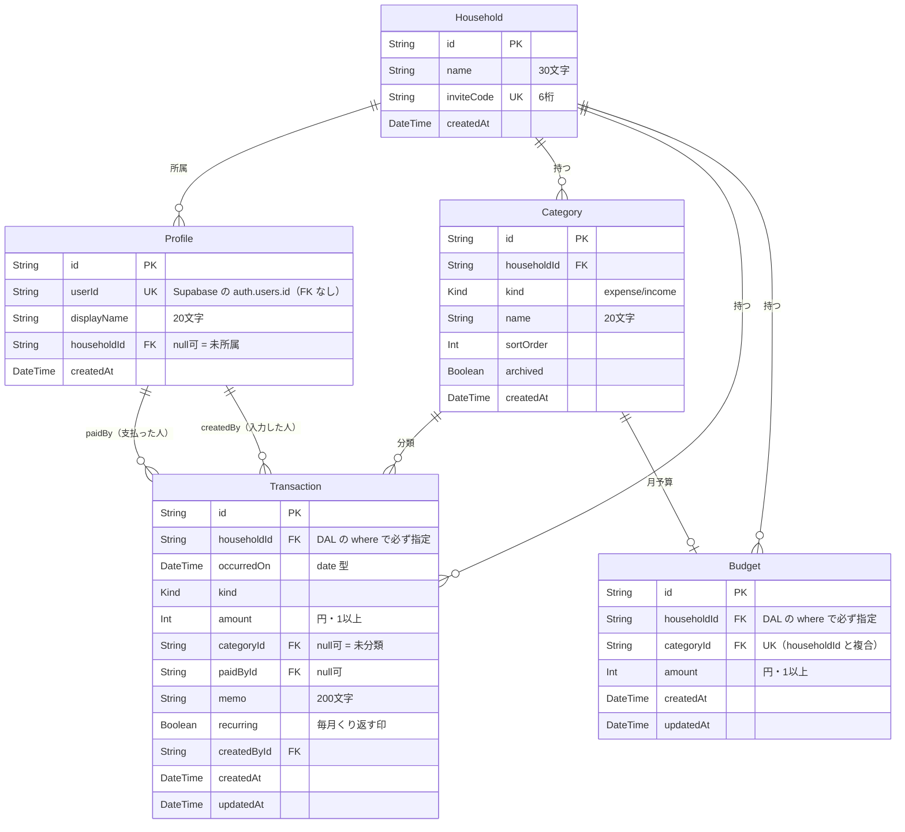

# データベース設計

最終更新: 2026-11-07

**目的: データ設計の不整合を防ぐ。** DB は Supabase の PostgreSQL。スキーマの正は **`prisma/schema.prisma`** で、この文書は**設計意図と制約**を説明する。

> **認可はこの層では行わない。** 2026-11-07 に [ADR-0005](../05-decisions/ADR-0005-authorization-in-app-layer.md) で RLS をやめ、認可をアプリ層（Data Access Layer）に移した。旧構成（RLS ポリシー 13 本 + `security definer` 関数）は [ADR-0002](../05-decisions/ADR-0002-authorization-via-rls.md) に記録として残っている。

---

## 1. 設計の方針

### 1.1 スキーマの正は `prisma/schema.prisma`

マイグレーションは Prisma Migrate が `prisma/migrations/` に生成する。SQL を手で書くのは、**Prisma schema で表現できないもの**に限る（§6）。

### 1.2 認可はアプリ層

DB は制約（NOT NULL・外部キー・一意・CHECK）でデータの*正しさ*を守るが、*誰が見られるか*は守らない。それは `src/lib/data/` の責務。

→ [セキュリティガイドライン](../03-guidelines/security-guidelines.md) / [ADR-0005](../05-decisions/ADR-0005-authorization-in-app-layer.md)

### 1.3 1 ユーザー = 1 世帯

所属は `Profile.householdId`（null 可）の単一列。中間テーブルは作らない（[ADR-0003](../05-decisions/ADR-0003-one-household-per-user.md)）。

### 1.4 金額は Int（円）

日本円に小数は不要。丸め誤差を構造的に起こさない（NFR-D1）。

### 1.5 「払った人」と「入力した人」を分ける

`paidBy` は家計上の意味を持つ情報（将来の精算機能の土台）。`createdBy` は誰が入力したかの記録で、UI には出さない。

### 1.6 日付は時刻を持たない

`occurredOn` は `@db.Date`。タイムゾーンの違いで前日・翌日に動くことを構造的に防ぐ（NFR-D2）。**読み出し時の扱いに注意が必要**（§5.2）。

### 1.7 `auth` スキーマは Prisma の管理外

`auth.users` は Supabase Auth の所有物。Prisma では触らない。`Profile.userId` が Supabase のユーザー ID を持つが、**外部キーは張らない**。

---

## 2. ER 図



`auth.users`（Supabase 所有）は図に含めない。`Profile.userId` が緩やかに対応するだけで、DB 上の関係はない。

---

## 3. モデル定義

テーブル名・列名は snake_case に `@map` する（DB を直接見たときに読みやすいため）。TypeScript 側は camelCase。

### 3.1 `Household` — 世帯

| フィールド | 型 | 制約 | 説明 |
| --- | --- | --- | --- |
| `id` | String | PK, `uuid(7)` | UUID v7（時系列順に並ぶ） |
| `name` | String | `VarChar(30)`, 空文字不可 | 既定「わが家」 |
| `inviteCode` | String | `VarChar(6)`, **unique**, `^[A-Z0-9]{6}$` | 家族の参加に使う |
| `createdAt` | DateTime | default now | |

### 3.2 `Profile` — メンバー

| フィールド | 型 | 制約 | 説明 |
| --- | --- | --- | --- |
| `id` | String | PK, `uuid(7)` | **Monely 側の ID**。Supabase のユーザー ID とは別 |
| `userId` | String | **unique**, Uuid | Supabase Auth のユーザー ID。**FK なし** |
| `displayName` | String | `VarChar(20)`, 空文字不可 | 一覧で「支払った人」として出る |
| `householdId` | String? | FK → Household, `onDelete: SetNull` | **null = 未所属**（セットアップ前） |
| `createdAt` | DateTime | default now | |

- **`id` と `userId` を分ける理由**: Supabase Auth を将来入れ替えても、`Transaction.paidById` などの参照を壊さずに済む境界を作る。
- プロフィールの作成は**初回ログイン時にアプリ側で行う**（旧構成の `handle_new_user` トリガーは廃止）。
- インデックス: `(householdId)`

### 3.3 `Category` — カテゴリ

| フィールド | 型 | 制約 | 説明 |
| --- | --- | --- | --- |
| `id` | String | PK | |
| `householdId` | String | FK → Household, `onDelete: Cascade` | |
| `kind` | Kind | enum | 支出用 / 収入用 |
| `name` | String | `VarChar(20)`, 空文字不可 | |
| `sortOrder` | Int | default 0 | 「その他」は 999 |
| `archived` | Boolean | default false | true = 新規登録の選択肢から外す |
| `createdAt` | DateTime | default now | |

- 一意制約: `(householdId, kind, name)`（BR-8）
- インデックス: `(householdId, kind, sortOrder)`

#### 初期カテゴリ

| 種別 | カテゴリ（`sortOrder` 順） |
| --- | --- |
| 支出 | 食費 / 日用品 / 住居 / 水道・光熱 / 通信 / 交通 / 医療・健康 / 教育 / 趣味・娯楽 / 衣服・美容 / 交際費 / 特別費 / その他 |
| 収入 | 給与 / 賞与 / 副収入 / 臨時収入 / その他 |

計 18 件。世帯の作成時に**アプリ側のトランザクションで**投入する（旧構成の `create_household()` RPC は廃止）。定義は `src/lib/data/household.ts` に置く。

### 3.4 `Transaction` — 記録

| フィールド | 型 | 制約 | 説明 |
| --- | --- | --- | --- |
| `id` | String | PK | |
| `householdId` | String | FK → Household, `onDelete: Cascade` | **認可の要。** DAL の `where` で必ず指定する |
| `occurredOn` | DateTime | `@db.Date` | いつの支出か。時刻を持たない |
| `kind` | Kind | enum | |
| `amount` | Int | **CHECK `> 0`** | 円。符号は持たず、向きは `kind` で表す |
| `categoryId` | String? | FK → Category, `onDelete: SetNull` | null = 未分類 |
| `paidById` | String? | FK → Profile, `onDelete: SetNull` | メンバーが抜けても記録は残る（NFR-D5） |
| `memo` | String? | `VarChar(200)` | |
| `recurring` | Boolean | default `false` | 毎月くり返す支出の印（FR-R1）。**写した記録にも付く**ので翌月も候補に出る |
| `createdById` | String | FK → Profile, `onDelete: Cascade` | DAL でセッションから埋める |
| `createdAt` | DateTime | default now | |
| `updatedAt` | DateTime | `@updatedAt` | Prisma が更新する |

- インデックス: `(householdId, occurredOn desc, createdAt desc)` — 月次一覧がそのまま乗る（NFR-P4）
- **部分インデックス**: `(householdId, occurredOn desc) WHERE recurring` — 定期の候補を引く用。`recurring = false` の大多数をインデックスに載せない（マイグレーション `0005_recurring`）
- **`amount` を符号付きにしない理由**: 集計で `kind` の指定を忘れたときに、静かに間違った値が出るのを避ける。

### 3.4.1 `Budget` — カテゴリごとの月予算

→ [ADR-0011](../05-decisions/ADR-0011-tier1-and-recurring.md) / FR-B1〜B3（マイグレーション `0004_budgets`）

| フィールド | 型 | 制約 | 説明 |
| --- | --- | --- | --- |
| `id` | String | PK | |
| `householdId` | String | FK → Household, `onDelete: Cascade` | **認可の要。** DAL の `where` で必ず指定する |
| `categoryId` | String | FK → Category, `onDelete: Cascade` | **カテゴリを消したら予算も消える**（残しても意味が無い） |
| `amount` | Int | **CHECK `> 0` かつ `<= 9999999`** | 円。**0 は持たない**（予算なしは行を消す） |
| `createdAt` | DateTime | default now | |
| `updatedAt` | DateTime | `@updatedAt` | |

- 一意制約: `(householdId, categoryId)` — 1 カテゴリに 1 件。**世帯も入れる**ことで他世帯のカテゴリと衝突しない
- **月ごとの予算は持たない。** 毎月同じ額が適用される。月ごとに変えたくなったら `(householdId, categoryId, month)` に広げる
- **収入のカテゴリにも設定はできる**（DB は区別しない）が、画面は支出だけを出す

### 3.5 `Kind` — enum

```prisma
enum Kind {
  expense
  income

  @@map("kind")
}
```

DB 側の enum 型になるため、不正な値は DB が拒否する（旧構成の CHECK 制約の代わり）。TypeScript 側は `Kind.expense` または `"expense"` の文字列リテラルとして使える。

> [コーディング規約](../03-guidelines/coding-standards.md) の「`enum` を使わない」は **TypeScript の `enum`** についての規則。Prisma の enum は DB 制約を生むため使う。

---

## 4. 制約が守ること / 守らないこと

| DB が守る | DB が守らない（アプリの責務） |
| --- | --- |
| 金額が 1 以上（CHECK） | **誰がその行を見られるか** |
| `kind` が `expense` / `income` のどちらか（enum） | `categoryId` が同じ世帯のものか |
| カテゴリ名が世帯 × 種別で一意 | `paidById` が同じ世帯のメンバーか |
| 招待コードが全体で一意・6 桁英数字 | `createdById` がログイン中の本人か |
| 参照先の行が存在する（外部キー） | 金額の上限（9,999,999） |
| 文字列の最大長・空文字でないこと | 日付が妥当か |

**右の列が [ADR-0005](../05-decisions/ADR-0005-authorization-in-app-layer.md) で引き受けた責任。** DAL とアクションで必ず検証する。

---

## 4.1 ロールとテーブル権限

Supabase の DB には 4 つのロールがある。このアプリが使うのは **`postgres` だけ**。

| ロール | 誰が使うか | public スキーマへの権限 |
| --- | --- | --- |
| `postgres` | **Prisma（このアプリ）** | 全権（テーブルの所有者） |
| `service_role` | 使わない（Secret key のロール） | 全権 |
| `authenticated` | PostgREST（ログイン済み） | **なし**（剥奪済み） |
| `anon` | PostgREST（未ログイン） | **なし**（剥奪済み） |

### なぜ剥奪が必要か

Supabase は DB の上に PostgREST（`/rest/v1/...`）を自動で立てる。これは `anon` / `authenticated` で動き、**ブラウザに埋め込まれる Publishable key だけで叩ける**。

RLS を使わない構成では行を絞る仕組みが無いため、**既定のままだと全テーブルが公開される**（2026-11-07 に実測で確認）。`prisma/migrations/0002_revoke_postgrest_access` で権限を剥奪した。

詳細と確認方法 → [セキュリティガイドライン §2.2](../03-guidelines/security-guidelines.md#22-postgrest-を-public-スキーマから締め出す必須)

### 将来のテーブルも守られる

Supabase の既定権限（新規テーブルに `anon` へ `ALL` を付与）を、`postgres` ロール向けに打ち消してある。

**2026-11-09 に本番で実測した。** `0004_budgets` でテーブルを 1 つ追加した直後、`anon` / `authenticated` の `public` スキーマへのテーブル権限は **0 件**のままで、`budgets` の権限保持者は `postgres` と `service_role` だけだった。

> ローカルの捨て DB には `anon` / `authenticated` ロールが無いため、この確認は**本番でしかできない**。スキーマを変えたら [テスト戦略 §4.2](../03-guidelines/testing-strategy.md#42-認可の確認毎回実施) に従って毎回見る。

---

## 5. 主要なクエリ

認可は**関数の中**で行う。世帯 ID を引数で受け取らない（ADR-0005 の約束 B）。

### 5.1 月次一覧

```ts
// src/lib/data/transactions.ts
export async function listTransactionsByMonth(month: string) {
  const me = await requireMember();
  const { start, nextStart } = monthRange(month);

  return prisma.transaction.findMany({
    where: {
      householdId: me.householdId, // ← 認可。絶対に外さない
      occurredOn: { gte: start, lt: nextStart },
    },
    orderBy: [{ occurredOn: "desc" }, { createdAt: "desc" }],
    include: {
      category: { select: { name: true } },
      paidBy: { select: { displayName: true } },
    },
  });
}
```

`paidBy` / `createdBy` がリレーション名で区別されるため、旧構成で必要だった「どの外部キーを辿るか」の明示（`profiles!transactions_paid_by_fkey`）は不要になった。

### 5.2 `@db.Date` の読み出しに注意

`occurredOn` は Postgres の `date` 型だが、Prisma は **JavaScript の `Date`（UTC 0 時）** として返す。

```ts
// DB: 2026-11-07  →  JS: 2026-11-07T00:00:00.000Z
```

**ローカルタイムで整形すると日付がずれうる。** JST（UTC+9）なら同じ日付になるが、負のオフセットの環境では前日になる。整形は必ず UTC で行い、`src/lib/month.ts` に閉じ込める。

```ts
// ✗ 環境によって前日になる
date.toLocaleDateString("ja-JP");

// ✓ UTC で取り出す
`${date.getUTCMonth() + 1}月${date.getUTCDate()}日`;
```

書き込み時も同様に、`new Date("2026-11-07")`（UTC 0 時として解釈される）を使い、`new Date(2026, 10, 7)`（ローカル 0 時）を使わない。

### 5.3 月次合計

一覧で取得した行からアプリ側で集計する。1 か月の件数はせいぜい数百件なので、集計用のクエリを別に投げない。

### 5.4 カテゴリの選択肢

```ts
prisma.category.findMany({
  where: { householdId: me.householdId, kind, archived: false },
  orderBy: { sortOrder: "asc" },
});
```

使用頻度順（FR-C7）は M4 で対応する。

---

## 6. マイグレーション運用

```
prisma/
  schema.prisma              ← スキーマの正
  migrations/
    0001_init/
      migration.sql
prisma.config.ts             ← CLI の設定（.env.local を読む）
```

### 6.1 コマンド

| 目的 | コマンド |
| --- | --- |
| スキーマを変えた → マイグレーションを作る | `pnpm db:migrate` |
| 本番（Supabase）に適用する | `pnpm db:deploy` |
| 適用状況を確認する | `pnpm db:status` |
| Client を再生成する | `pnpm db:generate` |
| データを覗く | `pnpm db:studio` |

適用済みのマイグレーションは Supabase 側の `_prisma_migrations` テーブルが記録するので、手でメモする必要はない。

### 6.2 Prisma schema で表現できないもの

**CHECK 制約は Prisma schema に書けない。** マイグレーションの SQL に手書きで追記する。

`prisma/migrations/0001_init/migration.sql` の末尾に以下を入れている。

| 制約 | 内容 |
| --- | --- |
| `transactions_amount_positive` | `amount > 0`（BR-2 / NFR-D1） |
| `households_invite_code_format` | `invite_code ~ '^[A-Z0-9]{6}$'`（BR-9） |
| `households_name_not_blank` | `btrim(name) <> ''` |
| `profiles_display_name_not_blank` | `btrim(display_name) <> ''` |
| `categories_name_not_blank` | `btrim(name) <> ''` |

**NOT NULL だけでは空文字を防げない**ため、空でないことを明示している。

スキーマを変更して新しいマイグレーションを作ったとき、Prisma はこれらの CHECK 制約を認識しない（schema に書けないため）。**テーブルを作り直す変更をする場合は、CHECK 制約を再度追記すること。**

### 6.3 初期マイグレーションの作り方（参考）

`prisma migrate dev` はシャドーデータベースを要求し、Supabase では権限不足になることがある。初期マイグレーションは接続なしで生成した。

```bash
pnpm prisma migrate diff --from-empty --to-schema prisma/schema.prisma --script \
  > prisma/migrations/0001_init/migration.sql
# → CHECK 制約を手で追記 → pnpm db:deploy
```

---

## 7. 接続

Supabase のプーラーを **2 本使い分ける**（Prisma + Supabase の定番構成）。

| 用途 | 環境変数 | プーラー | ポート |
| --- | --- | --- | --- |
| アプリの通常のクエリ | `DATABASE_URL` | Transaction pooler（`pgbouncer=true`） | 6543 |
| マイグレーション（CLI） | `DIRECT_URL` | Session pooler | 5432 |

どちらもプーラー経由なので **IPv4 で繋がる**（無料プランの直接接続 `db.<ref>.supabase.co` は IPv6 のみ）。

### 7.1 マイグレーションを Transaction pooler に向けてはいけない

**`prisma migrate` を 6543 に向けると応答が返らずハングする**（2026-11-07 に実測。4 分待っても戻らなかった）。マイグレーションは DDL とアドバイザリロックを使うため、トランザクション単位で接続を切り替えるモードでは成立しない。

そのため **`prisma.config.ts` の `datasource.url` には `DIRECT_URL` を入れる**。この設定ファイルは CLI 専用で、アプリの実行時には読まれない。

```ts
// prisma.config.ts — CLI 専用
datasource: { url: env("DIRECT_URL") }   // Session pooler, 5432
```

```ts
// src/lib/data/db.ts — アプリ実行時
new PrismaPg({ connectionString: requiredEnv("DATABASE_URL") })   // 6543
```

### 7.2 アプリ側は Transaction pooler で問題なく動く

Prisma 7 は driver adapter（`@prisma/adapter-pg` + `pg`）経由で接続する。`pgbouncer=true` は Prisma 自身のエンジン向けのフラグで、アダプタ経由では解釈されないが、**実測で以下はすべて動作した**（2026-11-07）。

- 単純なクエリ（`count` / `findMany`）
- `include` によるリレーションの取得
- **`$transaction` によるインタラクティブトランザクション**（複数の `create` を 1 つのトランザクションで実行）
- CHECK 制約による拒否

`pg` は名前付き prepared statement を既定で使わないため、トランザクションモードのプーラーと衝突しない。

### 7.3 接続プール

`PrismaClient` は `src/lib/data/db.ts` でグローバルに 1 つだけ保つ（開発中の HMR で接続が増え続けないようにするため）。

### 7.4 環境変数

| 変数 | 用途 | 公開 |
| --- | --- | --- |
| `DATABASE_URL` | アプリのクエリ（6543） | **非公開。DB の全権を持つ** |
| `DIRECT_URL` | マイグレーション（5432） | **非公開。DB の全権を持つ** |
| `BETTER_AUTH_SECRET` | セッションの署名鍵 | **非公開** |
| `BETTER_AUTH_URL` | アプリの URL | 公開してよい |
| `RESEND_API_KEY` / `MAIL_FROM` | メール送信 | 非公開 / 公開してよい |

> **`DATABASE_URL` / `DIRECT_URL` は Publishable key と同列に扱ってはいけない。** RLS を使わないため、この接続文字列はテーブルの全権（読み書き・削除・TRUNCATE）を持つ。`.env.local` 限定、コミット禁止、`NEXT_PUBLIC_` を付けない。

### 7.5 Prisma CLI はパスワードをプロセス引数に渡す

`prisma migrate` 系のコマンドを実行すると、スキーマエンジンのプロセス引数に**接続文字列が平文で載る**。

```
$ ps -eo command | grep schema-engine
schema-engine-darwin-arm64 --datasource {"url":"postgresql://postgres.xxx:<パスワード>@..."}
```

同じマシンの他のプロセスから `ps` で見える。1 人用の開発機では実害は小さいが、**画面共有・スクリーンショット・ログの貼り付けで漏れやすい**ことを意識する。Prisma の実装に由来するため、こちら側では回避できない。

## 8. 想定データ量

| モデル | 想定行数（5 年後） | 根拠 |
| --- | --- | --- |
| `Household` | 1 | 自分の世帯のみ |
| `Profile` | 2〜4 | 家族の人数 |
| `Category` | 20〜40 | 初期 18 件 + 追加 |
| `Transaction` | 約 15,000 | 年 3,000 件 × 5 年 |

インデックス 1 本で十分な規模。

---

## 9. Supabase ダッシュボードの RLS 警告について

Supabase は「RLS が無効なテーブルがあります」という警告を出し続ける。**これは意図した状態**（[ADR-0005](../05-decisions/ADR-0005-authorization-in-app-layer.md)）。

警告を消すために RLS を有効にすると、Prisma は所有者ロールで接続するため**ポリシーは効かないまま**警告だけ消える。つまり「守られているつもり」の状態を作るので、やらない。
