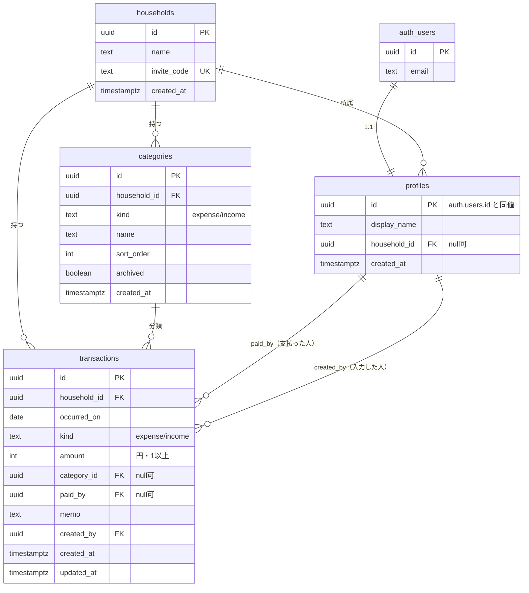

# データベース設計

最終更新: 2026-11-07

**目的: データ設計の不整合を防ぐ。** DB は Supabase（PostgreSQL）。実際の DDL は `supabase/migrations/0001_init.sql` が正で、この文書は**設計意図と制約**を説明する。

---

## 1. 設計の方針

### 1.1 1 ユーザー = 1 世帯

所属は `profiles.household_id` で表す。`household_members` のような中間テーブルは作らない。

- **利点**: 「今のユーザーの世帯 ID」が 1 回の単純な SELECT で取れる。RLS のポリシーが全テーブルで `household_id = current_household_id()` の 1 行で済む。
- **代償**: 1 人が複数の世帯（例: 自分の家と実家）を切り替えられない。
- **判断**: v1 の用途では複数所属が不要。必要になった時点で中間テーブルを足し、`current_household_id()` を「選択中の世帯」を返す実装に差し替えれば、ポリシー本体は変えずに移行できる。
- 判断の経緯と移行手順 → [ADR-0003 1 ユーザー = 1 世帯のデータモデル](../05-decisions/ADR-0003-one-household-per-user.md)

### 1.2 金額は integer（円）

日本円に小数は不要。`numeric` や浮動小数点を避けることで、合計の丸め誤差を構造的に起こさなくする（NFR-D1）。

### 1.3 「払った人」と「入力した人」を分ける

`paid_by` は家計上の意味を持つ情報（将来の精算機能の土台）。`created_by` は誰が入力したかの記録で、UI には出さない。混ぜると「代わりに入力してあげた」ケースで意味が壊れる。

### 1.4 権限はすべて DB 側（RLS）に置く

アプリのクエリに `where household_id = ...` を書き忘れても他世帯のデータが漏れないことを、DB の保証として持つ。アプリ側の条件は「取得量を絞るため」であって、セキュリティのためではない（NFR-S1）。

判断の経緯 → [ADR-0002 認可を PostgreSQL の RLS に置く](../05-decisions/ADR-0002-authorization-via-rls.md)

### 1.5 日付は時刻を持たない

`occurred_on` は `date` 型。タイムゾーンの違いで前日・翌日に動くことを構造的に防ぐ（NFR-D2）。

---

## 2. ER 図



`auth_users` は Supabase が管理する `auth.users`。アプリから直接は触らない。

---

## 3. テーブル定義

### 3.1 `households` — 世帯

家計簿を共有する単位。

| 列 | 型 | 制約 | 説明 |
| --- | --- | --- | --- |
| `id` | uuid | PK, default `gen_random_uuid()` | |
| `name` | text | not null | 世帯名。既定「わが家」。1〜30 文字（アプリ側で検証） |
| `invite_code` | text | not null, **unique** | 6 桁の英数字（大文字）。家族の参加に使う |
| `created_at` | timestamptz | not null, default `now()` | |

- 招待コードは `create_household()` の中で生成し、衝突したら再生成する。
- v1 ではコードの再発行機能を作らない（必要になったら追加）。

### 3.2 `profiles` — メンバー

`auth.users` と 1:1。`auth.users` はアプリから直接触れないため、表示名などはここに持つ。

| 列 | 型 | 制約 | 説明 |
| --- | --- | --- | --- |
| `id` | uuid | PK, FK → `auth.users.id` on delete cascade | ユーザー ID と同一の値 |
| `display_name` | text | not null | 一覧で「支払った人」として出る名前。1〜20 文字 |
| `household_id` | uuid | FK → `households.id` on delete set null, **null 可** | null = まだ世帯に未所属（セットアップ前） |
| `created_at` | timestamptz | not null, default `now()` | |

- **`household_id` が null を取れることが重要。** サインアップ直後はこの状態で、アプリは `/setup` へ誘導する（FR-X1）。
- サインアップ時に `auth.users` の INSERT トリガー（`handle_new_user()`）で自動作成する。`display_name` の初期値はメールアドレスの `@` より前。
- インデックス: `(household_id)`

### 3.3 `categories` — カテゴリ

| 列 | 型 | 制約 | 説明 |
| --- | --- | --- | --- |
| `id` | uuid | PK | |
| `household_id` | uuid | not null, FK → `households.id` on delete cascade | |
| `kind` | text | not null, check `in ('expense','income')` | 支出用 / 収入用 |
| `name` | text | not null | 1〜20 文字 |
| `sort_order` | int | not null, default 0 | 表示順。「その他」は 999 |
| `archived` | boolean | not null, default false | true = 新規登録の選択肢から外す。既存の記録には残る |
| `created_at` | timestamptz | not null, default `now()` | |

- 一意制約: `(household_id, kind, name)` — 同じ世帯に同名カテゴリを作らせない（BR-8）。
- インデックス: `(household_id, kind, sort_order)`
- 初期カテゴリは `create_household()` が投入する。

#### 初期カテゴリ

| 種別 | カテゴリ（`sort_order` 順） |
| --- | --- |
| 支出 | 食費 / 日用品 / 住居 / 水道・光熱 / 通信 / 交通 / 医療・健康 / 教育 / 趣味・娯楽 / 衣服・美容 / 交際費 / 特別費 / その他 |
| 収入 | 給与 / 賞与 / 副収入 / 臨時収入 / その他 |

「その他」は `sort_order = 999` で末尾に固定。

### 3.4 `transactions` — 記録

| 列 | 型 | 制約 | 説明 |
| --- | --- | --- | --- |
| `id` | uuid | PK | |
| `household_id` | uuid | not null, FK → `households.id` on delete cascade | RLS の判定に使う。非正規化だが、全クエリで JOIN を省けるので意図的に持つ |
| `occurred_on` | date | not null | いつの支出か。**時刻を持たない** |
| `kind` | text | not null, check `in ('expense','income')` | |
| `amount` | int | not null, check `amount > 0` | 円。符号は持たず、向きは `kind` で表す |
| `category_id` | uuid | FK → `categories.id` on delete set null, null 可 | null = 未分類 |
| `paid_by` | uuid | FK → `profiles.id` on delete set null, null 可 | 支払った人。メンバーが抜けても記録は残す（NFR-D5） |
| `memo` | text | null 可 | 200 文字以内（アプリ側で検証） |
| `created_by` | uuid | not null, FK → `profiles.id` on delete cascade | 入力した人 |
| `created_at` | timestamptz | not null, default `now()` | |
| `updated_at` | timestamptz | not null, default `now()` | `before update` トリガーで更新 |

- インデックス: `(household_id, occurred_on desc, created_at desc)` — 月次一覧のクエリがそのまま乗る（NFR-P4）。
- **`amount` を符号付きにしない理由**: 合計の計算で `kind` の指定を忘れたときに、静かに間違った値が出るのを避ける。集計は `kind` で分けて `sum()` する。

---

## 4. 関数とトリガー

| 名前 | 種類 | 役割 |
| --- | --- | --- |
| `current_household_id()` | `security definer`, stable | ログイン中のユーザーの世帯 ID を返す。RLS から呼ぶ |
| `handle_new_user()` | トリガー関数 | `auth.users` の INSERT 時に `profiles` を自動作成 |
| `touch_updated_at()` | トリガー関数 | `transactions` の `updated_at` を更新 |
| `create_household(p_name, p_display_name)` | `security definer` RPC | 世帯の作成 + 初期カテゴリ投入 + 自分の所属更新 |
| `join_household(p_invite_code, p_display_name)` | `security definer` RPC | 招待コードで世帯に参加 |

### 4.1 `current_household_id()`

```sql
-- 現在のユーザーの世帯 ID を返す。
-- security definer にすることで、この関数の内部クエリに
-- profiles のポリシーが適用されない（＝無限再帰しない）。
create or replace function public.current_household_id()
returns uuid
language sql
stable
security definer
set search_path = public
as $$
  select household_id from public.profiles where id = auth.uid();
$$;
```

**なぜ `security definer` が必要か**: `profiles` の SELECT ポリシーに「同じ世帯のメンバーは読める」と書くと、条件の中で `profiles` を参照することになる。ポリシーがポリシーを呼んで無限再帰する典型的な失敗。`security definer` 関数の中からの参照は RLS をバイパスするため、これを断ち切れる。

**引数を取らない設計にする。** 世帯 ID を引数で受け取る形にすると、呼び出し側が他人の世帯 ID を渡せてしまう。見るのは `auth.uid()` だけ。

`set search_path = public` を必ず付ける（`search_path` を差し替えられる攻撃を防ぐ）。

### 4.2 RPC に寄せる理由

世帯を作る操作は「世帯の作成 + 自分の所属更新 + 初期カテゴリの投入」の 3 つを伴う。RLS では表現できず、クライアントから 3 回に分けて実行させると途中で失敗したときに中途半端な状態が残る。`security definer` 関数に閉じ込めて 1 回の呼び出しで完結させる。

| 関数 | 引数 | やること | エラー条件 |
| --- | --- | --- | --- |
| `create_household` | 世帯名、表示名 | 招待コードを生成（衝突したら再生成）→ 世帯を作成 → 初期カテゴリを投入 → `profiles.household_id` と `display_name` を更新 | 未認証 / **既に世帯に所属している** |
| `join_household` | 招待コード、表示名 | コードから世帯を引き、`profiles.household_id` と `display_name` を更新 | 未認証 / コードが存在しない |

どちらも先頭で `auth.uid()` が null でないことを確認する。`authenticated` ロールにのみ `execute` を許可し、`public` からは `revoke` する。

---

## 5. RLS（行レベルセキュリティ）

4 テーブルすべてで RLS を有効にする。

### 5.1 ポリシー一覧

| テーブル | SELECT | INSERT | UPDATE | DELETE |
| --- | --- | --- | --- | --- |
| `households` | `id = current_household_id()` | なし（RPC 経由） | `id = current_household_id()` | なし |
| `profiles` | `id = auth.uid()` **または** 同じ世帯 | `id = auth.uid()` | `id = auth.uid()` | なし |
| `categories` | 同じ世帯 | 同じ世帯 | 同じ世帯 | 同じ世帯 |
| `transactions` | 同じ世帯 | 同じ世帯 **かつ** `created_by = auth.uid()` | 同じ世帯 | 同じ世帯 |

「同じ世帯」= `household_id = public.current_household_id()`

- `profiles` の UPDATE は**自分の行だけ**。家族の表示名を勝手に変えられないようにする（BR-4）。
- `transactions` の INSERT で `created_by = auth.uid()` を要求する。入力者を偽れないようにする（BR-6）。
- `households` の INSERT / DELETE ポリシーを作らない。作成は RPC、削除は v1 で提供しない。

### 5.2 書き方

```sql
create policy transactions_select on public.transactions
  for select to authenticated
  using (household_id = public.current_household_id());

create policy transactions_insert on public.transactions
  for insert to authenticated
  with check (
    household_id = public.current_household_id()
    and created_by = auth.uid()   -- 入力者を偽れないようにする
  );
```

- `to authenticated` を必ず付ける（`anon` に開かない）。
- `using` は「読める・対象にできる行」、`with check` は「書き込める値」。UPDATE には両方書く。

### 5.3 テーブルや列を足すときの手順

1. テーブルを作ったら**その場で** `alter table ... enable row level security` を書く。
2. 4 操作分のポリシーを漏れなく書く（提供しない操作はポリシーを作らない = 全拒否）。
3. [AC-9](../01-requirements/functional-requirements.md#ac-9-他世帯のデータが見えないfr-x2-br-12最重要) を再実行する。

RLS を有効にしてポリシーを書かないテーブルは「誰も読めない」状態になる。これは安全側の失敗なので、迷ったらポリシーを書かない。

### 5.4 検証（必ず手で試す）

RLS は「書けたつもり」が最も危ない。M2 の完了条件として以下を実際に確認する。

1. アカウント A で世帯を作り、記録を 1 件入れる。
2. **別のメールアドレスでアカウント B を作り、世帯 B を作る**（A の招待コードは使わない）。
3. B でログインした状態で一覧を開く → **A の記録が 1 件も見えないこと**。
4. B のセッションで A の記録の ID を直接指定して取得・更新・削除を試みる → **いずれも失敗すること**。

手順の詳細 → [テスト戦略](../03-guidelines/testing-strategy.md)

---

## 6. 主要なクエリ

### 6.1 月次一覧

```sql
select t.id, t.occurred_on, t.kind, t.amount, t.memo,
       c.name as category_name,
       p.display_name as paid_by_name
from transactions t
left join categories c on c.id = t.category_id
left join profiles  p on p.id = t.paid_by
where t.occurred_on >= :month_start
  and t.occurred_on <  :next_month_start
order by t.occurred_on desc, t.created_at desc;
```

`household_id` の条件は書かない（RLS が付ける）。インデックス `(household_id, occurred_on desc, created_at desc)` にそのまま乗る。

Supabase クライアントからは 1 回のリクエストで関連を取る。**`transactions` から `profiles` への外部キーが 2 本（`paid_by` / `created_by`）あるため、どちらを辿るか明示する必要がある**（省略すると曖昧さでエラーになる）。

```ts
supabase
  .from("transactions")
  .select(
    "id, occurred_on, kind, amount, memo, category_id, " +
    "categories(name), " +
    "paid_by_profile:profiles!transactions_paid_by_fkey(display_name)"
  )
  .gte("occurred_on", monthStart)
  .lt("occurred_on", nextMonthStart)
  .order("occurred_on", { ascending: false })
  .order("created_at", { ascending: false });
```

### 6.2 月次合計

一覧で取得した行からアプリ側で集計する。1 か月の件数はせいぜい数百件なので、集計用のクエリを別に投げない。件数が増えて重くなったら DB 側の集計（ビューまたは RPC）に切り替える。

### 6.3 カテゴリの選択肢

```ts
supabase
  .from("categories")
  .select("id, name, kind, sort_order")
  .eq("kind", kind)
  .eq("archived", false)
  .order("sort_order");
```

使用頻度順（FR-C7）は M4 で対応する。直近 30 日の `transactions` を集計して並べ替える。

---

## 7. マイグレーション運用

```
supabase/
  migrations/
    0001_init.sql     ← テーブル、関数、トリガー、RLS
```

- **v1 の運用**: ファイルの中身を Supabase ダッシュボードの SQL Editor に貼って実行する。Supabase CLI（Docker が必要）は入れない。
- **冪等に書く**（`create table if not exists`、`create or replace function`、`drop policy if exists` → `create policy`）。何度貼り直しても壊れないようにする。
- 列の追加・変更は `0002_*.sql` 以降を追加する。**既存ファイルは編集しない。**
- ファイル名は連番 + 内容（例: `0002_add_budgets.sql`）。
- 適用したら、どのファイルまで適用済みかを [タスクリスト](../04-development/task-list.md) に記録する（適用状況を DB 側で管理しないため）。

---

## 8. 想定データ量

| テーブル | 想定行数（5 年後） | 根拠 |
| --- | --- | --- |
| `households` | 1 | 自分の世帯のみ |
| `profiles` | 2〜4 | 家族の人数 |
| `categories` | 20〜40 | 初期 18 件 + 追加 |
| `transactions` | 約 15,000 | 年 3,000 件（1 日 8 件程度）× 5 年 |

インデックス 1 本で十分な規模。パーティショニングや集計テーブルは不要。

---

## 9. 環境変数

| 変数 | 用途 | 公開 |
| --- | --- | --- |
| `NEXT_PUBLIC_SUPABASE_URL` | Supabase プロジェクトの URL | ブラウザに出る |
| `NEXT_PUBLIC_SUPABASE_ANON_KEY` | 公開可能キー（anon / publishable） | ブラウザに出る |

**`service_role` キーは使わない。** 使うと RLS をバイパスできてしまい、この設計の前提が崩れる（NFR-S3）。
