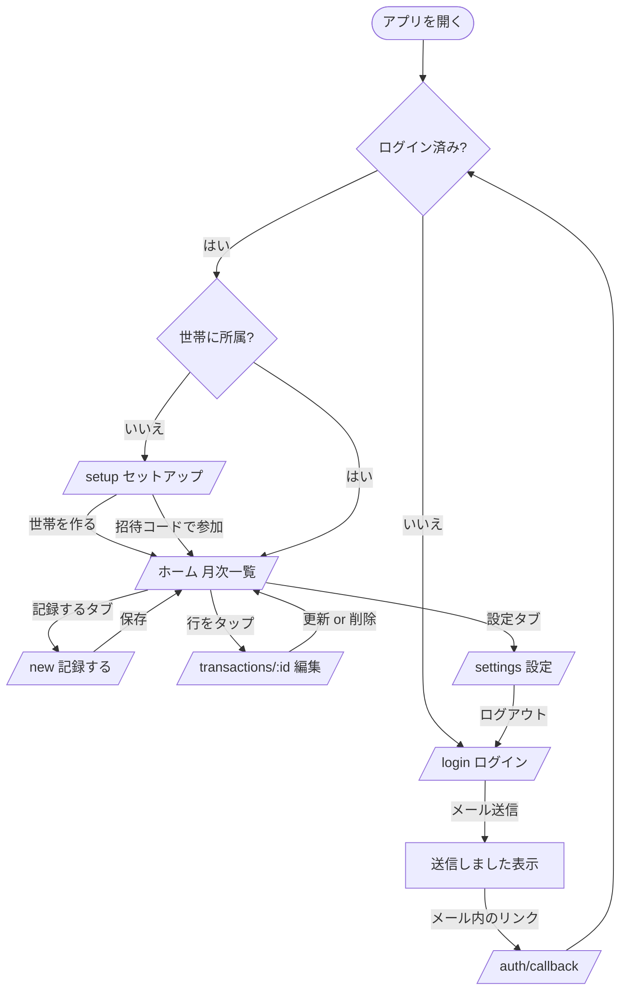

# UI / UX 設計

最終更新: 2026-11-07

**目的: UI/UX の一貫性を維持する。** スマホ縦画面（幅 375px）を基準に設計し、PC では同じレイアウトを中央寄せ（最大幅 480px）で表示する。

---

## 1. UI 原則

意思決定の基準。上が優先。

1. **入力の速さを損なわない。** 項目を増やす前に「既定値で省略できるか」を確認する。既定値で済むものは折りたたむ。
2. **指の届く範囲に主要操作を置く。** 画面下部が一等地。上部はタイトルと情報表示に使う。
3. **初見で分かる言葉を使う。** 「世帯」ではなく「わが家」。専門用語を UI に出さない（→ [用語集](../00-overview/glossary.md)）。
4. **色だけで意味を伝えない。** 収入は色 + `+` 記号の両方で示す（NFR-U15）。
5. **操作の結果を必ず見せる。** 保存中はボタンを無効化し、完了したら画面を変える。
6. **失敗しても入力を失わせない。** エラー時もフォームの値を残す（NFR-U10）。
7. **画面を増やさない。** v1 は 7 画面。足す前に既存画面に収まらないか考える。

---

## 2. 画面一覧

| ルート | 画面名 | 認証 | 世帯 | 役割 |
| --- | --- | --- | --- | --- |
| `/login` | ログイン | 不要 | — | メールアドレスを入力してログインリンクを送る |
| `/auth/callback` | 認証コールバック | 不要 | — | 画面なし。リンクのコードをセッションに交換して振り分ける |
| `/setup` | 初回セットアップ | 必要 | 未所属 | 世帯を作る / 招待コードで参加する |
| `/` | ホーム（月次一覧） | 必要 | 所属済 | 当月の合計と記録の一覧。**アプリの中心** |
| `/new` | 記録する | 必要 | 所属済 | 新規登録。金額から入力する |
| `/transactions/[id]` | 記録の詳細・編集 | 必要 | 所属済 | 編集と削除 |
| `/settings` | 設定 | 必要 | 所属済 | 世帯名、招待コード、メンバー、表示名、カテゴリ、ログアウト |

下部タブ（ホーム / 記録する / 設定）は `/`、`/new`、`/settings` に表示する。`/login`、`/setup`、`/transactions/[id]` には表示しない。

---

## 3. 画面遷移



**振り分けの実装方針**: 判定はサーバー側で行い、条件に合わなければ `redirect()` する。`src/app/(app)/layout.tsx` で「未ログイン → `/login`」「世帯なし → `/setup`」をまとめて処理する（FR-A4, FR-X1）。クライアント側の判定は使わない。

---

## 4. ワイヤーフレーム

### 4.1 `/` ホーム（月次一覧）— 最も見る画面

```
┌─────────────────────────────┐
│  ‹      2026年11月      ›   │  ← 月の移動。タップで前月/翌月
├─────────────────────────────┤
│                             │
│   支出        ¥ 182,400     │  ← 当月の合計（大きく）
│   収入        ¥ 320,000     │
│   ─────────────────────     │
│   差額      + ¥ 137,600     │  ← プラスは緑、マイナスは赤
│                             │
├─────────────────────────────┤
│ 11月7日 (金)        ¥ 4,180 │  ← 日付見出し + その日の支出計
│ ┌─────────────────────────┐ │
│ │ 食費            ¥ 1,280 │ │
│ │ スーパー・たっつ         │ │  ← メモ・支払った人
│ ├─────────────────────────┤ │
│ │ 交通            ¥ 2,900 │ │
│ ├─────────────────────────┤ │
│ │ 日用品           ¥  180 │ │
│ └─────────────────────────┘ │
│ 11月6日 (木)       ¥ 12,000 │
│ ┌─────────────────────────┐ │
│ │ 給与          + ¥320,000│ │  ← 収入は + と色で区別
│ ├─────────────────────────┤ │
│ │ 食費            ¥ 3,200 │ │
│ └─────────────────────────┘ │
│            ⋮                │
├─────────────────────────────┤
│   ホーム  │ 記録する │ 設定  │  ← 下部タブ
└─────────────────────────────┘
```

**空のとき（FR-L6）**:

```
┌─────────────────────────────┐
│  ‹      2026年11月      ›   │
├─────────────────────────────┤
│   支出 ¥0  収入 ¥0  差額 ¥0 │  ← 合計は 0 として表示する
├─────────────────────────────┤
│                             │
│      まだ記録がありません     │
│                             │
│    ┌───────────────────┐    │
│    │   記録する        │    │  ← 中央に導線
│    └───────────────────┘    │
│                             │
├─────────────────────────────┤
│   ホーム  │ 記録する │ 設定  │
└─────────────────────────────┘
```

### 4.2 `/new` 記録する — 最もよく使う操作

**設計の核**: 画面を開いた瞬間に金額を打てる。カテゴリを選べば保存できる。他の項目は既定値のままで良い。

```
┌─────────────────────────────┐
│  ✕                          │  ← 閉じる（ホームに戻る）
│  ┌─────────┬─────────┐      │
│  │  支出   │  収入   │      │  ← 種別。既定は「支出」
│  └─────────┴─────────┘      │
│                             │
│         ¥ 1,280             │  ← 大きく表示。フォーカス済み
│       ───────────           │     3桁区切りで即反映
│                             │
│  カテゴリ                    │
│  ┌──────┬──────┬──────┐     │
│  │ 食費 │日用品│ 交通 │     │  ← よく使う順。1タップで選択
│  ├──────┼──────┼──────┤     │
│  │ 通信 │ 住居 │ ...  │     │
│  └──────┴──────┴──────┘     │
│                             │
│  日付      2026/11/07 (今日) │  ← タップで変更。既定は今日
│  支払った人  たっつ          │  ← タップで変更。既定は自分
│  メモ      （任意）          │
│                             │
│    ┌───────────────────┐    │
│    │      保存する      │    │  ← 画面下部（親指が届く位置）
│    └───────────────────┘    │
└─────────────────────────────┘
```

- 金額が空・0 のときは「保存する」を押せない。
- 保存したらホームに戻り、追加した行が一覧に出る。
- 「日付」「支払った人」「メモ」は折りたたんだ 1 行表示。**既定値で済むなら触らせない。**
- 種別を切り替えると、カテゴリの選択肢が入れ替わる（FR-C1）。選択済みのカテゴリはクリアする。

### 4.3 `/transactions/[id]` 編集

`/new` とほぼ同じ構成。違いは 3 点。

- 既存の値が入っている。
- 「保存する」が「更新する」になる。
- 画面下部に「この記録を削除」（赤文字）。押すと確認を出してから削除する（FR-T8）。

存在しない ID や他世帯の記録を開いた場合は「見つかりませんでした」とホームへの導線を出す（AC-9）。

### 4.4 `/login` ログイン

```
┌─────────────────────────────┐
│                             │
│          Monely             │
│      わが家の家計簿          │
│                             │
│  メールアドレス              │
│  ┌─────────────────────┐    │
│  │                     │    │  ← type=email, autoComplete="email"
│  └─────────────────────┘    │
│                             │
│  ┌─────────────────────┐    │
│  │  ログインリンクを送る  │    │
│  └─────────────────────┘    │
│                             │
│  パスワードはありません。      │
│  届いたメールのリンクを開くと   │
│  ログインできます。           │
│                             │
└─────────────────────────────┘
```

送信後は同じ画面を差し替えて「`xxx@example.com` にリンクを送りました。メールを確認してください」と表示する。**メールアドレスが登録済みかどうかは示さない**（FR-A6, NFR-S7）。

リンクが無効・期限切れだった場合（`/login?error=1`）は、上部に「リンクが無効または期限切れです。もう一度お試しください」を出す。

### 4.5 `/setup` 初回セットアップ

```
┌─────────────────────────────┐
│       はじめの設定           │
│                             │
│  あなたの名前                │
│  ┌─────────────────────┐    │
│  │ たっつ               │    │  ← メールの @ より前を初期値に
│  └─────────────────────┘    │
│                             │
│  ─── 新しく家計簿を作る ───   │
│  わが家の名前                │
│  ┌─────────────────────┐    │
│  │ わが家               │    │
│  └─────────────────────┘    │
│  ┌─────────────────────┐    │
│  │   家計簿を作る        │    │
│  └─────────────────────┘    │
│                             │
│  ─── または参加する ───       │
│  招待コード（6桁）           │
│  ┌─────────────────────┐    │
│  │ A1B2C3              │    │  ← 自動で大文字化
│  └─────────────────────┘    │
│  ┌─────────────────────┐    │
│  │   参加する           │    │
│  └─────────────────────┘    │
└─────────────────────────────┘
```

家族は下半分だけを使う。「新しく作る」が上にあるのは、最初に使うのが開発者本人だから。

### 4.6 `/settings` 設定

```
┌─────────────────────────────┐
│          設定               │
├─────────────────────────────┤
│  わが家                      │
│  名前        わが家      ›   │  ← タップで変更
│                             │
│  招待コード                  │
│  ┌─────────────────────┐    │
│  │      A1B2C3         │    │  ← 大きく表示
│  └─────────────────────┘    │
│  このコードを家族に伝えると    │
│  同じ家計簿に参加できます      │
│                             │
│  メンバー                    │
│   ・たっつ（あなた）          │
│   ・はなこ                   │
├─────────────────────────────┤
│  あなた                      │
│  表示名      たっつ      ›   │
│  メール   ta...@gmail.com    │
├─────────────────────────────┤
│  カテゴリの管理           ›  │
├─────────────────────────────┤
│        ログアウト            │
├─────────────────────────────┤
│   ホーム  │ 記録する │ 設定  │
└─────────────────────────────┘
```

カテゴリの管理（FR-C3〜C5）は設定画面内の折りたたみか、別の軽い画面に置く。M4 で決める。

---

## 5. 入力フローの設計

### 5.1 タップ数（UC-1 / NFR-U2）

| 手順 | 操作 |
| --- | --- |
| 1 | ホーム画面の Monely アイコン（起動） |
| 2 | 下部タブ「記録する」 |
| 3〜6 | 金額をテンキーで入力（4 桁なら 4 タップ。キーボードは自動で開く） |
| 7 | カテゴリ「食費」 |
| 8 | 「保存する」 |

キーボードの打鍵を除けば **4 タップ**。NFR-U2（5 タップ以内）を満たす。

### 5.2 既定値

| 項目 | 既定値 | 根拠 |
| --- | --- | --- |
| 種別 | 支出 | 記録の大半が支出 |
| 日付 | 今日 | 買い物直後に入力する前提 |
| 支払った人 | ログイン中の自分 | 自分が払った分を自分で入れる |
| カテゴリ | 未選択 | 推測しない。ただし並び順で選びやすくする |

### 5.3 カテゴリの並び順

**直近 30 日でその世帯が使った回数の多い順**、同数なら `sort_order`（FR-C7）。使うカテゴリは偏るので、固定順より 1 タップで届く確率が上がる。

M3 では `sort_order` 順で出し、M4 で使用頻度順に差し替える。

### 5.4 金額入力

- `inputMode="numeric"`、`pattern="[0-9]*"` で数値キーボードを開く（NFR-U3）。
- 入力中に 3 桁区切りを表示に反映するが、**保持する値は数値**（`"1,280"` という文字列を送らない）。
- 1 円未満・0・負数は受け付けない。サーバー側でも検証し、DB の `check (amount > 0)` が最終防衛（BR-2）。

### 5.5 日付の入力

- 既定は今日。タップすると選択 UI を開く。
- v1 は `<input type="date">` を使う（OS 標準の UI が出る。実装が最小）。
- 「今日」「昨日」のショートカットを置く（M4）。

---

## 6. 表示のルール

### 6.1 金額

- 形式: `¥1,280`（`Intl.NumberFormat("ja-JP", { style: "currency", currency: "JPY" })`）。
- 支出は符号なし、収入は `+` を付けて色を変える。
- 差額は `+` / `−` を付ける。プラスは緑系、マイナスは赤系。
- 整形は `src/lib/money.ts` に集約する。画面ごとに書かない。

### 6.2 日付

| 場所 | 形式 |
| --- | --- |
| 一覧の日付見出し | `11月7日 (金)`。当日は `今日`、前日は `昨日` |
| 月の見出し | `2026年11月` |
| 編集画面の日付 | `2026/11/07` |

整形は `src/lib/month.ts` / `src/lib/money.ts` に集約する。

### 6.3 色

| 用途 | 方針 |
| --- | --- |
| 支出 | **中立色（本文色）。赤にしない。** 支出は毎日のことで、赤だと一覧が警告だらけになる |
| 収入 | 緑系 + `+` 記号 |
| 差額マイナス | 赤系 |
| 破壊的操作（削除） | 赤系 |
| 選択中の種別タブ | アクセント色の背景 |

ダークモードは `prefers-color-scheme` に追従する（NFR-U5）。色は CSS 変数（`globals.css` の `:root`）で定義し、ライト / ダークで値を差し替える。**コンポーネントに生の色値を書かない。**

### 6.4 デザイントークン

`src/app/globals.css` に定義し、Tailwind の `@theme` から参照する。

| トークン | 用途 |
| --- | --- |
| `--color-background` / `--color-foreground` | 背景・本文 |
| `--color-surface` | カード・行の背景 |
| `--color-border` | 区切り線 |
| `--color-muted` | 補助テキスト（メモ、支払った人） |
| `--color-accent` | 主要ボタン、選択状態 |
| `--color-income` | 収入 |
| `--color-danger` | 差額マイナス、削除 |

余白は Tailwind の既定スケールを使う（独自に定義しない）。文字サイズは本文 16px を基準にし、金額の表示だけ大きくする。

### 6.5 エラー表示

| 種類 | 表示場所 | 例 |
| --- | --- | --- |
| 入力エラー | 該当項目の直下に赤文字 | 「金額を入力してください」 |
| 通信・保存エラー | フォーム上部に帯で表示。**入力内容は消さない** | 「保存できませんでした。通信を確認してもう一度お試しください」 |
| 見つからない | 画面全体で表示 + ホームへの導線 | 「見つかりませんでした」 |

文言の方針 → [API設計 §2.4](./api-design.md#24-メッセージの書き方)

### 6.6 ローディング

- 保存ボタンは送信中に無効化し、ラベルを「保存中…」にする（NFR-U9）。
- 画面遷移時のローディングは `loading.tsx` ではなく、認証後の画面は `instant = false` でサーバー側でブロックする方針（→ [アーキテクチャ §6.2](./architecture.md#62-cachecomponents-true-が有効)）。体感が悪ければ M4 で見直す。

---

## 7. 月の切り替え

- **URL に持つ**: `/?m=2026-11`。パラメータが無ければ当月。
- URL に入れておくことで、リロードしても同じ月が開き、ブラウザの戻るで前の月に戻れる（FR-L3, AC-7）。
- 未来の月にも移動できる（先に予定の支出を入れたい場合があるため制限しない）。
- 不正な値（`?m=abc`）は当月として扱う。

---

## 8. レイアウト

| 事項 | 方針 |
| --- | --- |
| 基準幅 | 375px。320px でも崩れない |
| PC | 最大幅 480px で中央寄せ |
| 下部タブ | `position: sticky` で画面下端に固定。セーフエリア（`env(safe-area-inset-bottom)`）を考慮 |
| タップ対象 | 44 × 44px 以上（NFR-U7） |
| 横スクロール | 発生させない。カテゴリの選択肢は折り返す（横スクロールにしない） |
| フォント | システムフォント優先。日本語の表示崩れを避ける。スキャフォールドの Geist は英数字向けなので日本語用の指定を足す |

---

## 9. コンポーネント構成（想定）

| コンポーネント | 置き場所 | 種類 |
| --- | --- | --- |
| `BottomTabs` | `components/` | Server |
| `MonthSwitcher` | `components/` | Server（Link で遷移） |
| `MonthSummary` | `components/` | Server |
| `TransactionRow` | `components/` | Server |
| `AmountInput` | `components/` | **Client**（入力状態を持つ） |
| `KindTabs` | `components/` | **Client**（選択状態を持つ） |
| `CategoryPicker` | `components/` | **Client** |
| `Button` / `Field` / `ErrorText` | `components/ui/` | Server（汎用） |
| `DeleteButton` | `components/` | **Client**（確認ダイアログ） |

**既定は Server Component。** 操作の状態を持つものだけ `"use client"` にする（→ [アーキテクチャ §3.2](./architecture.md#32-server--client-の境界)）。

---

## 10. v1 で作らない UI

| 作らないもの | 理由 |
| --- | --- |
| スプラッシュ画面 | PWA の起動が速いので不要 |
| オンボーディングのチュートリアル | 画面が 7 つで、説明が必要なほど複雑でない |
| トースト通知 | 画面遷移で結果が分かる。仕組みを足す価値が薄い |
| スワイプ削除 | 誤操作のリスク。編集画面からの削除で足りる |
| 無限スクロール | 1 か月単位の表示なので件数が収まる |
| グラフ | v1 のスコープ外（合計の数字で足りる） |
| 検索・絞り込み | v1 のスコープ外。月の移動で足りる |
