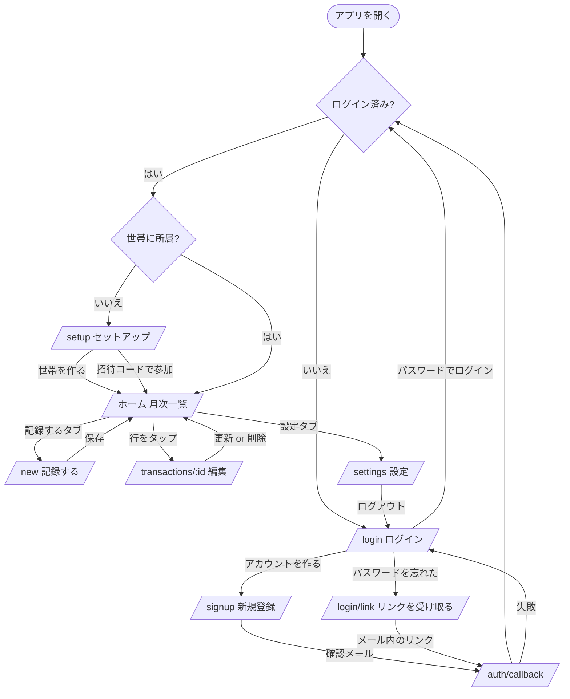

# UI / UX 設計

最終更新: 2026-11-07

**目的: UI/UX の一貫性を維持する。** スマホ縦画面（幅 375px）を基準に設計し、PC では同じレイアウトを中央寄せ（最大幅 480px）で表示する。

---

## 1. UI 原則

意思決定の基準。上が優先。

1. **入力の速さを損なわない。** 項目を増やす前に「既定値で省略できるか」を確認する。既定値で済むものは折りたたむ。
2. **指の届く範囲に主要操作を置く。** 画面下部が一等地。上部はタイトルと情報表示に使う。
3. **初見で分かる言葉を使う。** 「世帯」ではなく「わが家」。専門用語を UI に出さない（→ [用語集](../00-overview/glossary.md)）。
4. **色だけで意味を伝えない。** 収入は色 + `+` 記号の両方で示す（NFR-U15）。
5. **操作の結果を必ず見せる。** 保存中はボタンを無効化し、完了したら画面を変える。
6. **失敗しても入力を失わせない。** エラー時もフォームの値を残す（NFR-U10）。
7. **画面を増やさない。** v1 は 7 画面。足す前に既存画面に収まらないか考える。

---

## 2. 画面一覧

| ルート | 画面名 | 認証 | 世帯 | 役割 |
| --- | --- | --- | --- | --- |
| `/login` | ログイン | 不要 | — | メールアドレスとパスワードでログイン |
| `/signup` | アカウントを作る | 不要 | — | メールアドレスとパスワードで新規登録（確認メール 1 通） |
| `/login/link` | ログインリンクを受け取る | 不要 | — | パスワードを忘れたときの導線 |
| `/login/verify` | 確認メールを再送する | 不要 | — | 最初の確認リンクを逃した／期限切れのときの導線 |
| `/auth/callback` | 認証コールバック | 不要 | — | 画面なし。リンクのコードをセッションに交換して振り分ける |
| `/setup` | 初回セットアップ | 必要 | 未所属 | 世帯を作る / 招待コードで参加する |
| `/` | ホーム（月次一覧） | 必要 | 所属済 | 当月の合計と記録の一覧。**アプリの中心** |
| `/new` | 記録する | 必要 | 所属済 | 新規登録。金額から入力する |
| `/transactions/[id]` | 記録の詳細・編集 | 必要 | 所属済 | 編集と削除 |
| `/breakdown` | カテゴリ別の内訳 | 必要 | 所属済 | 月のカテゴリ別内訳。**スマホでも見られる。** `?c=` でその月のそのカテゴリの記録に絞る（→ [ADR-0012](../05-decisions/ADR-0012-breakdown-screen.md)） |
| `/year/[year]` | 年の一覧 | 必要 | 所属済 | **12 か月を並べて比べる。** 各月から `/` へ（→ [ADR-0010](../05-decisions/ADR-0010-year-page.md)） |
| `/settings` | 設定 | 必要 | 所属済 | 世帯名、招待コード、メンバー、表示名、カテゴリ、ログアウト |
| `/settings/categories` | カテゴリの管理 | 必要 | 所属済 | 追加・改名・非表示（→ [ADR-0009](../05-decisions/ADR-0009-desktop-layout-and-category-breakdown.md)） |
| `/settings/budgets` | 予算 | 必要 | 所属済 | カテゴリごとの月予算（→ [ADR-0011](../05-decisions/ADR-0011-tier1-and-recurring.md)） |

`/year` は今年のページへリダイレクトする（ナビゲーションのリンク先を固定できるようにするため）。

ナビゲーションの出し方 → §8.1 / §8.2。**スマホの下部タブは `/`、`/year`、`/settings` に出す**（`/new` と `/transactions/[id]` は下部が保存ボタンの場所なので出さない）。PC のサイドバーは認証後の全画面に出る。

> 画面が 7 → 12 に増えた。「画面を増やさない」原則（§1-7）に対する意識的な例外。理由 → [ADR-0006](../05-decisions/ADR-0006-email-password-auth.md)（認証の 3 画面）、[ADR-0009](../05-decisions/ADR-0009-desktop-layout-and-category-breakdown.md)（カテゴリの管理）、[ADR-0010](../05-decisions/ADR-0010-year-page.md)（年の一覧）

---

## 3. 画面遷移



**振り分けの実装方針**: 判定はサーバー側で行い、条件に合わなければ `redirect()` する。`src/app/(app)/layout.tsx` で「未ログイン → `/login`」「世帯なし → `/setup`」をまとめて処理する（FR-A4, FR-X1）。クライアント側の判定は使わない。

---

## 4. ワイヤーフレーム

### 4.1 `/` ホーム（月次一覧）— 最も見る画面

```
┌─────────────────────────────┐
│  ‹      2026年11月      ›   │  ← 月の移動。タップで前月/翌月
├─────────────────────────────┤
│                             │
│   支出        ¥ 182,400     │  ← 当月の合計（大きく）
│   収入        ¥ 320,000     │
│   ─────────────────────     │
│   差額      + ¥ 137,600     │  ← プラスは緑、マイナスは赤
│                             │
├─────────────────────────────┤
│ 11月7日 (金)        ¥ 4,180 │  ← 日付見出し + その日の支出計
│ ┌─────────────────────────┐ │
│ │ 食費            ¥ 1,280 │ │
│ │ スーパー・たっつ         │ │  ← メモ・支払った人
│ ├─────────────────────────┤ │
│ │ 交通            ¥ 2,900 │ │
│ ├─────────────────────────┤ │
│ │ 日用品           ¥  180 │ │
│ └─────────────────────────┘ │
│ 11月6日 (木)       ¥ 12,000 │
│ ┌─────────────────────────┐ │
│ │ 給与          + ¥320,000│ │  ← 収入は + と色で区別
│ ├─────────────────────────┤ │
│ │ 食費            ¥ 3,200 │ │
│ └─────────────────────────┘ │
│            ⋮                │
├─────────────────────────────┤
│   ホーム  │ 記録する │ 設定  │  ← 下部タブ
└─────────────────────────────┘
```

**空のとき（FR-L6）**:

```
┌─────────────────────────────┐
│  ‹      2026年11月      ›   │
├─────────────────────────────┤
│   支出 ¥0  収入 ¥0  差額 ¥0 │  ← 合計は 0 として表示する
├─────────────────────────────┤
│                             │
│      まだ記録がありません     │
│                             │
│    ┌───────────────────┐    │
│    │   記録する        │    │  ← 中央に導線
│    └───────────────────┘    │
│                             │
├─────────────────────────────┤
│   ホーム  │ 記録する │ 設定  │
└─────────────────────────────┘
```

### 4.2 `/new` 記録する — 最もよく使う操作

**設計の核**: 画面を開いた瞬間に金額を打てる。カテゴリを選べば保存できる。他の項目は既定値のままで良い。

```
┌─────────────────────────────┐
│  ✕                          │  ← 閉じる（ホームに戻る）
│  ┌─────────┬─────────┐      │
│  │  支出   │  収入   │      │  ← 種別。既定は「支出」
│  └─────────┴─────────┘      │
│                             │
│         ¥ 1,280             │  ← 大きく表示。フォーカス済み
│       ───────────           │     3桁区切りで即反映
│                             │
│  カテゴリ                    │
│  ┌──────┬──────┬──────┐     │
│  │ 食費 │日用品│ 交通 │     │  ← よく使う順。1タップで選択
│  ├──────┼──────┼──────┤     │
│  │ 通信 │ 住居 │ ...  │     │
│  └──────┴──────┴──────┘     │
│                             │
│  日付      2026/11/07 (今日) │  ← タップで変更。既定は今日
│  支払った人  たっつ          │  ← タップで変更。既定は自分
│  メモ      （任意）          │
│                             │
│    ┌───────────────────┐    │
│    │      保存する      │    │  ← 画面下部（親指が届く位置）
│    └───────────────────┘    │
└─────────────────────────────┘
```

- 金額が空・0 のときは「保存する」を押せない。
- 保存したらホームに戻り、追加した行が一覧に出る。
- 「日付」「支払った人」「メモ」は折りたたんだ 1 行表示。**既定値で済むなら触らせない。**
- 種別を切り替えると、カテゴリの選択肢が入れ替わる（FR-C1）。選択済みのカテゴリはクリアする。

### 4.3 `/transactions/[id]` 編集

`/new` とほぼ同じ構成。違いは 3 点。

- 既存の値が入っている。
- 「保存する」が「更新する」になる。
- 画面下部に「この記録を削除」（赤文字）。押すと確認を出してから削除する（FR-T8）。

存在しない ID や他世帯の記録を開いた場合は「見つかりませんでした」とホームへの導線を出す（AC-9）。

### 4.4 `/login` ログイン

```
┌─────────────────────────────┐
│          Monely             │
│      わが家の家計簿          │
│                             │
│  メールアドレス              │
│  ┌─────────────────────┐    │  ← type=email
│  │                     │    │     autoComplete="email"
│  └─────────────────────┘    │
│  パスワード                  │
│  ┌─────────────────────┐    │  ← type=password
│  │ ••••••••            │    │     autoComplete="current-password"
│  └─────────────────────┘    │
│  ┌─────────────────────┐    │
│  │      ログイン        │    │
│  └─────────────────────┘    │
│                             │
│  はじめての方は              │
│  アカウントを作る            │  ← /signup
│  パスワードを忘れた方は       │
│  ログインリンクを受け取る     │  ← /login/link
└─────────────────────────────┘
```

- ログイン失敗時は「メールアドレスまたはパスワードが正しくありません」。**どちらが違うかは示さない**（FR-A8）。
- `?error=1`（リンクからログインできなかった）のときは上部に通知を出し、パスワードでのログインを促す。

### 4.4.1 `/signup` アカウントを作る

```
┌─────────────────────────────┐
│       アカウントを作る        │
│  メールアドレス / パスワード   │
│  パスワード（確認）           │  ← 打ち間違いで入れなくなるのを防ぐ
│  ┌─────────────────────┐    │
│  │   アカウントを作る    │    │
│  └─────────────────────┘    │
└─────────────────────────────┘
```

送信後は同じ画面を差し替えて「`xxx@example.com` に確認メールを送りました」と表示する。**登録済みかどうかは示さない**（FR-A9）。パスワードは 8 文字以上（`autoComplete="new-password"`）。

### 4.4.2 `/login/link` ログインリンクを受け取る

パスワードを忘れたときの導線。メールアドレスだけを入力して送信する。未登録のアドレスでも同じ表示にする（FR-A9）。入れた後は設定画面でパスワードを変更する（M4）。

### 4.5 `/setup` 初回セットアップ

```
┌─────────────────────────────┐
│       はじめの設定           │
│                             │
│  あなたの名前                │
│  ┌─────────────────────┐    │
│  │ たっつ               │    │  ← メールの @ より前を初期値に
│  └─────────────────────┘    │
│                             │
│  ─── 新しく家計簿を作る ───   │
│  わが家の名前                │
│  ┌─────────────────────┐    │
│  │ わが家               │    │
│  └─────────────────────┘    │
│  ┌─────────────────────┐    │
│  │   家計簿を作る        │    │
│  └─────────────────────┘    │
│                             │
│  ─── または参加する ───       │
│  招待コード（6桁）           │
│  ┌─────────────────────┐    │
│  │ A1B2C3              │    │  ← 自動で大文字化
│  └─────────────────────┘    │
│  ┌─────────────────────┐    │
│  │   参加する           │    │
│  └─────────────────────┘    │
└─────────────────────────────┘
```

家族は下半分だけを使う。「新しく作る」が上にあるのは、最初に使うのが開発者本人だから。

### 4.6 `/settings` 設定

```
┌─────────────────────────────┐
│          設定               │
├─────────────────────────────┤
│  わが家                      │
│  名前        わが家      ›   │  ← タップで変更
│                             │
│  招待コード                  │
│  ┌─────────────────────┐    │
│  │      A1B2C3         │    │  ← 大きく表示
│  └─────────────────────┘    │
│  このコードを家族に伝えると    │
│  同じ家計簿に参加できます      │
│                             │
│  メンバー                    │
│   ・たっつ（あなた）          │
│   ・はなこ                   │
├─────────────────────────────┤
│  あなた                      │
│  表示名      たっつ      ›   │
│  メール   ta...@gmail.com    │
├─────────────────────────────┤
│  カテゴリの管理           ›  │
├─────────────────────────────┤
│        ログアウト            │
├─────────────────────────────┤
│   ホーム  │ 記録する │ 設定  │
└─────────────────────────────┘
```

カテゴリの管理（FR-C3〜C5）は **`/settings/categories` として別ページにした**（M4-7 の判断）。行ごとに改名と非表示の操作が付くので、設定画面に折りたたむと縦に長くなりすぎる。設定画面からは 1 行のリンクで入る。

```
┌─────────────────────────────┐
│  ←  カテゴリの管理           │
├─────────────────────────────┤
│  支出            12 件       │
│   食費          12件  ✎  🚫 │  ← 記録の件数 / 改名 / 非表示
│   日用品          3件  ✎  🚫 │
│   ⋮                         │
│   非表示                     │
│   特別費              ✎  👁 │  ← 押すと表示に戻る
│   ＋ カテゴリを追加           │
├─────────────────────────────┤
│  収入             5 件       │
│   ⋮                         │
└─────────────────────────────┘
```

**削除は作らない。** 消すと過去の記録のカテゴリ名が失われる（FR-C6）。使わなくなったものは非表示にする。非表示の切り替えに確認は出さない（1 タップで往復できる操作なので）。

---

## 5. 入力フローの設計

### 5.1 タップ数（UC-1 / NFR-U2）

| 手順 | 操作 |
| --- | --- |
| 1 | ホーム画面の Monely アイコン（起動） |
| 2 | 下部タブ「記録する」 |
| 3〜6 | 金額をテンキーで入力（4 桁なら 4 タップ。キーボードは自動で開く） |
| 7 | カテゴリ「食費」 |
| 8 | 「保存する」 |

キーボードの打鍵を除けば **4 タップ**。NFR-U2（5 タップ以内）を満たす。

### 5.2 既定値

| 項目 | 既定値 | 根拠 |
| --- | --- | --- |
| 種別 | 支出 | 記録の大半が支出 |
| 日付 | 今日 | 買い物直後に入力する前提 |
| 支払った人 | ログイン中の自分 | 自分が払った分を自分で入れる |
| カテゴリ | 未選択 | 推測しない。ただし並び順で選びやすくする |

### 5.3 カテゴリの並び順

**直近 30 日でその世帯が使った回数の多い順**、同数なら `sort_order` → 名前（FR-C7）。使うカテゴリは偏るので、固定順より 1 タップで届く確率が上がる。

実装は `listCategories(kind, usageSince)`（M4-8 で差し替え済み）。
集計期間の下限は**必須引数**で渡す（既定引数で時計を読まない → [コーディング規約 §8.0](../03-guidelines/coding-standards.md#80-時計を読むのは-requestnow-だけ)）。
使用回数の集計にも `householdId` の条件を付ける。**落とすと他世帯の使い方で並びが変わる**（認可テストで固定した）。

### 5.4 金額入力

- `inputMode="numeric"`、`pattern="[0-9]*"` で数値キーボードを開く（NFR-U3）。
- 入力中に 3 桁区切りを表示に反映するが、**保持する値は数値**（`"1,280"` という文字列を送らない）。
- 1 円未満・0・負数は受け付けない。サーバー側でも検証し、DB の `check (amount > 0)` が最終防衛（BR-2）。

### 5.5 日付の入力

- 既定は今日。タップすると選択 UI を開く。
- v1 は `<input type="date">` を使う（OS 標準の UI が出る。実装が最小）。
- 「今日」「昨日」のショートカットを日付欄の下に置く（M4-9 で実装）。**この 2 つで入力の大半が済むので、カレンダーを開かせない。**
- ショートカットの値は**サーバーで作って渡す**（`dateShortcuts(now)`）。クライアントで `new Date()` を読むとハイドレーションがずれる。

---

## 6. 表示のルール

### 6.1 金額

- 形式: `¥1,280`（`Intl.NumberFormat("ja-JP", { style: "currency", currency: "JPY" })`）。
- 支出は符号なし、収入は `+` を付けて色を変える。
- 差額は `+` / `−` を付ける。プラスは緑系、マイナスは赤系。
- 整形は `src/lib/money.ts` に集約する。画面ごとに書かない。

### 6.2 日付

| 場所 | 形式 |
| --- | --- |
| 一覧の日付見出し | `11月7日 (金)`。当日は `今日`、前日は `昨日` |

> 「今日 / 昨日」はサーバーの時計で判定する。**アプリは JST 固定**（`TZ=Asia/Tokyo`）という前提に依る（NFR-D8）。利用者が日本の一家族なので、端末ごとのタイムゾーンを考慮するより単純で正確。
| 月の見出し | `2026年11月` |
| 編集画面の日付 | `2026/11/07` |

整形は `src/lib/month.ts` / `src/lib/money.ts` に集約する。

### 6.3 色

| 用途 | 方針 |
| --- | --- |
| **一覧の支出の金額** | **赤系（`--deficit`）。** 収入と一目で見分けるため |
| **一覧の収入の金額** | **緑系（`--income`）+ `+` 記号** |
| 合計・内訳・年のページの支出 | **中立色（本文色）。** 下記の理由 |
| 差額マイナス | 赤系（`--deficit`） |
| 破壊的操作（削除） | 赤系（`--destructive`） |
| 予算の超過 | 赤系（`--destructive`）→ §8.6 |
| 選択中の種別タブ | カードの色で浮かせる（地の `--muted` から持ち上げる） |
| 選択中のカテゴリ | `--primary` の背景 + チェックのアイコン |

#### 一覧だけ支出を赤にする理由

**2026-11-09 に方針を変えた。** それまでは「支出は赤にしない（毎日のことなので
一覧が警告だらけになる）」としていたが、実際に使って
**一覧で支出と収入が見分けづらい**という指摘を受けた。

ただし**赤にするのは一覧の 1 件ごとの金額だけ**で、合計・カテゴリ別の内訳・
年のページの月別支出は中立色のまま残す。

| | 赤にする | 中立色のまま |
| --- | --- | --- |
| 対象 | 一覧の 1 件ごとの金額 | 合計、カテゴリ別の内訳、年のページの月別 |
| 理由 | **同じ場所に支出と収入が混ざる**ので、色で分かれていないと読みづらい | 支出だけが並ぶ場所。全部赤くしても情報が増えず、画面が警告だらけになる |

**赤は `--destructive`（削除ボタン）ではなく `--deficit` を使う。**
削除の赤を調整したときに金額の色が連動して変わらないようにしている。

### 6.3.1 テーマの切り替え（システム / ライト / ダーク）

既定は OS の設定に追従し、`/settings` で明示的に上書きできる（FR-X5）。

| `data-theme` | OS の設定 | 結果 |
| --- | --- | --- |
| なし（システム） | ライト | ライト |
| なし（システム） | ダーク | ダーク |
| `light` | ダーク | **ライト**（上書き） |
| `dark` | ライト | **ダーク**（上書き） |

実装は **CSS の `light-dark()`** を使う。

```css
:root {
  color-scheme: light dark;                      /* 既定: OS に追従 */
  --background: light-dark(#f7f7f8, #09090b);    /* 定義は 1 箇所 */
}
:root[data-theme="light"] { color-scheme: light; }
:root[data-theme="dark"]  { color-scheme: dark; }
```

**トークンの定義が二重化しない**のが利点。ライト用とダーク用を別ブロックに書くと、片方だけ直す事故が起きる。`color-scheme` を切り替えるだけなので、**スクロールバーや `<input type="date">` などのネイティブ UI も一緒に切り替わる**。

| ファイル | 役割 |
| --- | --- |
| `src/app/globals.css` | トークンの定義と `color-scheme` の切り替え |
| `src/components/theme/theme.ts` | 型、`localStorage` の読み書き |
| `src/components/theme/theme-script.tsx` | **描画前**に `data-theme` を当てる（ちらつき防止） |
| `src/components/theme/theme-sync.tsx` | 開発時に `data-theme` が外れたら貼り直す（本番では何もしない） |
| `src/components/theme/theme-toggle.tsx` | 切り替え UI（中身は本物の radio） |

**ちらつき防止には `<head>` 内のインラインスクリプトが必要**（Next.js の公式手順）。これが無いと、OS がダークで利用者がライトを選んでいる場合に一瞬ダークで描画される。

このスクリプトには **`type` をサーバーとクライアントで変える**仕掛けが要る。クライアントの描画で `<script>` を作っても実行されないため、React が開発時にエラーを出す。Server Action のあとに `refresh()` を呼ぶとルートレイアウトまで再描画されてこの経路に入る（実際に踏んだ）。サーバーでは `text/javascript`、クライアントでは `text/plain` にして、食い違いは `suppressHydrationWarning` で黙らせる。

**この仕掛けには `"use client"` が必要。** Server Component だと `typeof window` はサーバーでしか評価されず、RSC ペイロードに `text/javascript` が載ったままクライアントに渡るので、同じエラーになる（1 度これで直し損ねた）。Client Component にすると、バンドラが `typeof window` を静的に解決してクライアント側は `text/plain` 固定になる。

React 側の判定は `react-dom` の `isScriptDataBlock`：`type` が JavaScript の MIME 一覧（`text/javascript` など）と `module` / `importmap` / `speculationrules` のいずれでもなければ警告しない。

また開発時は React の Strict Mode が 1 度再マウントし、そのとき `<html>` の属性を **JSX に書かれているものだけ**に戻す。スクリプトが付けた `data-theme` は消えるので、`ThemeSync`（`useLayoutEffect`）で貼り直す。

保存先は `localStorage`（キー `monely-theme`）。**端末ごとの設定**で、サーバーにも他の端末にも共有されない。書き込みに失敗しても表示は切り替わる。

### 6.3.2 色の定義

色は CSS 変数（`globals.css` の `:root`）で定義する。**コンポーネントに生の色値を書かない。**

値は `light-dark()` で 1 箇所に書く。**`.dark` クラスで上書きする方式は使わない**（→ [ADR-0008](../05-decisions/ADR-0008-shadcn-ui.md)）。shadcn のコンポーネントが使う `dark:` ユーティリティは、`globals.css` の `@custom-variant dark` で `data-theme` 属性に繋いである。

### 6.4 デザイントークン

`src/app/globals.css` に定義し、Tailwind の `@theme inline` から参照する。
**命名は shadcn/ui に合わせる**（→ [ADR-0008](../05-decisions/ADR-0008-shadcn-ui.md)）。

| トークン | 用途 | 間違いやすい点 |
| --- | --- | --- |
| `--background` / `--foreground` | ページの背景・本文 | |
| `--card` / `--card-foreground` | カード・行の背景 | 旧 `--surface` |
| `--popover` / `--popover-foreground` | 重ねて出すもの | |
| `--primary` / `--primary-foreground` | 主要ボタン、選択状態 | 旧 `--accent` |
| `--secondary` / `--secondary-foreground` | 副ボタン | |
| `--muted` | **背景色**（セグメントの地、淡い帯） | **旧 `--muted` は文字色だった。意味が逆** |
| `--muted-foreground` | **補助テキスト**（メモ、支払った人、ラベル） | 旧 `--muted` の役割 |
| `--accent` / `--accent-foreground` | **ホバー時の背景**。主要な操作の色ではない | **旧 `--accent` は主要色だった。意味が違う** |
| `--destructive` / `--destructive-foreground` | 破壊的操作、エラー | 旧 `--danger`。`-foreground` はモードで反転する |
| `--border` / `--input` / `--ring` | 区切り線、入力欄の枠、フォーカスリング | |
| `--income` | 収入、成功の通知 | Monely 固有 |
| `--deficit` | 差額がマイナスのときの金額 | Monely 固有。`--destructive` とは役割が別 |
| `--chart-1`〜`5` | グラフ（v2） | |
| `--radius` | 角丸の基準（0.75rem） | shadcn の既定より大きい |

**旧トークン（`--surface` / `--danger` / 旧 `--muted` / 旧 `--accent`）は削除した。** 同じ名前で意味が違うものを残すと、見つけにくい崩れを生む。

余白は Tailwind の既定スケールを使う（独自に定義しない）。文字サイズは本文 16px を基準にし、金額の表示だけ大きくする。

#### コントラストの検証

```bash
pnpm check:contrast
```

`globals.css` の `light-dark()` を読み、oklch → sRGB に変換して、文字色と背景色の組み合わせをライト / ダークの両方で判定する（WCAG AA = 4.5:1、NFR-U6）。**色を変えたら必ず実行する。** 目視では落ちているものに気づけない（実際に 2 件見逃していた → [ADR-0008](../05-decisions/ADR-0008-shadcn-ui.md)）。

### 6.5 エラー表示

| 種類 | 表示場所 | 例 |
| --- | --- | --- |
| 入力エラー | 該当項目の直下に赤文字 | 「金額を入力してください」 |
| 通信・保存エラー | フォーム上部に帯で表示。**入力内容は消さない** | 「保存できませんでした。通信を確認してもう一度お試しください」 |
| 見つからない | 画面全体で表示 + ホームへの導線 | 「見つかりませんでした」 |

文言の方針 → [API設計 §2.4](./api-design.md#24-メッセージの書き方)

### 6.6 ローディング

- 保存ボタンは送信中に無効化し、スピナーを出し、ラベルを「保存中…」にする（NFR-U9）。
- **実装は `Button` の `pending` prop に寄せてある。** 画面ごとに書くと付け忘れが出るので、無効化とスピナーはコンポーネント側が面倒を見る。ラベルの差し替えだけ呼び出し側が持つ（文言が画面ごとに違うため）。
- 認証後の画面は `instant = false` でサーバー側でブロックする（→ [アーキテクチャ §6.2](./architecture.md#62-cachecomponents-true-が有効)）。
- **そのうえで `(app)/loading.tsx` を置く。** これが無いと、タップしてから画面が入れ替わるまで**古い画面のまま固まって見える**（2026-11-10 の指摘）。Next.js はこれをセグメントの Suspense の fallback として使い、**クライアント側の遷移では即座に表示する**。
- **骨組みに個人のデータを入れない。** `loading.tsx` は静的に配信される。

---

## 7. 月の切り替え

- **URL に持つ**: `/?m=2026-11`。パラメータが無ければ当月。
- URL に入れておくことで、リロードしても同じ月が開き、ブラウザの戻るで前の月に戻れる（FR-L3, AC-7）。
- 未来の月にも移動できる（先に予定の支出を入れたい場合があるため制限しない）。
- 不正な値（`?m=abc`）は当月として扱う。

---

## 8. レイアウト

**スマホと PC で別のレイアウトにする**（→ [ADR-0009](../05-decisions/ADR-0009-desktop-layout-and-category-breakdown.md)）。
境界は Tailwind の `md`（768px）。

| 事項 | 方針 |
| --- | --- |
| 基準幅 | 375px。320px でも崩れない |
| 分岐 | `md`（768px）。**スマホの作りは v1 のまま変えない** |
| タップ対象 | 44 × 44px 以上（NFR-U7） |
| 横スクロール | 発生させない。カテゴリの選択肢は折り返す（横スクロールにしない） |
| フォント | システムフォント優先。日本語の表示崩れを避ける。スキャフォールドの Geist は英数字向けなので日本語用の指定を足す |

### 8.1 スマホ（`md` 未満）

| 事項 | 方針 |
| --- | --- |
| 本文の幅 | 最大 480px で中央寄せ |
| ナビゲーション | **下部タブ**（ホーム / 記録 / 内訳 / 年 / 設定）。`fixed` で画面下端。セーフエリア（`env(safe-area-inset-bottom)`）を考慮 |
| **描く場所** | **`(app)/layout.tsx`。ページ側で描かない。** ページ側だと離れた瞬間にアンマウントされ、**遷移ごとに消えて出直す**ように見える（2026-11-10 の指摘） |
| カテゴリ別の内訳 | **出さない**（縦に伸びて一覧が押し出される） |

### 8.2 PC（`md` 以上）

| 事項 | 方針 |
| --- | --- |
| ナビゲーション | **左のサイドバー**（幅 240px、`sticky`）。下部タブは出さない |
| サイドバーの項目 | ホーム / 記録する / **カテゴリ** / 設定。スマホより 1 つ多い |
| サイドバーの下部 | **世帯名と自分の表示名を常に出す**（家族と共有するので「誰としてどの家計簿を見ているか」が常に見える必要がある） |
| ホーム | **2 カラム**。左に一覧、右に合計と内訳（`sticky`） |
| 設定・カテゴリ管理 | 最大 768px。カテゴリ管理は `lg` 以上で支出と収入を横に並べる |
| `/new`・編集 | **480px のまま中央寄せ。** 横に広げると視線の移動が増えて入力が遅くなる（NFR-U2） |

```
┌─ サイドバー ─┬────────────────────────────────┐
│  ■ Monely    │  ‹   2026年11月   ›            │
│              │                                │
│ ● ホーム      │ ┌─ 一覧 ──────────┐ ┌─ 合計 ──┐ │
│ ＋ 記録する   │ │ 11月7日  ¥4,180 │ │支出     │ │
│ 🏷 カテゴリ   │ │ ┌─────────────┐ │ │¥182,400 │ │
│ ⚙ 設定       │ │ │食費  ¥1,280 │ │ │収入     │ │
│              │ │ │交通  ¥2,900 │ │ │¥320,000 │ │
│              │ │ └─────────────┘ │ │─────────│ │
│              │ │ 11月6日 ¥12,000 │ │差額     │ │
│              │ │ ┌─────────────┐ │ │+¥137,600│ │
│              │ │ │給与 +¥320,000│ │ └─────────┘ │
│              │ │ └─────────────┘ │ ┌─ 内訳 ──┐ │
│ ──────────── │ │        ⋮        │ │食費  42%│ │
│ わが家        │ └─────────────────┘ │████████ │ │
│ たっつ        │                     │住居  28%│ │
└──────────────┴─────────────────────────────────┘
```

### 8.3 カテゴリ別の内訳（FR-L8）

| 事項 | 方針 |
| --- | --- |
| 対象 | **支出のみ。** 収入は件数が少なく内訳を見る動機が薄い |
| 表示する画面 | **専用画面 `/breakdown`（スマホ・PC 両方）** と、ホームの右カラム（PC のみ）→ [ADR-0012](../05-decisions/ADR-0012-breakdown-screen.md) |
| カテゴリから記録へ | 行をタップすると `?c=` が付き、**その月のそのカテゴリの記録だけ**を出す（FR-L13） |
| ホームのスマホ表示 | **出さない。** カテゴリ 13 個で縦に伸び、一覧（この画面の主役）が下に押し出される。専用画面で足りる |
| 並び | 金額の多い順。同額なら名前の読み順（表示が毎回入れ替わらないように） |
| 形 | **横棒。** 円グラフにしない（扇形の面積は読み取りにくく、スマホ幅で凡例の場所が無い） |
| 読み上げ | `dl` で名前と金額を対応させる。棒は `aria-hidden`（金額と割合は文字でも出している） |
| 色 | `--chart-1`〜`5` を巡回。**下地（`--muted`）と 3:1 以上**（`pnpm check:contrast` が検査） |
| 集計 | **DB に問い合わせない。** ホームが取得済みの行から純関数で計算する（認可の面を増やさないため。ADR-0009） |
| グラフのライブラリ | **入れない。** 横棒は `div` 2 つで描ける |

### 8.4 先月との比較（FR-L9）

「今月だけ見えて比較ができない」という指摘への対応。

| 置き場所 | 出すもの |
| --- | --- |
| 合計カードの支出・収入 | `先月比 +¥12,400（+7%）` |
| カテゴリ別の内訳の各行 | 増減額と矢印。先月に無かったカテゴリは **「新しく追加」** |

| 事項 | 方針 |
| --- | --- |
| **色を付けない** | 支出の増加を赤で出すと、月初（まだ記録が少ない月）が常に「改善」に見える。矢印の向きだけで示し、判断は利用者に委ねる |
| 先月が 0 のとき | **割合を出さない。** 0 からの増加に割合は無い（`+Infinity%` になる）。金額だけ出す |
| 先月に記録が 1 件も無い月 | 比較自体を出さない |
| 増減が 0 のとき | 「変わらず」「先月と同じ」と文字で出す（`±¥0` は読みにくい） |
| 割合の桁 | 整数の %。家計の増減で 0.1% の差は意味を持たない |
| データの取得 | ホームが**先月ぶんの行もそのまま取る**。合計だけを取る DAL 関数は足さない（[ADR-0009](../05-decisions/ADR-0009-desktop-layout-and-category-breakdown.md) と同じ理由。認可の面を増やさない） |

### 8.5 年のページ（FR-L10）

月どうしを比べるための画面（→ [ADR-0010](../05-decisions/ADR-0010-year-page.md)）。

```
┌─ サイドバー ─┬────────────────────────────────┐
│ ● 年の一覧    │  ‹      2026年      ›          │
│              │ ┌─ 2026年の合計 ───┐ ┌─ 年間の内訳 ─┐
│              │ │支出 ¥2,190,000   │ │食費   31%   │
│              │ │収入 +¥3,840,000  │ │████████     │
│              │ │差額 +¥1,650,000  │ │住居   24%   │
│              │ └──────────────────┘ │██████       │
│              │ ┌──────────────────┐ └─────────────┘
│              │ │ 1月  ¥182,400  +¥137,600  › │
│              │ │      ████████░░             │
│              │ │ 2月  ¥142,000  +¥178,000  › │
│              │ │      ██████░░░░             │
│              │ │ 3月  記録なし             › │
│              │ │  ⋮                          │
│              │ │12月  記録なし             › │
│              │ └──────────────────┘          │
└──────────────┴────────────────────────────────┘
```

| 事項 | 方針 |
| --- | --- |
| **12 か月を必ず並べる** | 記録が無い月も「記録なし」として行に出す。抜くと「使っていない月」と「記録を忘れた月」が区別できない |
| 棒の長さ | **支出が最も多い月を基準にした相対値。** 月どうしの大小を掴むのが目的 |
| 行のタップ | その月のホーム（`/?m=2026-01`）へ。**比較 → 詳細**の流れ |
| スマホで出すもの | 月・支出・棒。収入と差額は `sm` 以上 |
| 年間のカテゴリ別内訳 | **PC のみ。** `CategoryBreakdown` をそのまま使う（期間が変わるだけ） |
| 不正な年 | `/year/abc` は今年として扱う（`?m=abc` と同じ方針。AC-7） |
| 主な導線 | **ホームの月見出し（`2026年11月`）をリンクにする。** 「この月を見ていて他と比べたい」と思った場所から 1 タップ |

### 8.6 予算（FR-B1〜B3）

→ [ADR-0011](../05-decisions/ADR-0011-tier1-and-recurring.md)

| 事項 | 方針 |
| --- | --- |
| 設定 | `/settings/budgets`。**1 つのフォームで全カテゴリをまとめて保存**（1 件ずつだと 13 回の送信になる） |
| 対象 | **支出のカテゴリだけ。** 収入に予算を立てる動機が無い |
| 予算なし | 空欄か 0。**削除ボタンを別に置かない** |
| 消化率 | カテゴリ別の内訳の棒を**「予算に対する消化率」に差し替える**（支出全体の割合より行動に繋がる） |
| 超過 | **`--destructive`。** 「支出を赤にしない」（§6.3）とは矛盾しない。毎日の支出ではなく「超えた」という例外だけに付く |
| 予算外の支出 | 合計の消化率に**含めない**（「使いすぎ」と「予算外の支出」が区別できなくなる） |

### 8.7 記録忘れの提示と支払者別の集計

| 画面の要素 | 方針 |
| --- | --- |
| **入れ忘れ？**（FR-L11） | 先月にあって今月まだ無い支出カテゴリ。**今月を見ているときだけ。** 先月の金額つきで `/new` へ |
| **誰が払ったか**（FR-L12） | 支払者別の金額と割合。**払っていないメンバーも 0 円で並べる** |
| 精算額 | **2 人の世帯で支払者が全員分かっているときだけ。** 均等割りの差額の半分 |
| **これと同じ記録を作る**（FR-T11） | 編集画面の下部。**日付は引き継がない**（複製は「今月も入れる」用途） |
| **毎月の支出**（FR-R2） | 先月「毎月くり返す」にした記録のうち今月に無いものを一覧で出し、**まとめて登録**できる。今月を見ているときだけ |
| **毎月くり返す**（FR-R1） | 入力フォームの折りたたみ内のチェックボックス。家賃やサブスクに付ける |

---

## 9. コンポーネント構成（想定）

基盤は **shadcn/ui（Radix ベース）**。→ [ADR-0008](../05-decisions/ADR-0008-shadcn-ui.md)

#### shadcn が生成したもの（`components/ui/`）

`button` / `card` / `input` / `label` / `badge` / `separator` / `collapsible` / `empty`

**生成されたコードはこのリポジトリのもの**で、npm の依存ではない。遠慮なく編集する。
実際に `button` と `input` は高さを 44px に上げてある（NFR-U7）。

#### 自前のもの

| コンポーネント | 置き場所 | 種類 | 備考 |
| --- | --- | --- | --- |
| `AuthShell` / `AuthLink` / `MailSentNotice` | `components/ui/` | Server | `/login`, `/signup`, `/login/link` の共通枠 |
| `Field` / `TextInput` / `SelectInput` / `FormError` | `components/ui/` | Server | shadcn の `Label` / `Input` の上に乗せた薄い層 |
| `SegmentedControl` | `components/ui/` | **Client** | 種別・テーマの切り替え。**中身は本物の radio**（Radix の ToggleGroup を使わない理由は ADR-0008） |
| `MonthSwitcher` | `components/` | Server | Link で遷移 |
| `MonthSummary` | `components/` | Server | |
| `TransactionList` / `TransactionRow` | `components/` | Server | |
| `EmptyMonth` | `components/` | Server | shadcn の `Empty` を使う |
| `TransactionForm` | `components/` | **Client** | 金額・種別・カテゴリの状態を持つ |
| `DeleteTransaction` | `components/` | **Client** | 確認を自前の状態で出す（ダイアログを使わない） |
| `ThemeToggle` | `components/theme/` | **Client** | localStorage を読む |
| `ThemeScript` | `components/theme/` | **Client** | `<head>` のインラインスクリプト。**`"use client"` が必須**（下記） |
| `ThemeSync` | `components/theme/` | **Client** | 開発時に `data-theme` が外れたら貼り直す |

**既定は Server Component。** 操作の状態を持つものだけ `"use client"` にする（→ [アーキテクチャ §3.2](./architecture.md#32-server--client-の境界)）。

アイコンは **lucide-react**。装飾のアイコンには `aria-hidden` を付け、アイコンだけのボタンには `aria-label` を付ける。

---

## 10. v1 で作らない UI

| 作らないもの | 理由 |
| --- | --- |
| スプラッシュ画面 | PWA の起動が速いので不要 |
| オンボーディングのチュートリアル | 画面が 7 つで、説明が必要なほど複雑でない |
| トースト通知 | 画面遷移で結果が分かる。仕組みを足す価値が薄い（必要になれば `shadcn add sonner`） |
| スワイプ削除 | 誤操作のリスク。編集画面からの削除で足りる |
| 無限スクロール | 1 か月単位の表示なので件数が収まる |
| グラフ | v1 のスコープ外（合計の数字で足りる） |
| 検索・絞り込み（自由入力） | v1 のスコープ外。月の移動で足りる。**内訳からカテゴリで絞る導線だけは入れた**（FR-L13。入力も選択 UI も要らない 1 タップ） |
