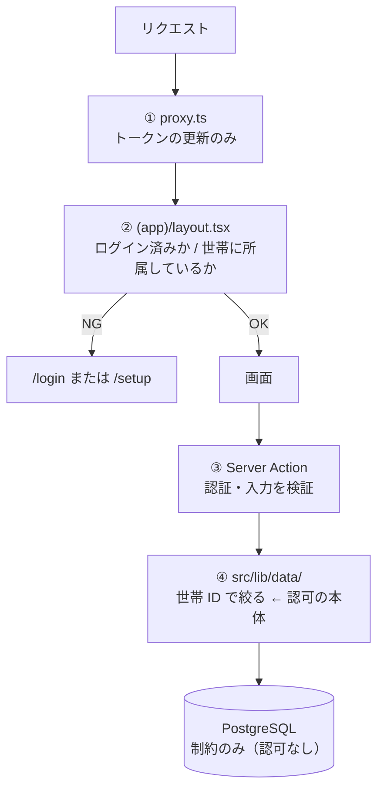

# セキュリティガイドライン

最終更新: 2026-11-07

**目的: セキュリティ事故を防ぐ。** 家計のデータは、金額と生活のパターンが分かる個人情報。利用者が家族だけでも、漏れたときの影響は小さくない。

**このプロジェクトで最も重要な文書。** 他のガイドラインと衝突したら、こちらを優先する。

> **2026-11-07 に守り方が変わった。** [ADR-0005](../05-decisions/ADR-0005-authorization-in-app-layer.md) で認可を DB（RLS）からアプリ層に移した。
>
> **これは「守りが 1 枚減った」ことを意味する。** 以前は `where` を書き忘れても DB が 0 行を返したが、いまは**書き忘れがそのまま漏洩になる**。だからこの文書の §4（3 つの約束）は、好ましい慣習ではなく**守らなければ設計が成立しない条件**である。

---

## 1. 守るべきもの・想定する脅威

| 守るもの | 失うと何が起きるか |
| --- | --- |
| 記録（金額・日付・カテゴリ・メモ） | 収入や生活パターンが他人に分かる |
| メールアドレス | スパム、なりすましの足がかり |
| セッション（認証 Cookie） | アカウントの乗っ取り |
| 招待コード | 見知らぬ人が世帯に入り、全記録を読み書きできる |
| **`DATABASE_URL` / `DIRECT_URL`** | **DB の全権。全世帯のデータの読み書き・削除** |

| 想定する脅威 | 対策 |
| --- | --- |
| **他の世帯のデータへのアクセス**（最重要） | DAL での世帯 ID 絞り込み + 自動テスト（§4） |
| Server Action の直接 POST | 全アクションで認証と世帯を再確認（§5） |
| URL の ID 書き換え（`/transactions/<他人の ID>`） | DAL が世帯 ID 込みで検索し、0 件なら `NOT_FOUND` |
| **Publishable key による PostgREST 経由の直接アクセス** | `anon` / `authenticated` から `public` の権限を剥奪（§2.2） |
| セッションの漏洩（CDN キャッシュ経由） | 認証 Cookie を含むレスポンスをキャッシュさせない（§8） |
| 接続文字列の漏洩 | `.env.local` 限定、コミット禁止（§6） |
| メールアドレスの存在調査 | ログイン画面の応答を一定にする（§3.2） |

**想定しない脅威**: 標的型攻撃、DDoS、内部不正（利用者は家族のみ）。

---

## 2. 多層防御の構造



| 段 | 役割 | 信頼度 | 省略できるか |
| --- | --- | --- | --- |
| ① `proxy.ts` | トークンの更新。**認可の判断をしない** | 低 | — |
| ② レイアウトの振り分け | 画面を出さない（UX のため） | 中（迂回されうる） | — |
| ③ Server Action | 認証・入力の検証 | 高 | **不可** |
| ④ **DAL** | **世帯 ID による絞り込み** | **ここが唯一の砦** | **不可** |
| DB | 制約（金額 > 0、外部キー、一意） | データの正しさのみ | — |

### 2.1 旧構成との違い

| | 旧（RLS） | 現在（アプリ層） |
| --- | --- | --- |
| 認可の場所 | PostgreSQL のポリシー | `src/lib/data/` の `where` |
| `where` を書き忘れたとき | DB が 0 行を返す | **他世帯のデータが出る** |
| 最終防衛線 | DB | **無い** |
| 検出工程 | DB が構造的に保証 | **自動テストだけ** |

**「最終防衛線が無い」ことを常に意識する。** だから §4 がある。

---

## 2.2 PostgREST を public スキーマから締め出す（必須）

Supabase は DB の上に **PostgREST**（`/rest/v1/...`）を自動で立てる。これは `anon` / `authenticated` ロールで動き、**Publishable key だけで叩ける**。Publishable key はブラウザのバンドルに埋め込まれる公開値である。

RLS を使う構成ではポリシーが行を絞っていたが、[ADR-0005](../05-decisions/ADR-0005-authorization-in-app-layer.md) で RLS をやめた結果、**Publishable key だけで全テーブルの読み取り・挿入・削除ができる状態になっていた**（2026-11-07 に実測）。

```
GET    /rest/v1/transactions          -> 200          （全世帯の記録が読める）
POST   /rest/v1/households            -> 23514        （CHECK 制約まで到達 = 権限はある）
DELETE /rest/v1/transactions?id=eq... -> 204          （削除できる）
```

原因は Supabase の既定設定。`public` に作られた新規テーブルへ `anon` / `authenticated` に `ALL` を付与する。

```sql
alter default privileges in schema public grant all on tables to anon, authenticated, service_role;
```

### 対策（`prisma/migrations/0002_revoke_postgrest_access`）

このアプリは **supabase-js をデータアクセスに使わない**（認証のみ）。DB へは Prisma が `postgres` ロールで接続する。よって `anon` / `authenticated` には `public` へのアクセスを一切与えない。

```sql
revoke all on all tables in schema public from anon, authenticated;
-- 将来 postgres ロールが作るテーブルにも権限が付かないようにする
alter default privileges in schema public revoke all on tables from anon, authenticated;
```

適用後は `42501 permission denied` になる。

> **`revoke usage on schema public` は効かない。** `public` スキーマへの `USAGE` は `PUBLIC` 疑似ロール経由で付与されているため、`anon` を名指しで revoke しても `has_schema_privilege('anon','public','USAGE')` は `true` のまま。
> **実際に防いでいるのはテーブル権限の剥奪と既定権限の打ち消し。** マイグレーション 0002 のコメントはこの点を過大に書いているが、適用済みのため修正していない（Prisma がチェックサムを検証するので、適用済みマイグレーションは編集できない）。

### テーブルを足すたびに確認する

既定権限は打ち消したので自動では戻らない（実証済み）。ただし Supabase 側の設定変更で復活しうるため、**マイグレーションを適用したら毎回確認する**。

```bash
# Publishable key で REST API を叩く。401 / 42501 であること
curl -s -o /dev/null -w "%{http_code}\n" \
  -H "apikey: $NEXT_PUBLIC_SUPABASE_PUBLISHABLE_KEY" \
  "$NEXT_PUBLIC_SUPABASE_URL/rest/v1/transactions?select=id&limit=1"
```

### 追加で固めるなら

Supabase ダッシュボード → Project Settings → API の **Exposed schemas** から `public` を外すと、PostgREST 自体が `public` を見なくなる。DB 側の revoke で既に塞がっているので必須ではないが、二重化になる。

---

## 3. 認証

| 事項 | 方針 |
| --- | --- |
| 方式 | **メールアドレス + パスワード**（Supabase Auth）。パスワードを忘れたときはマジックリンク → [ADR-0006](../05-decisions/ADR-0006-email-password-auth.md) |
| パスワード | 8 文字以上 72 文字以内。文字種は要求しない。保存は Supabase（bcrypt） |
| 総当たり対策 | **Supabase Auth の既定のレート制限に依る。** v1 では自前の制限を作らない（利用者が家族のみ） |
| セッション | Cookie（`@supabase/ssr` が管理） |
| トークンの更新 | `src/proxy.ts` で毎リクエスト時に実施 |
| 確認方法 | **`supabase.auth.getUser()` を使う** |

### 3.1 `getSession()` に頼らない

`getSession()` は Cookie の中身をそのまま返すため、改ざんの検証を伴わない。**サーバー側の判断には必ず `getUser()` を使う。**

```ts
// ✗ サーバー側の認可判断に使ってはいけない
const { data: { session } } = await supabase.auth.getSession();

// ✓
const { data: { user } } = await supabase.auth.getUser();
```

### 3.2 ログイン画面で情報を漏らさない

| 画面 | 守ること |
| --- | --- |
| `/login` | ログイン失敗時に**メールアドレスとパスワードのどちらが違うかを示さない**（FR-A8）。常に「メールアドレスまたはパスワードが正しくありません」 |
| `/signup` | 登録済みのメールアドレスでも同じ「確認メールを送りました」を出す（FR-A9）。Supabase は既存のアドレスに何も送らずに成功を返すので、表示を変えない |
| `/login/link` | 未登録のメールアドレスでも同じ表示にする（FR-A9）。Supabase のエラーは握りつぶしてログにだけ残す |

**マジックリンクで新規登録させない。** `signInWithOtp` に `shouldCreateUser: false` を渡す。渡さないと、リンク経由でパスワードなしのアカウントが作られてしまう。

### 3.3 Supabase のユーザー ID と `Profile.id` は別物

| | 意味 |
| --- | --- |
| `user.id`（Supabase） | 認証の主体。`Profile.userId` に入る |
| `Profile.id` | Monely 側の ID。`Transaction.paidById` などが参照する |

**この 2 つを混同しない。** セッションから得られるのは `user.id` で、DAL で `Profile` を引いてから世帯 ID を得る。

### 3.4 招待コード

| 事項 | 内容 |
| --- | --- |
| 強度 | 6 桁の英数字（大文字）。36^6 ≈ 22 億通り |
| 生成 | `node:crypto` の `randomInt` / `randomBytes` を使う。**`Math.random()` を使わない** |
| 扱い | **世帯の全記録への読み書き権限と同等。** パスワードと同じ扱いで伝える |
| 制限 | v1 では試行回数の制限を設けない |

**注意**: 現状、コードの再発行機能が無い。漏れた場合は Prisma Studio か SQL で `inviteCode` を直接更新する。v2 で再発行機能を検討する。

---

## 4. 認可 — 3 つの約束

[ADR-0005](../05-decisions/ADR-0005-authorization-in-app-layer.md) の約束 A/B/C。**これが認可の全体。** 1 つでも破れば設計が成立しない。

### 4.1 約束 A: `prisma` を DAL の外から import しない

データベースに触るのは `src/lib/data/` の中だけ。画面と Server Action は DAL の関数しか呼ばない。

```ts
// ✗ src/app/(app)/page.tsx
import { prisma } from "@/lib/data/db";          // 禁止

// ✓
import { listTransactionsByMonth } from "@/lib/data/transactions";
```

**理由**: 認可の書き忘れが起きる場所を 1 ディレクトリに閉じる。レビュー対象を絞る。

**検出**:

```bash
# DAL の外から db を import していないか（0 件であること）
grep -rn "data/db" src --include="*.ts" --include="*.tsx" | grep -v "^src/lib/data/"
```

### 4.2 約束 B: DAL の関数は世帯 ID を引数で受け取らない

```ts
// ✗ 呼び出し側が他世帯の ID を渡せる
export async function listTransactions(householdId: string, month: string) { ... }

// ✓ 関数の中でセッションから取る
export async function listTransactionsByMonth(month: string) {
  const me = await requireMember();
  return prisma.transaction.findMany({
    where: { householdId: me.householdId, ... },
  });
}
```

**同じ理由で、以下もクライアントから受け取らない。**

| 値 | どこから取るか |
| --- | --- |
| `householdId` | `requireMember()` の戻り値 |
| `createdById` | `requireMember()` の戻り値（`me.profileId`） |
| `userId` | `supabase.auth.getUser()` |

### 4.3 約束 C: DAL の認可を自動テストで守る

**書き忘れを検出する工程は他に無い。** Vitest で、別世帯のデータが取れないことを検証する。

```ts
// 例: src/lib/data/transactions.test.ts
it("他世帯の記録を返さない", async () => {
  const { householdA, householdB } = await seedTwoHouseholds();
  await asMember(householdB.member, async () => {
    const rows = await listTransactionsByMonth("2026-11");
    expect(rows).toHaveLength(0);          // A の記録が混ざらない
  });
});

it("他世帯の記録を ID 指定でも返さない", async () => {
  // getTransaction(aTransactionId) が null を返すこと
});

it("他世帯の記録を更新・削除できない", async () => {
  // 0 件更新 / NOT_FOUND になること
});
```

**DAL に関数を 1 つ足したら、その関数の認可テストを同じコミットで足す。** テストが無い DAL 関数をマージしない。

→ [テスト戦略](./testing-strategy.md)

### 4.4 参照先の所属も確認する

外部キーは「その行が存在するか」しか見ない。**他世帯のカテゴリやメンバーを紐付けられる。**

```ts
// categoryId が自分の世帯のものか、kind が一致するかを確認する
const category = await prisma.category.findFirst({
  where: { id: categoryId, householdId: me.householdId, kind, archived: false },
});
if (!category) return fail("VALIDATION", "選択できないカテゴリです", "categoryId");
```

同じことを `paidById`（自分の世帯のメンバーか）にも行う。

### 4.5 存在を漏らさない

他世帯の ID を指定された場合も `NOT_FOUND`（「見つかりませんでした」）を返す。「存在するが権限がない」と答えると ID の存在を漏らす。

---

## 5. Server Action の書き方

**Server Action は UI を経由せず直接 POST できる。** ボタンを隠しても守りにならない。

```ts
"use server";

export async function createTransaction(formData: FormData) {
  // ① 認証と世帯を取得する（毎回・必ず・1行目）
  const me = await requireMember();

  // ② 入力を検証する
  const parsed = parseTransactionInput(formData);
  if (!parsed.ok) return parsed;

  // ③ 参照先の所属を確認する（§4.4）
  // ④ DAL を呼ぶ。householdId / createdById は DAL が me から埋める
  await createTransactionForMe(parsed.value);
}
```

### 5.1 禁止事項

| してはいけないこと | 何が起きるか |
| --- | --- |
| クライアントから `householdId` を受け取って保存する | 他世帯にデータを書き込める |
| クライアントから `createdById` を受け取る | 入力者を偽れる |
| 認証の確認を「呼び出し元の画面でやっているから」と省略する | 直接 POST で迂回される |
| 検証をクライアント側だけで行う | 迂回される |
| アクションから `prisma` を直接触る | 約束 A 違反。認可の場所が散る |

---

## 6. 秘密情報

| 事項 | 方針 |
| --- | --- |
| 置き場所 | **`.env.local` 1 つ**（Next.js と Prisma CLI で共用）。コミットしない |
| 例の提供 | `.env.local.example` に変数名のみ（値は空） |
| `.gitignore` | `.env*` で除外。`!.env.local.example` で雛形だけ除外解除 |
| ブラウザに出てよいもの | `NEXT_PUBLIC_SUPABASE_URL`, `NEXT_PUBLIC_SUPABASE_PUBLISHABLE_KEY` |
| **ブラウザに出してはいけないもの** | **`DATABASE_URL`, `DIRECT_URL`** |
| 使わないもの | Supabase の Secret key（旧 `service_role` キー） |

### 6.1 `DATABASE_URL` の扱い

RLS を使わないため、**この接続文字列はテーブルの全権（読み書き・削除・TRUNCATE）を持つ**。

- `NEXT_PUBLIC_` を**絶対に付けない**（付けるとブラウザのバンドルに埋め込まれる）
- 画面やクライアントコンポーネントから参照しない（`src/lib/data/db.ts` だけが読む）
- ログやエラーメッセージに出さない

```bash
# 定期的に確認する
grep -rn "DATABASE_URL\|DIRECT_URL" src/ | grep -v "src/lib/data/db.ts"   # 0 件であること
grep -rn "NEXT_PUBLIC_DATABASE\|NEXT_PUBLIC_DIRECT" .                     # 0 件であること
```

### 6.1.1 Prisma CLI はパスワードをプロセス引数に渡す

`prisma migrate` 系を実行すると、スキーマエンジンのプロセス引数に接続文字列が**平文で載る**（`ps` で他のプロセスから見える）。Prisma の実装に由来するため回避できない。

**画面共有・スクリーンショット・ログの貼り付けで漏れやすい。** 漏れた疑いがあれば Supabase で DB パスワードをリセットする。

### 6.2 コミットしてしまった場合

1. Supabase ダッシュボードで **DB のパスワードをリセット**する（履歴を消しても漏れた文字列は無効にならない）
2. `git` の履歴から削除する
3. `.gitignore` を直す

### 6.3 `NEXT_PUBLIC_` の意味を誤解しない

`NEXT_PUBLIC_` が付いた変数は**ブラウザのバンドルに埋め込まれる**。秘密にしたい値に付けてはならない。

---

## 7. 入力検証

| 原則 | 内容 |
| --- | --- |
| サーバー側で必ず検証する | クライアント側の検証は利便性のため。**代わりにならない**（NFR-S8） |
| 範囲を決める | 金額は 1〜9,999,999。メモは 200 文字。表示名は 20 文字 |
| 型を変換する | `FormData` の値は `string`。数値・日付は明示的に変換し、失敗を検証エラーにする |
| 列挙は許可リストで照合する | `kind` が `"expense" \| "income"` のどちらかであることを確認 |
| 参照先の所属を確認する | §4.4 |
| DB の制約を最終防衛にする | CHECK（`amount > 0`、空文字でない）、enum、外部キー、一意制約 |

### 7.1 全角数字に注意

スマホの日本語キーボードでは全角が混入しやすい。`parseAmount` で全角を弾くか半角に正規化し、**テストケースに含める**。

### 7.2 SQL インジェクション

Prisma のクエリビルダを使う限り、値はパラメータとして送られるため発生しない。**`$queryRaw` / `$executeRaw` を使わない。** どうしても必要な場合はタグ付きテンプレート（`$queryRaw\`...\``）を使い、文字列連結で組み立てない。

```bash
grep -rn "queryRawUnsafe\|executeRawUnsafe" src/   # 0 件であること
```

### 7.3 XSS

React は既定で文字列をエスケープする。**`dangerouslySetInnerHTML` を使わない。** メモ欄は自由文を受け取るが、`{memo}` として描画すれば安全。

### 7.4 CSRF

Server Action は Next.js が Origin を検証するため、基本的な保護が入っている。**v1 では `/auth/callback` の GET 以外に Route Handler を作らない。**

---

## 8. キャッシュとセッション

### 8.1 認証 Cookie を含むレスポンスをキャッシュさせない

`@supabase/ssr@0.12.7` の `setAll` は第 2 引数でキャッシュ無効化ヘッダを渡してくる。**`proxy.ts` でこれをレスポンスに設定する**（NFR-S5）。

```ts
setAll(cookiesToSet, headers) {
  for (const { name, value, options } of cookiesToSet) {
    response.cookies.set(name, value, options);
  }
  // ← 忘れると、他人のセッションが CDN から配信されうる
  for (const [key, value] of Object.entries(headers)) {
    response.headers.set(key, value);
  }
}
```

### 8.2 キャッシュキーに個人情報を入れない

`cacheComponents` が有効なため、`use cache` / `cacheTag` を使う場面がありうる。**キーとタグは平文で保存される。**

- ✗ `cacheTag("transactions:" + email)`
- ✓ `cacheTag("transactions:" + householdId)`

### 8.3 ログに個人情報を出さない

`console.error` にエラーを出す際、メールアドレスや金額を含めない。ID までに留める。**Prisma のクエリログを本番で有効にしない**（パラメータに金額やメモが出る）。

---

## 9. エラー応答

| してはいけないこと | 代わりに |
| --- | --- |
| Prisma のエラーをそのまま画面に出す | 「保存できませんでした。もう一度お試しください」 |
| スタックトレースを画面に出す | `console.error` に出し、画面には一般的なメッセージ |
| 「権限がありません」と「見つかりません」を区別する | どちらも `NOT_FOUND` |
| 「このメールアドレスは登録されていません」 | 常に「リンクを送りました」 |

---

## 10. 実装後のチェックリスト

マイルストーンの完了前に毎回確認する。

### PostgREST の遮断（テーブルを足したら毎回）

- [ ] Publishable key で `/rest/v1/<テーブル>` を叩いて **401 / 42501** になる（§2.2）
- [ ] `anon` / `authenticated` の `public` テーブル権限が 0 件

### 約束 A/B/C

- [ ] `grep -rn "data/db" src --include="*.ts" --include="*.tsx" | grep -v "^src/lib/data/"` が 0 件
- [ ] DAL のすべての関数が世帯 ID を引数で受け取っていない
- [ ] DAL のすべてのクエリに `householdId` の条件がある（目で全件確認する。v1 では 15 本程度）
- [ ] DAL のすべての関数に認可テストがある

### コード

- [ ] すべての Server Action の 1 行目で認証と世帯を取得している
- [ ] `householdId` / `createdById` をクライアントから受け取っていない
- [ ] `categoryId` / `paidById` の所属を確認している
- [ ] `getSession()` を認可の判断に使っていない
- [ ] `dangerouslySetInnerHTML` を使っていない
- [ ] `queryRawUnsafe` / `executeRawUnsafe` を使っていない
- [ ] `proxy.ts` で `setAll` の第 2 引数のヘッダを設定している
- [ ] キャッシュキー・タグに個人情報が入っていない
- [ ] エラーメッセージに Prisma の内部情報が出ていない

### 秘密情報

- [ ] `grep -rn "DATABASE_URL" src/ | grep -v "src/lib/data/db.ts"` が 0 件
- [ ] `NEXT_PUBLIC_DATABASE` のような変数が存在しない
- [ ] `.env.local` がコミットされていない（`git log --all -- .env.local` が空）
- [ ] `git log -p` に接続文字列が出ていない

### 動作

- [ ] [AC-9（他世帯のデータが見えない）](../01-requirements/functional-requirements.md#ac-9-他世帯のデータが見えないfr-x2-br-12最重要) を実施した（**毎回**）
- [ ] ログイン画面の応答が、登録済み・未登録で同じ

---

## 11. 事故が起きたときの手順

| 事象 | 対応 |
| --- | --- |
| **Publishable key でテーブルが読めた** | **すぐに他の作業を止める。** `0002_revoke_postgrest_access` の revoke が効いているか確認し、効いていなければ新しいマイグレーションで再度 revoke する（§2.2） |
| **他世帯のデータが見えた** | **すぐに他の作業を止める。** 該当の DAL 関数の `where` を修正 → 認可テストを追加 → 全 DAL 関数を見直す。[ADR-0005](../05-decisions/ADR-0005-authorization-in-app-layer.md) の「見直す条件」に該当するので、RLS への回帰も検討する |
| 接続文字列が漏れた（コミット・`ps`・画面共有） | ① Supabase で **DB パスワードをリセット** ② `.env.local` の 2 本を更新 ③ コミットしていたら git 履歴から削除 |
| 招待コードが漏れた | Prisma Studio か SQL で `inviteCode` を更新する（再発行機能が無いため） |
| セッションが漏れた疑い | Supabase ダッシュボードから該当ユーザーのセッションを失効させる |

---

## 12. v1 で対応しないこと（意識的な判断）

| 対応しないもの | 理由 | 見直す条件 |
| --- | --- | --- |
| RLS（DB 側の認可） | [ADR-0005](../05-decisions/ADR-0005-authorization-in-app-layer.md) の判断 | **AC-9 が 1 度でも落ちたら回帰を検討。** 公開・開発者増加・DB 経路増加でも回帰 |
| 招待コードの試行回数制限 | 22 億通りで、利用者が家族のみ | 外部に公開する場合 |
| 招待コードの再発行機能 | v1 のスコープ外 | コードが漏れた場合 |
| 多要素認証 | 利用者が家族のみ。登録時にメールの所有確認をしている | 外部に公開する場合 |
| パスワードの総当たり対策（自前） | Supabase Auth の既定のレート制限に依る | 総当たりが観測された場合 |
| 監査ログ | `createdById` と `updatedAt` で足りる | 利用者が増えた場合 |
| CSP | 外部スクリプトを読み込まないため効果が薄い | 外部サービスを組み込む場合 |
| レート制限 | 利用者が家族のみ | 外部に公開する場合 |

**この表は「考えていない」ではなく「判断して外した」ものの記録。**
