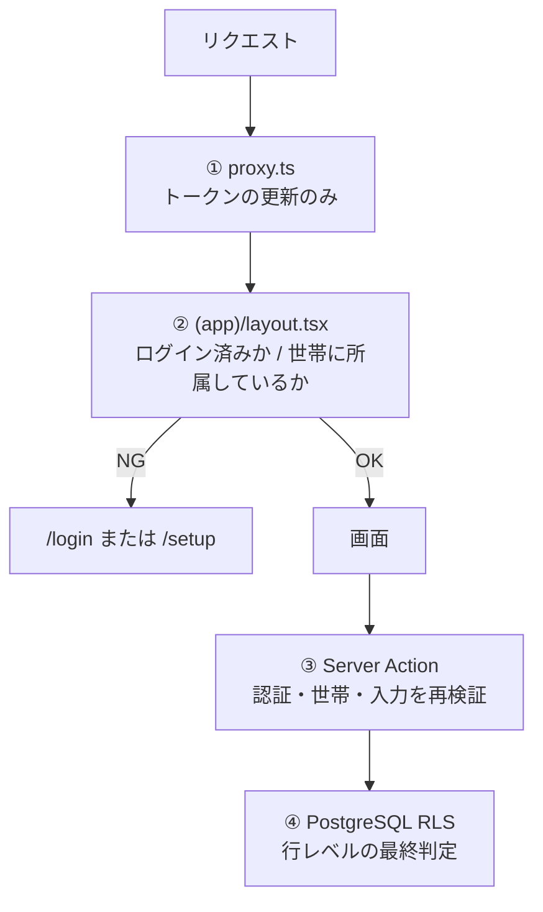

# セキュリティガイドライン

最終更新: 2026-11-07

**目的: セキュリティ事故を防ぐ。** 家計のデータは、金額と生活のパターンが分かる個人情報。利用者が家族だけでも、漏れたときの影響は小さくない。

**このプロジェクトで最も重要な文書。** 他のガイドラインと衝突したら、こちらを優先する。

---

## 1. 守るべきもの・想定する脅威

| 守るもの | 失うと何が起きるか |
| --- | --- |
| 記録（金額・日付・カテゴリ・メモ） | 収入や生活パターンが他人に分かる |
| メールアドレス | スパム、なりすましの足がかり |
| セッション（認証 Cookie） | アカウントの乗っ取り |
| 招待コード | 見知らぬ人が世帯に入り、全記録を読み書きできる |

| 想定する脅威 | 対策 |
| --- | --- |
| **他の世帯のデータへのアクセス**（最重要） | RLS + アクション内の所属確認 |
| Server Action の直接 POST | 全アクションで認証と世帯を再確認 |
| URL の ID 書き換え（`/transactions/<他人の ID>`） | RLS で 0 行になる。`NOT_FOUND` を返す |
| セッションの漏洩（CDN キャッシュ経由） | 認証 Cookie を含むレスポンスをキャッシュさせない |
| 秘密情報のコミット | `.gitignore` + `service_role` キーを使わない |
| メールアドレスの存在調査 | ログイン画面の応答を一定にする |

**想定しない脅威**: 標的型攻撃、DDoS、内部不正（利用者は家族のみ）。利用規模に見合わない対策で複雑さを持ち込まない。

---

## 2. 多層防御の構造



| 段 | 役割 | 信頼度 | 省略できるか |
| --- | --- | --- | --- |
| ① `proxy.ts` | トークンの更新。**認可の判断をしない** | 低 | — |
| ② レイアウトの振り分け | 画面を出さない（UX のため） | 中（迂回されうる） | — |
| ③ Server Action / Route Handler | 認証・世帯・入力の検証 | 高 | **不可** |
| ④ RLS | 行レベルの可否 | 最終防衛線 | **不可** |

### 2.1 原則

1. **②だけで守った気にならない。** 画面を隠すことはデータを守ることではない。
2. **③と④は両方必要。** ③は RLS が検出できない不整合（他世帯のカテゴリ ID を紐付ける等）を防ぐ。④はアプリのバグを防ぐ。
3. **①に認可を置かない。** Next.js のドキュメントが「完全なセッション管理・認可の解決策として使うべきでない」と明記している。

---

## 3. 認証

| 事項 | 方針 |
| --- | --- |
| 方式 | Supabase Auth のマジックリンク（パスワードなし） |
| セッション | Cookie（`@supabase/ssr` が管理）。`httpOnly` / `secure` / `sameSite` はライブラリの既定に従う |
| トークンの更新 | `src/proxy.ts` で毎リクエスト時に実施 |
| 確認方法 | **`supabase.auth.getUser()` を使う** |

### 3.1 `getSession()` に頼らない

`getSession()` は Cookie の中身をそのまま返すため、改ざんの検証を伴わない。**サーバー側の判断には必ず `getUser()`（または `getClaims()`）を使う。**

```ts
// ✗ サーバー側の認可判断に使ってはいけない
const { data: { session } } = await supabase.auth.getSession();

// ✓
const { data: { user } } = await supabase.auth.getUser();
```

### 3.2 ログイン画面で情報を漏らさない

メールアドレスが登録済みかどうかを応答から判別できないようにする（FR-A6, NFR-S7）。

- 送信後のメッセージは常に同一（「〜にリンクを送りました」）。
- Supabase 側がエラーを返した場合も、同じメッセージを表示する。
- 応答時間の差で判別されることまでは考慮しない（規模に見合わない）。

### 3.3 招待コード

| 事項 | 内容 |
| --- | --- |
| 強度 | 6 桁の英数字（大文字）。36^6 ≈ 22 億通り |
| 生成 | `create_household()` 内で生成し、既存との衝突を確認 |
| 扱い | **世帯の全記録への読み書き権限と同等。** パスワードと同じ扱いで伝える（口頭、または家族間のメッセージ） |
| 制限 | v1 では試行回数の制限を設けない。**不審な参加があった場合はコードを再発行する機能を追加する**（v1 には無い） |

**注意**: 現状、コードの再発行ができない。漏れた場合は SQL で `invite_code` を直接更新する必要がある。v2 で再発行機能を検討する。

---

## 4. 認可

### 4.1 RLS が本体

4 テーブルすべてで RLS を有効にし、「自分の世帯の行だけ」に限定する。定義 → [DB設計 §5](../02-design/database-design.md#5-権限と-rls行レベルセキュリティ) / 判断の経緯と守るべき前提 → [ADR-0002](../05-decisions/ADR-0002-authorization-via-rls.md)

```sql
-- 必ずこの形。to authenticated を忘れない（anon に開かない）
create policy transactions_select on public.transactions
  for select to authenticated
  using (household_id = public.current_household_id());
```

### 4.2 テーブルを足したときの手順

1. `alter table ... enable row level security` を**その場で**書く。
2. **`revoke all on <table> from anon, authenticated;` を書いてから、必要な操作だけ `grant` する。**
3. 提供する操作の分だけポリシーを書く（提供しない操作はポリシーを作らない = 全拒否）。
4. UPDATE には `using` と `with check` を**両方**書く。
5. [RLS の侵入確認](./testing-strategy.md#42-rls-の侵入確認毎回実施)を再実行する。

#### 2 を省略すると TRUNCATE で全世帯のデータが消える

Supabase は既定で `public` の新規テーブルに `ALL` を付与する。`ALL` には **TRUNCATE が含まれ、TRUNCATE は RLS の対象外**。

```sql
-- ログイン済みの誰でも実行できてしまう（RLS は止められない）
truncate public.transactions;
```

**ローカルの Postgres 17 で実際に再現した**（2026-11-07、`supabase/verify/`）。`DELETE` は RLS が 0 行に抑えるが、`TRUNCATE` は素通りする。

→ [DB設計 §5.0](../02-design/database-design.md#50-テーブル権限先に剥がしてから付け直す)

RLS を有効にしてポリシーを書かないテーブルは「誰も読めない」状態になる。これは安全側の失敗。**迷ったらポリシーを書かない。**

### 4.3 `security definer` 関数の作り方

| 必須 | 理由 |
| --- | --- |
| `set search_path = public` を付ける | `search_path` を差し替えられて別のテーブルを参照させられるのを防ぐ |
| 引数で**ユーザー ID や世帯 ID を受け取らない** | 呼び出し側が他人の ID を渡せてしまう。見るのは `auth.uid()` だけ |
| `revoke all ... from public` → `grant execute ... to authenticated` | 匿名ユーザーから実行できないようにする |
| 関数の中で `auth.uid()` の null を確認する | 未認証での実行を弾く |

### 4.4 RLS で防げないこと

**他世帯の ID を外部キーに紐付ける操作は、RLS だけでは防げない。**

```ts
// transactions の with check は household_id と created_by しか見ない。
// category_id に他世帯のカテゴリ ID を入れても通ってしまう。
```

そのため、**アクション内で参照先の所属を確認する**（→ [API設計 §4.3](../02-design/api-design.md#43-記録srcactionstransactionsts)）。

- `categoryId` → 自分の世帯の、`kind` が一致するカテゴリであること
- `paidBy` → 自分の世帯のメンバーであること

### 4.5 存在を漏らさない

他世帯の ID を指定された場合も `NOT_FOUND`（「見つかりませんでした」）を返す。「存在するが権限がない」と答えると ID の存在を漏らす。

---

## 5. Server Action の書き方

**Server Action は UI を経由せず直接 POST できる。** ボタンを隠しても守りにならない。

### 5.1 必ず守る 4 ステップ

```ts
"use server";

export async function createTransaction(formData: FormData) {
  // ① 認証と世帯を取得する（毎回・必ず・1行目）
  const me = await requireMember();

  // ② 入力を検証する
  const parsed = parseTransactionInput(formData);
  if (!parsed.ok) return parsed;

  // ③ 参照先の所属を確認する（RLS では防げない）
  if (parsed.value.categoryId && !(await belongsToHousehold(parsed.value.categoryId, me))) {
    return fail("VALIDATION", "選択できないカテゴリです", "categoryId");
  }

  // ④ DB を操作する。household_id / created_by はサーバーの値を使う
  await supabase.from("transactions").insert({
    ...parsed.value,
    household_id: me.householdId,   // ← クライアントの値を使わない
    created_by: me.userId,          // ← 同上
  });
}
```

### 5.2 禁止事項

| してはいけないこと | 何が起きるか |
| --- | --- |
| クライアントから `household_id` を受け取って DB に書く | 他世帯にデータを書き込める |
| クライアントから `created_by` を受け取る | 入力者を偽れる |
| 認証の確認を「呼び出し元の画面でやっているから」と省略する | 直接 POST で迂回される |
| 検証をクライアント側だけで行う | 迂回される |
| 読み取り関数の中で認可を判断する | 判断箇所が散る。RLS に任せる |

---

## 6. 秘密情報

| 事項 | 方針 |
| --- | --- |
| 置き場所 | `.env.local`。**コミットしない** |
| 例の提供 | `.env.local.example` に変数名のみ（値は空） |
| `.gitignore` | `.env*` で除外済み。`.env.local.example` は `!.env.local.example` で除外解除が必要 |
| ブラウザに出てよいもの | `NEXT_PUBLIC_SUPABASE_URL`, `NEXT_PUBLIC_SUPABASE_PUBLISHABLE_KEY`（Publishable key。旧 anon キー） |
| **使わないもの** | Secret key（旧 `service_role` キー） |

### 6.1 `service_role` キーを使わない

このキーは **RLS を完全にバイパスする**。アプリに持ち込むと、ここまでの設計の前提がすべて崩れる。

```bash
# 定期的に確認する
grep -rn "service_role" src/
# → 0 件であること（NFR-S3）
```

「管理用に 1 箇所だけ」も作らない。必要になったら Supabase ダッシュボードの SQL Editor で手で実行する。

### 6.2 コミットしてしまった場合

1. Supabase ダッシュボードでキーをローテーションする（これが最優先。履歴を消しても漏れたキーは無効にならない）。
2. `git` の履歴から削除する。
3. `.gitignore` を直す。

### 6.3 `NEXT_PUBLIC_` の意味を誤解しない

`NEXT_PUBLIC_` が付いた変数は**ブラウザのバンドルに埋め込まれる**。秘密にしたい値に付けてはならない。逆に、付いていない変数はクライアントから参照できない。

---

## 7. 入力検証

| 原則 | 内容 |
| --- | --- |
| サーバー側で必ず検証する | クライアント側の検証は利便性のため。**代わりにならない**（NFR-S8） |
| 範囲を決める | 金額は 1〜9,999,999。メモは 200 文字。表示名は 20 文字 |
| 型を変換する | `FormData` の値は `string`。数値・日付は明示的に変換し、失敗を検証エラーにする |
| 列挙は許可リストで照合する | `kind` は `"expense" \| "income"` のどちらかであることを確認 |
| 参照先の所属を確認する | `categoryId` / `paidBy` は自分の世帯のものか（§4.4） |
| DB の制約を最終防衛にする | `check (amount > 0)`、`check (kind in (...))`、外部キー、一意制約 |

### 7.1 SQL インジェクション

Supabase クライアント（PostgREST）を使う限り、値はパラメータとして送られるため発生しない。**ただし以下は避ける。**

- 生の SQL 文字列を組み立てて `rpc` に渡す。
- `.or()` や `.filter()` にユーザー入力を直接埋め込む（PostgREST のフィルタ構文として解釈される）。

### 7.2 XSS

React は既定で文字列をエスケープする。**`dangerouslySetInnerHTML` を使わない。** メモ欄は自由文を受け取るが、そのまま `{memo}` として描画すれば安全。

### 7.3 CSRF

Server Action は Next.js が Origin を検証するため、基本的な保護が入っている。独自の Route Handler で POST を受ける場合は自分で対策が必要になるが、**v1 では `/auth/callback` の GET 以外に Route Handler を作らない**。

---

## 8. キャッシュとセッション

### 8.1 認証 Cookie を含むレスポンスをキャッシュさせない

`@supabase/ssr@0.12.7` の `setAll` は第 2 引数でキャッシュ無効化ヘッダを渡してくる。**`proxy.ts` でこれをレスポンスに設定する**（NFR-S5）。

```ts
setAll(cookiesToSet, headers) {
  for (const { name, value, options } of cookiesToSet) {
    response.cookies.set(name, value, options);
  }
  // ← 忘れると、他人のセッションが CDN から配信されうる
  for (const [key, value] of Object.entries(headers)) {
    response.headers.set(key, value);
  }
}
```

### 8.2 キャッシュキーに個人情報を入れない

`cacheComponents` が有効なため、`use cache` / `cacheTag` を使う場面がありうる。**キーとタグは平文で保存される**（Next.js のドキュメントが明記）。

- ✗ `cacheTag("transactions:" + email)`
- ✓ `cacheTag("transactions:" + userId)`

メールアドレス、トークン、メモの内容などを入れない（NFR-S4）。

### 8.3 ログに個人情報を出さない

`console.error` にエラーを出す際、メールアドレスや金額を含めない。ID までに留める。

---

## 9. エラー応答

| してはいけないこと | 代わりに |
| --- | --- |
| DB のエラー文をそのまま画面に出す | 「保存できませんでした。もう一度お試しください」 |
| スタックトレースを画面に出す | `console.error` に出し、画面には一般的なメッセージ |
| 「権限がありません」と「見つかりません」を区別する | どちらも `NOT_FOUND` |
| 「このメールアドレスは登録されていません」 | 常に「リンクを送りました」 |

---

## 10. 実装後のチェックリスト

マイルストーンの完了前に毎回確認する。

### コード

- [ ] すべての Server Action の 1 行目で認証と世帯を取得している
- [ ] `household_id` / `created_by` をクライアントから受け取っていない
- [ ] `categoryId` / `paidBy` の所属をアクション内で確認している
- [ ] `getSession()` を認可の判断に使っていない
- [ ] `grep -rn "service_role" src/` が 0 件
- [ ] `dangerouslySetInnerHTML` を使っていない
- [ ] `proxy.ts` で `setAll` の第 2 引数のヘッダを設定している
- [ ] キャッシュキー・タグに個人情報が入っていない
- [ ] エラーメッセージに DB の内部情報が出ていない

### DB

- [ ] 新しいテーブルに RLS が有効
- [ ] **`authenticated` の権限に TRUNCATE / TRIGGER / REFERENCES が残っていない**（下の SQL で確認）
- [ ] `anon` にテーブル権限が 1 つも無い
- [ ] ポリシーに `to authenticated` が付いている
- [ ] UPDATE のポリシーに `using` と `with check` の両方がある
- [ ] `security definer` 関数に `set search_path = public` が付いている
- [ ] `security definer` 関数が ID を引数で受け取っていない

```sql
-- 権限の確認。authenticated に TRUNCATE などが混ざっていないこと、anon が 0 行であること
select grantee, table_name, string_agg(privilege_type, ',' order by privilege_type) as privs
from information_schema.table_privileges
where grantee in ('anon', 'authenticated') and table_schema = 'public'
group by grantee, table_name
order by grantee, table_name;
```

### 動作

- [ ] [RLS の侵入確認](./testing-strategy.md#42-rls-の侵入確認毎回実施) を実施した（**毎回**）
- [ ] ログイン画面の応答が、登録済み・未登録で同じ

### リポジトリ

- [ ] `.env.local` がコミットされていない（`git log --all -- .env.local` が空）
- [ ] `git log -p` に鍵が出ていない

---

## 11. 事故が起きたときの手順

| 事象 | 対応 |
| --- | --- |
| キーをコミットした | ① Supabase でキーをローテーション ② git 履歴から削除 ③ `.gitignore` を修正 |
| 招待コードが漏れた | SQL で `households.invite_code` を更新する（再発行機能が無いため） |
| 他世帯のデータが見えた | **すぐに他の作業を止める。** RLS のポリシーを確認し、修正してから侵入確認を再実行 |
| セッションが漏れた疑い | Supabase ダッシュボードから該当ユーザーのセッションを失効させる |

---

## 12. v1 で対応しないこと（意識的な判断）

| 対応しないもの | 理由 | 見直す条件 |
| --- | --- | --- |
| 招待コードの試行回数制限 | 22 億通りで、利用者が家族のみ | 外部に公開する場合 |
| 招待コードの再発行機能 | v1 のスコープ外。SQL で対応可能 | コードが漏れた場合 |
| 多要素認証 | マジックリンクがメールの所有確認を兼ねている | — |
| 監査ログ | `created_by` と `updated_at` で足りる | 利用者が増えた場合 |
| CSP（Content Security Policy） | 外部スクリプトを読み込まないため効果が薄い | 外部サービスを組み込む場合 |
| 依存パッケージの脆弱性スキャン | 依存が 5 つで、手で追える | 依存が増えた場合 |
| レート制限 | 利用者が家族のみ | 外部に公開する場合 |

**この表は「考えていない」ではなく「判断して外した」ものの記録。** 条件が変わったら見直す。
