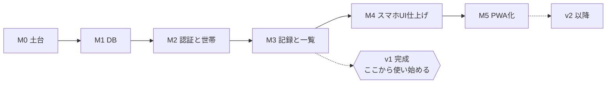

# 実装計画

最終更新: 2026-11-07

**目的: 開発順序を理解させる。** 上から順に進める。各マイルストーンは**それ単体で動作確認できる**単位に切っている。

進行状況は [タスクリスト](./task-list.md) で管理する。

---

## 全体像

**M3 が終われば「自分で使える」状態になる。** M4・M5 は体験の仕上げ。M3 の完了時点で一度使い始め、実際に困ったことを M4 以降の判断材料にする。

### 依存関係

| マイルストーン | 前提 | 理由 |
| --- | --- | --- |
| M0 | なし | |
| M1 | M0 | 環境変数の置き場所が必要 |
| M2 | M1 | テーブルと RPC が無いとログイン後に進めない |
| M3 | M2 | 世帯 ID が取れないと記録を作れない |
| M4 | M3 | 仕上げる対象が必要 |
| M5 | M4 + デプロイ先の決定 | PWA のインストールには HTTPS が必要 |

**順番を飛ばさない。** 特に M2 を飛ばして M3 を作ると、認証なしの前提でコードが書かれ、後から認証を差し込む作業が発生する。

---

## M0 — 土台の整備

スキャフォールドを Monely の形にする。アプリの機能はまだ作らない。

### やること

| # | 内容 | 対象ファイル |
| --- | --- | --- |
| 1 | スキャフォールドの残骸を削除（既定のトップページ、`public/*.svg`、README の書き換え） | `src/app/page.tsx`, `public/`, `README.md` |
| 2 | ルートレイアウトを整える（`lang="ja"`、メタデータ、日本語フォントの指定、`viewport`） | `src/app/layout.tsx` |
| 3 | デザイントークンを定義（ライト / ダークの色、`@theme` への登録） | `src/app/globals.css` |
| 4 | `.env.local.example` を作成。`.gitignore` に `!.env.local.example` を追加 | `.env.local.example`, `.gitignore` |
| 5 | Supabase の依存追加分をコミット | `package.json`, `pnpm-lock.yaml` |

### 完成の定義

- `pnpm dev` で日本語・ダークモード対応の空のアプリが表示される
- `pnpm lint` と `pnpm build` が通る
- `.env.local.example` が `git status` に出る（除外されていない）

### 参照

[UI/UX設計 §6.4 デザイントークン](../02-design/ui-ux-design.md#64-デザイントークン) / [コーディング規約 §9](../03-guidelines/coding-standards.md#9-css--tailwind)

---

## M1 — Supabase プロジェクトと DB スキーマ

### やること

| # | 内容 | 対象 |
| --- | --- | --- |
| 1 | Supabase に無料プロジェクトを作る（**手作業**） | Supabase ダッシュボード |
| 2 | Prisma を導入する（`prisma`, `@prisma/client`, `@prisma/adapter-pg`, `pg`, `dotenv`） | `package.json` |
| 3 | スキーマを書く（4 モデル + `Kind` enum） | `prisma/schema.prisma` |
| 4 | CLI の設定（`.env.local` を読む） | `prisma.config.ts` |
| 5 | 初期マイグレーションを生成し、CHECK 制約を手で追記する | `prisma/migrations/0001_init/migration.sql` |
| 6 | Prisma Client の生成口を作る | `src/lib/data/db.ts` |
| 7 | 接続文字列を設定（Session pooler, 5432）（**手作業**） | `.env.local` |
| 8 | 本番に適用する | `pnpm db:deploy` |
| 9 | Authentication → URL Configuration の Redirect URLs に `http://localhost:3000/auth/callback` を登録（**手作業**） | Supabase ダッシュボード |

### 完成の定義

- `pnpm db:status` がすべて適用済みと表示する
- Table Editor に 4 テーブルが見える
- CHECK 制約が 5 件入っている
- Redirect URLs が登録されている

### 注意

- **CHECK 制約は Prisma schema に書けない。** マイグレーションの SQL に手書きで追記する
- `prisma migrate dev` はシャドー DB を要求するため、初期マイグレーションは `migrate diff --from-empty` で生成した
- Supabase の「RLS が無効です」警告は**意図した状態**（[ADR-0005](../05-decisions/ADR-0005-authorization-in-app-layer.md)）
- **`DATABASE_URL` は DB の全権を持つ。** `NEXT_PUBLIC_` を付けない

### 参照

[DB設計](../02-design/database-design.md) / [テスト戦略 §4.3](../03-guidelines/testing-strategy.md#43-スキーマとマイグレーションの確認m1)

---

## M2 — 認証と世帯

ログインできて、世帯に所属できる状態にする。**RLS が効いていることをここで初めて実地確認する。**

### やること

| # | 内容 | 対象ファイル |
| --- | --- | --- |
| 1 | メール送信（Resend / 開発時はコンソール） | `src/lib/email.ts` |
| 2 | better-auth の設定（メール + パスワード、確認メール、マジックリンク） | `src/lib/auth/server.ts` |
| 3 | better-auth のエンドポイント | `src/app/api/auth/[...all]/route.ts` |
| 4 | 認証ヘルパー（`getMe` / `requireUser` / `requireMember`）。**初回ログイン時に `Profile` を作る** | `src/lib/auth.ts`, `src/lib/data/profile.ts` |
| 5 | 型定義（`Me`（`userId` と `profileId` を持つ）, `Member`, `ActionResult`） | `src/lib/types.ts` |
| 6 | 検証ヘルパーの土台 | `src/lib/validation.ts` |
| 7 | `/login`（メール + パスワード）、`/signup`（新規登録）、`/login/link`（パスワードを忘れたとき） | `src/app/login/`, `src/app/signup/`, `src/actions/auth.ts` |
| 8 | `/auth/callback`（`exchangeCodeForSession` → 振り分け） | `src/app/auth/callback/route.ts` |
| 9 | `/setup`（世帯を作る / 招待コードで参加する）。DAL に `createHouseholdForMe` / `joinHouseholdForMe`（`$transaction` + 初期カテゴリ 18 件 + 招待コード生成） | `src/app/setup/`, `src/actions/household.ts`, `src/lib/data/household.ts` |
| 10 | `(app)` レイアウトでの振り分け + `export const instant = false` | `src/app/(app)/layout.tsx` |
| 11 | ログアウト | `src/actions/auth.ts` |
| 12 | 仮のホーム画面（「ログインできました」程度） | `src/app/(app)/page.tsx` |

### 完成の定義

| # | 条件 | 受入条件 |
| --- | --- | --- |
| 1 | 新規登録 → 確認メール → パスワードでログインできる。閉じて開き直してもログインしたまま | AC-1 |
| 2 | `/setup` で世帯を作れて、初期カテゴリ 18 件が入る | AC-2 |
| 3 | 2 つ目のアカウントが招待コードで同じ世帯に参加できる | AC-3 |
| 4 | 世帯未所属で `/`、`/new`、`/settings` を開くと `/setup` に飛ぶ | AC-11 |
| 5 | **別世帯のアカウントから 1 件もデータが見えない** | **AC-9** |

### 注意

- `getUser()` を使う（`getSession()` を認可の判断に使わない）
- リンクからログインできなかった場合の表示を忘れない（先読み・別ブラウザ・期限切れ）
- ログイン失敗時にメールアドレスとパスワードのどちらが違うかを示さない
- `signInWithOtp` に `shouldCreateUser: false` を渡す（リンク経由の新規登録を禁じる）

### 参照

[API設計 §3〜4.2](../02-design/api-design.md#3-認証) / [セキュリティガイドライン](../03-guidelines/security-guidelines.md) / [アーキテクチャ §4.3, §7](../02-design/architecture.md#43-認証マジックリンク)

---

## M3 — 記録と一覧（v1 の本体）

**ここが終われば v1 完成。** 使い始める。

### やること

| # | 内容 | 対象ファイル |
| --- | --- | --- |
| 0 | **Vitest とローカル DB の用意**（[ADR-0005](../05-decisions/ADR-0005-authorization-in-app-layer.md) 約束 C） | `vitest.config.ts`, `scripts/test-db.sh`, `.env.test` |
| 1 | 金額のユーティリティ（整形・パース・集計） | `src/lib/money.ts` |
| 2 | 月のユーティリティ（範囲計算・前後移動・表示名・日付ラベル） | `src/lib/month.ts` |
| 3 | DAL（月次一覧、単体取得、カテゴリ、メンバー、世帯）**＋ 各関数の認可テスト** | `src/lib/data/*.ts`, `src/lib/data/*.test.ts` |
| 4 | ホーム画面（月切り替え、合計、日付グループ化、一覧、空表示） | `src/app/(app)/page.tsx` |
| 5 | 一覧の行コンポーネント | `src/components/transaction-row.tsx` など |
| 6 | 記録の登録アクション（検証・参照先の所属確認）＋ DAL の `createTransactionForMe` | `src/actions/transactions.ts`, `src/lib/data/transactions.ts` |
| 7 | `/new`（種別タブ、金額入力、カテゴリ選択、折りたたみ項目、保存） | `src/app/(app)/new/` |
| 8 | 金額入力・種別タブ・カテゴリ選択の Client Component | `src/components/` |
| 9 | 更新・削除アクション（DAL は `updateMany` / `deleteMany` で世帯条件を付ける） | `src/actions/transactions.ts` |
| 10 | `/transactions/[id]`（編集・削除・見つからない表示） | `src/app/(app)/transactions/[id]/` |
| 11 | エラー表示（入力エラー・保存失敗） | 各フォーム |

### 完成の定義

| # | 条件 | 受入条件 |
| --- | --- | --- |
| 1 | `/new` で登録 → `/` の当月一覧に出る。既定値が正しい | AC-4 |
| 2 | 不正な金額（空 / 0 / 負数 / 小数 / 全角）が弾かれ、入力が消えない | AC-5 |
| 3 | 編集・削除が反映される | AC-6 |
| 4 | 月を前後に移動でき、URL に残る。合計が手計算と一致する | AC-7 |
| 5 | 記録のない月で空表示が出る | AC-8 |
| 6 | 他世帯のデータが見えない（再確認） | **AC-9** |
| 7 | 起動から保存まで 10 秒以内、4 タップ | NFR-P3, NFR-U2 |
| 8 | **DAL の全関数に認可テストがあり `pnpm test` が通る** | ADR-0005 約束 C |

### 注意

- `householdId` / `createdById` をクライアントから受け取らない
- `categoryId` / `paidById` の所属を確認する（外部キーでは防げない）
- **`update({ where: { id } })` を使わない。** `updateMany({ where: { id, householdId } })` にして `count === 0` なら `NOT_FOUND`
- 月末・月初の記録が正しい月に入ることを必ず確認する
- **`occurredOn` の整形は UTC で行う**（`@db.Date` は UTC 0 時の `Date` で返る）
- **テストの無い DAL 関数を作らない**

### 参照

[API設計 §4.3, §5](../02-design/api-design.md#43-記録srcactionstransactionsts) / [UI/UX設計 §4.1〜4.3](../02-design/ui-ux-design.md#41--ホーム月次一覧-最も見る画面) / [機能要件 FR-T, FR-L](../01-requirements/functional-requirements.md#fr-t-記録)

---

## M4 — スマホ UI の仕上げ

### やること

| # | 内容 | 対象 |
| --- | --- | --- |
| 1 | 下部タブ（ホーム / 記録する / 設定）。セーフエリア対応 | `src/app/(app)/layout.tsx`, `src/components/bottom-tabs.tsx` |
| 2 | `/settings`（世帯名の変更、招待コード、メンバー一覧、表示名の変更、**パスワードの変更**、ログアウト） | `src/app/(app)/settings/` |
| 3 | カテゴリ管理（追加・改名・非表示） | `src/app/(app)/settings/`, `src/actions/categories.ts` |
| 4 | カテゴリの並びを直近 30 日の使用頻度順に | `src/lib/data/transactions.ts` |
| 5 | 日付の「今日 / 昨日」ショートカット | `src/app/(app)/new/` |
| 6 | タップ領域・コントラスト・フォーカス表示の調整 | 全体 |
| 7 | 保存中の状態表示 | 各フォーム |

### 完成の定義

| # | 条件 | 受入条件 |
| --- | --- | --- |
| 1 | カテゴリを非表示にできる。既存の記録の表示は壊れない | AC-10 |
| 2 | 幅 375px / 320px で崩れない。44px 以上のタップ領域。ダークモードが追従する | AC-12 |
| 3 | 実機（iPhone）で片手で 1 件記録できる | — |
| 4 | 他世帯のデータが見えない（再確認） | **AC-9** |

### 参照

[UI/UX設計 §6, §8](../02-design/ui-ux-design.md#6-表示のルール) / [非機能要件 §3](../01-requirements/non-functional-requirements.md#3-使い勝手nfr-u)

---

## M5 — PWA 化

**前提: デプロイ先の決定。** PWA のインストールには HTTPS が必要（`pnpm dev --experimental-https` でも検証は可能）。

### やること

| # | 内容 | 対象 |
| --- | --- | --- |
| 1 | デプロイ先を決める（未確定事項 #1） | — |
| 2 | `manifest.ts`（name, short_name, start_url, display: standalone, theme_color, icons） | `src/app/manifest.ts` |
| 3 | アイコン（192 / 512 / maskable、apple-touch-icon） | `public/` |
| 4 | `theme-color` と `viewport` の調整 | `src/app/layout.tsx` |
| 5 | デプロイして HTTPS で確認 | — |
| 6 | Supabase の Redirect URLs に本番の URL を追加 | Supabase ダッシュボード |

### 完成の定義

- スマホでホーム画面に追加でき、アドレスバーのない全画面で起動する
- アイコンが意図したものになっている
- 起動後にログイン状態が保持されている

### 参照

同梱ドキュメント `node_modules/next/dist/docs/01-app/02-guides/progressive-web-apps.md`

---

## v1 の完成とは

M3 が終わり、以下がすべて「はい」になった状態。

- [ ] 自分のスマホからログインできる
- [ ] 買い物の直後に 10 秒で 1 件記録できる
- [ ] 今月の支出合計が一目で分かる
- [ ] 家族が招待コードで参加し、記録でき、その記録が自分の一覧にも出る
- [ ] 別世帯のデータが見えないことを実際に試して確認した
- [ ] `pnpm lint` と `pnpm build` が通る

---

## 進め方のルール

1. **1 マイルストーンずつ。** M3 を飛ばして M5 をやらない。
2. マイルストーンの終わりに `pnpm lint` / `pnpm build` を通し、受入条件を手で確認してコミットする。
3. **M2 以降は毎回 AC-9（他世帯のデータが見えない）を実施する。** 認可がアプリ層にあるため、DAL に関数を足すたびに穴が開きうる。
3b. **DAL に関数を足したら、認可テストを同じコミットで足す**（[ADR-0005](../05-decisions/ADR-0005-authorization-in-app-layer.md) 約束 C）。
4. 仕様を変えたら、コードと同じコミットで `docs/` を直す（NFR-M4）。
5. 設計の判断を変えたら [ADR](../05-decisions/) を追加する。既存の ADR を書き換えず、新しい番号で「置き換える」形にする。
6. 詰まったら [v1 に入れないリスト](../00-overview/project-overview.md#52-v1-に入れない意図的に落とす)に逃がすことを検討する。
7. 進行状況を [タスクリスト](./task-list.md) に反映する。

---

## 作業時間の見立て

| マイルストーン | 見立て | 不確実性の要因 |
| --- | --- | --- |
| M0 | 1〜2 時間 | 小 |
| M1 | 2〜4 時間 | Prisma のセットアップと接続（Supabase のプーラー設定） |
| M2 | 4〜8 時間 | **大。** 認証基盤の選定と移行（Supabase Auth → better-auth）、メール送信の用意 |
| M3 | 12〜16 時間 | 中。画面と入力フォームの量 + **Vitest の環境構築と認可テスト** |
| M4 | 4〜8 時間 | 中。実機での調整 |
| M5 | 2〜4 時間 | アイコンの作成とデプロイ |

**M2 が最も詰まりやすい。** 認証とフレームワーク固有の制約が重なる。ここで時間を使うことを前提にしておく。
